# 1. Start here: the whole project in plain English

Five Nights at Gudo's is an offline Java desktop horror game. You are a night guard in a carinderia. Survive six real active minutes, shown as 12 AM to 6 AM, while managing power and defending against one enemy. Watch six cameras, lower the monitor when Gudo arrives, face his doorway, and hold the flashlight until he fades away. Five normal nights unlock progressively. A hidden side-view minigame adds a separate story interaction.

**A ready-to-say opening answer:** "Our project is an offline survival game built with Java Swing. We separate the screen from the game rules: GamePanel handles input and drawing, GameSession handles the night rules, and Application coordinates screens, audio and saving. SQLite stores local profiles, progress and attempts. Text files store preferences and readable shift reports. Our code includes a navigation facade, an audio facade, composable renderer decorators, and a builder for the hidden minigame level."

## The fifteen facts to learn first

1. Main starts the application. Application coordinates it. GameSession runs the normal-night rules. GamePanel displays and controls them.
2. New Game starts Night 1. It does not erase records or previously unlocked nights.
3. Continue starts a fresh attempt of the next unlocked night. It does not restore a mid-shift checkpoint.
4. Continue becomes enabled after any recorded attempt, including an abandoned or lost attempt.
5. The monitor and flashlight cannot be on together. The rule is enforced in GameSession, not only in button visibility.
6. Holding F is not enough: monitor down, correct view direction, enough sustained light.
7. Gudo cycles LEFT -> RIGHT -> FRONT after successful defenses. The route is deterministic.
8. Normal shift length is 360 active seconds. Pause freezes clock, drain, Gudo and CCTV sweep.
9. Only Outcome.COMPLETED unlocks the next normal night. A secret win has a different outcome.
10. One attempt gets one UUID and one final RunRecord. Retrying a save uses that same identity.
11. SQLite attempt insertion and unlock changes are transactional. The text-log append is a separate write.
12. Settings are preferences, progress is an unlock summary, and a run is one attempt. These are three different things.
13. Swing screen changes happen on EDT. Storage and audio have separate serial workers.
14. Facade simplifies access to a subsystem. Decorator adds behavior by wrapping the same interface. Builder constructs a complex object step by step.
15. The hidden game is available through CAM 04 on Nights 1-4. Both outcomes save an attempt and restart the same normal night.

## Vocabulary before reading the code

| Term | Meaning in this project | Simple example |
| --- | --- | --- |
| Class | A named type containing related data/behavior | GameSession groups one night's rules |
| Object | One created instance of a class | new GameSession(1) creates one attempt |
| Method | A callable operation | toggleMonitor() changes accepted monitor state |
| Constructor | Initialization that runs when an object is created | GamePanel receives the model and callbacks |
| Field | Data retained by an object | power keeps the current percentage |
| Interface | A contract for operations a client can request | Navigation tells a panel what it can ask for |
| Callback | Code handed to another object to run later | a button receives () -> navigation.startNight(1) |
| Lambda | Compact syntax for a callback/function | () -> means a function with no parameters |
| Enum | A fixed set of named values | Outcome.CAUGHT or Scene.CAM_04 |
| Record | Concise Java value carrier with generated accessors/equality | RunRecord holds the final attempt receipt |
| State | What is currently true about an object | monitor open, elapsed 51 seconds, Gudo at left door |
| EDT | Swing event dispatch thread | button callbacks and painting execute here |
| Executor | Worker queue for tasks | one storage worker runs JDBC/file operations in order |
| JDBC | Java's database access API | PreparedStatement sends bound values to SQLite |
| Transaction | Database operations that commit or roll back together | insert result and update unlocks |
| Idempotent retry | Repeating the same request has no additional intended effect | saving the same run UUID twice inserts once |

## How to build an answer without memorizing a paragraph

Use four steps: **what it does -> where it is -> how it works -> why that arrangement helps**. Example: "The flashlight defends the office. The rule is in GameSession.update and GudoEncounter.advance. Effective light requires the correct direction and accumulates exposure until the threshold. Keeping that rule outside the screen makes it testable and prevents invalid UI input from bypassing it."

If a follow-up asks for proof, open the method and point at its guard, state change and next call. Explain the visible code instead of inventing an original-author intention. The rationales in this reviewer are reasoned from the implementation; they are not interviews with the original author.

# 2. Run the game and navigate the code

## Windows: first launch and a repeatable defense setup

1. Download/clone the repository and open its root folder. The root contains pom.xml, run.cmd, mvnw.cmd and src.
2. Install a JDK 17 or newer. A JRE alone may run a built JAR, but the build needs compiler tooling. The launcher looks for both java and javac.
3. For an ordinary launch, double-click run.cmd. It selects a JDK, builds with tests skipped, then launches the shaded JAR.
4. For a defense, first run the full verification explicitly in PowerShell from the root:

```powershell
.\mvnw.cmd clean verify
```

5. The first build needs internet to download Maven/dependencies. The built game itself runs offline.
6. Launch with a separate demo save folder so the presentation has a controlled profile:

```powershell
java --enable-native-access=ALL-UNNAMED `
  "-Dgudo.dataDir=target/defense-demo-data" `
  -jar target/five-nights-at-gudos.jar
```

7. Keep that terminal available if you need a stack trace. Wait for the title screen before beginning the demo.
8. On macOS/Linux, the equivalent build is sh ./mvnw clean verify. run.command is also included for macOS. The distributable is target/five-nights-at-gudos.jar, not the smaller version-numbered intermediate JAR.

**Why the flag matters:** the project uses a native SQLite JDBC component. The launcher/build configuration supplies the native-access flag. If you change the command, preserve the project command rather than troubleshooting an avoidable warning during the presentation.

## Open a feature in any IDE, step by step

1. Open the repository root, not only a single .java file. Let the IDE recognize pom.xml as a Maven project.
2. Expand src -> main -> java -> com -> gudos. Main.java and Application.java are at this level.
3. Expand game for rules, ui for screens, persistence for storage, assets for loading/projection, or audio for playback.
4. Open the named file in the feature map in Chapter 4.
5. Use Find in File (usually Ctrl+F) for the exact method name. Match the declaration, not only a call site.
6. Read the DEFENSE overview, then the DEFENSE method comment, then the code below it.
7. To explain a button, start in its panel constructor and find the callback passed into GameButton. Follow that callback into Application or GameSession.
8. To explain the next operation, use the IDE's Go to Definition or open the target file and search the called method manually.
9. To explain a test, switch from src/main/java to src/test/java and open the matching ...Test.java file. A test method says what scenario it proves; it is not production behavior.
10. Use the line references in this reviewer for the annotated source commit. If a later edit shifts line numbers, the filename and exact method name remain the safest locator.

## Build configuration: explain pom.xml without guessing

The project targets Java 17 bytecode. sqlite-jdbc supplies embedded database access. slf4j-nop provides the selected logging backend behavior. JUnit Jupiter is test-only. The compiler plugin builds Java; Surefire runs the headless tests; Shade produces one distributable JAR containing dependencies/resources. The manifest names com.gudos.Main as entry point. Signature/module metadata exclusions and the services transformer support combining dependencies into the shaded artifact.

**What not to claim:** Swing is the UI toolkit and Java2D supplies drawing. This is not a browser game, not JavaFX, and not an external 3D game engine. There is no separate database server in the normal runtime.

# 3. Click-by-click demonstrations and speaking notes

The following images are real headless renders of the checked source with controlled demo data. They illustrate layouts and states; they are not a claim that native focus, fullscreen or speakers were tested in this environment.

## Demo A: start a new normal shift

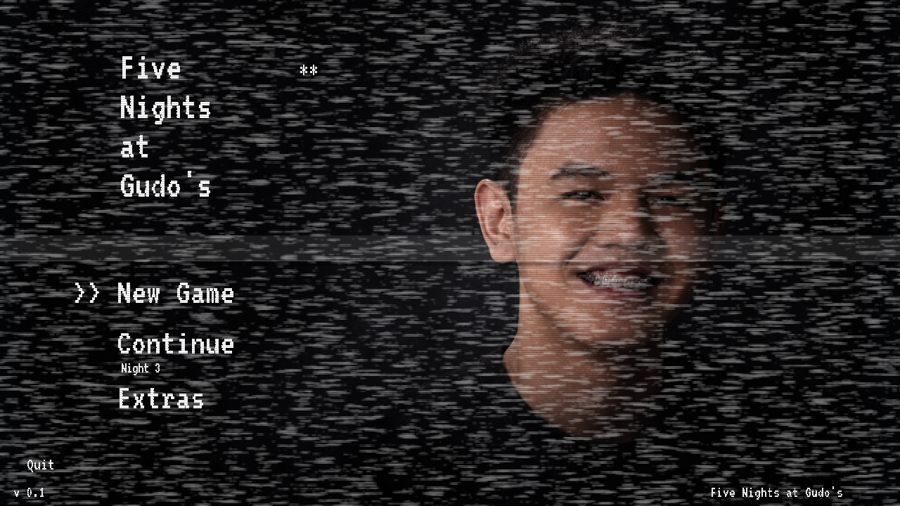

1. At the title, point at New Game. Say: "This starts Night 1, while keeping saved history."
2. Click New Game, or use Up/Down and Enter to select it.
3. The office opens with 12 AM and 100 percent power. A normal-effects intro covers the first two seconds.
4. Say: "The button delegates one start request to our navigation facade. Application coordinates validation, model construction, callbacks, screen replacement and audio."
5. Open MenuPanel's constructor and show navigation.startNight(1). Then open Navigation.startNight and Application.startNight.
6. Show new GameSession(night), new GamePanel(...), onSecret, show(gamePanel), and updateGameAudio in that method.

**Expected result:** a new session with its own UUID, not cleared database tables and not a restored checkpoint.

Source: [MenuPanel.MenuPanel (MenuPanel.java:92)](https://github.com/itsnold/FiveNightsAtGudos/blob/7e6f0112de35a3fb648e45b1c0f53e876f6e98e4/src/main/java/com/gudos/ui/MenuPanel.java#L92); [Navigation.startNight (Navigation.java:52)](https://github.com/itsnold/FiveNightsAtGudos/blob/7e6f0112de35a3fb648e45b1c0f53e876f6e98e4/src/main/java/com/gudos/ui/Navigation.java#L52); [Application.startNight (Application.java:328)](https://github.com/itsnold/FiveNightsAtGudos/blob/7e6f0112de35a3fb648e45b1c0f53e876f6e98e4/src/main/java/com/gudos/Application.java#L328).

## Demo B: office, monitor, cameras and flashlight

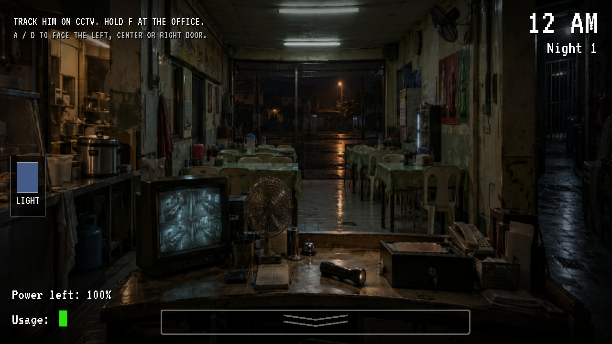

1. Move the mouse near either edge above the bottom control area, or hold A/D/arrow keys. The office pans smoothly.
2. Press Space or Tab, or click the bottom chevron monitor tab. The actual button text is OPEN MONITOR [SPACE], although its custom artwork is a chevron.
3. Point at the six CAM buttons on the map. Press 4 or click CAM 04, then switch to CAM 06 with 6.
4. Say: "CCTV sweeps automatically using the active shift clock. It does not follow the mouse."
5. Lower the monitor. Hold F, then release it. Point at usage changing and power draining.
6. Raise the monitor and attempt F. Say: "The model blocks flashlight use while CCTV is up."
7. In code show GamePanel's press/release bindings and toggleMonitor/selectCamera, then GameSession.toggleMonitor/setLight/selectCamera.

**Expected result:** one device active at a time; camera shortcuts work only while the monitor is open. Holding a monitor key does not repeatedly flip it because press flags debounce it.

Source: [GamePanel.GamePanel (GamePanel.java:100)](https://github.com/itsnold/FiveNightsAtGudos/blob/7e6f0112de35a3fb648e45b1c0f53e876f6e98e4/src/main/java/com/gudos/ui/GamePanel.java#L100); [GameSession.toggleMonitor (GameSession.java:170)](https://github.com/itsnold/FiveNightsAtGudos/blob/7e6f0112de35a3fb648e45b1c0f53e876f6e98e4/src/main/java/com/gudos/game/GameSession.java#L170); [GameSession.setLight (GameSession.java:182)](https://github.com/itsnold/FiveNightsAtGudos/blob/7e6f0112de35a3fb648e45b1c0f53e876f6e98e4/src/main/java/com/gudos/game/GameSession.java#L182); [CameraMotion.pan (CameraMotion.java:36)](https://github.com/itsnold/FiveNightsAtGudos/blob/7e6f0112de35a3fb648e45b1c0f53e876f6e98e4/src/main/java/com/gudos/game/CameraMotion.java#L36).

## Demo C: defend against Gudo with a reliable first-encounter plan

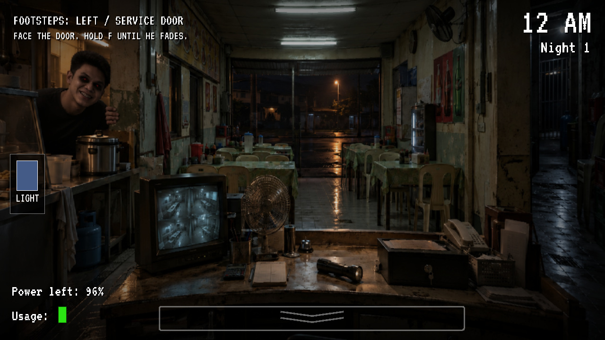

1. Start Night 1. Its first route is fixed: wait 18 seconds, CAM 04, then CAM 03, then CAM 02, then the left office doorway.
2. If untouched, the first left-office arrival is at 51 active seconds. Use CCTV briefly to show the route, then lower it before arrival.
3. On the FOOTSTEPS: LEFT / SERVICE DOOR warning, hold A until facing left. The LEFT direction is valid when model pan<=0.30; the target approach pan is 0.12.
4. Hold F for at least 1.6 seconds while facing that door. Do not look away during the exposure.
5. Point at gradual fading. When he disappears and the retreat notice appears, release F to conserve power.
6. Say: "Effective light accumulates exposure. Looking away or releasing lets him recover, so the defense must be completed within the attack window."
7. After success his next approach is right, then front. Do not promise that waiting in the left view defends every encounter.

**Expected result:** the office returns to its clean image, repelled increases, Gudo waits and begins the next route. A defense is not an instant victory for the entire night.

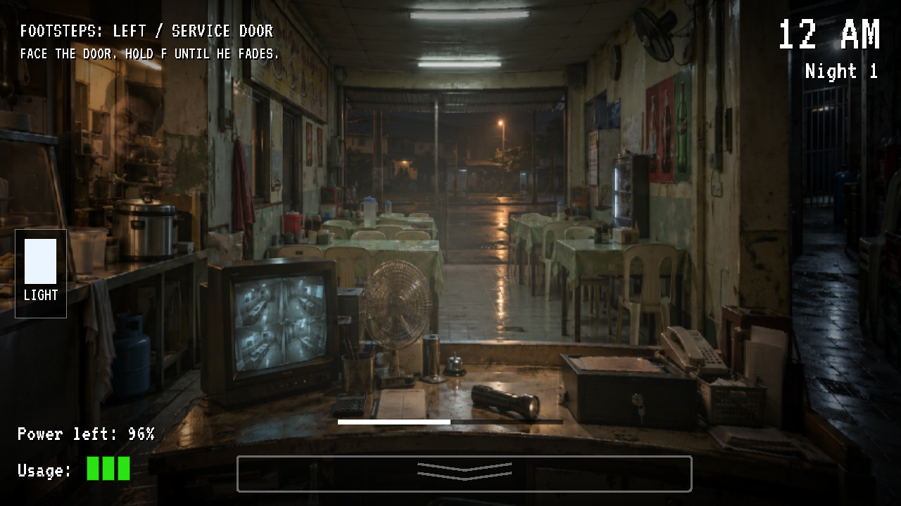

Source: [GudoEncounter.advance (GudoEncounter.java:130)](https://github.com/itsnold/FiveNightsAtGudos/blob/7e6f0112de35a3fb648e45b1c0f53e876f6e98e4/src/main/java/com/gudos/game/GudoEncounter.java#L130); [GudoEncounter.faces (GudoEncounter.java:82)](https://github.com/itsnold/FiveNightsAtGudos/blob/7e6f0112de35a3fb648e45b1c0f53e876f6e98e4/src/main/java/com/gudos/game/GudoEncounter.java#L82); [GamePanel.renderOffice (GamePanel.java:436)](https://github.com/itsnold/FiveNightsAtGudos/blob/7e6f0112de35a3fb648e45b1c0f53e876f6e98e4/src/main/java/com/gudos/ui/GamePanel.java#L436).

## Demo D: pause, resume and abandon safely

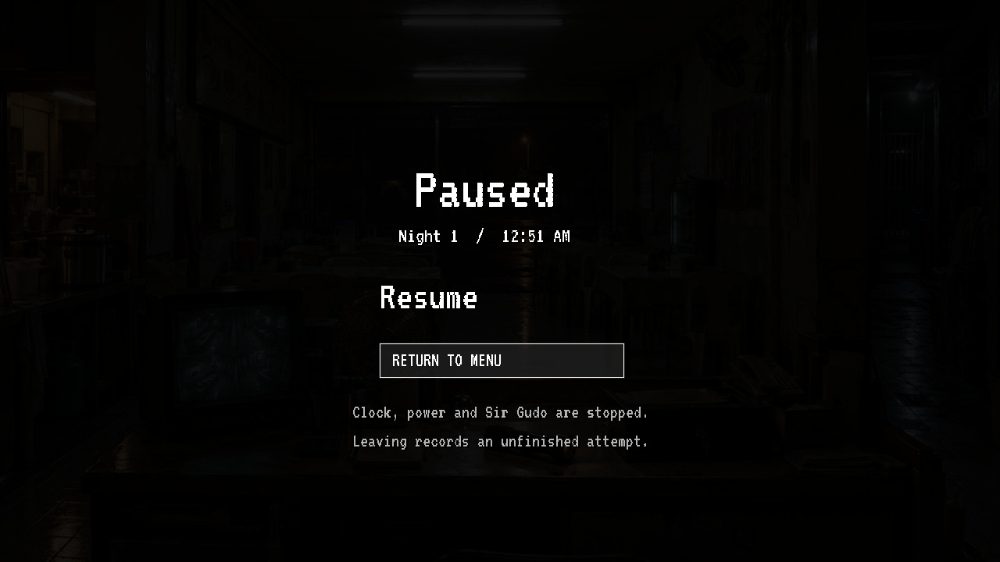

1. During an active shift, press Escape. The PausePanel opens.
2. Point at the paused time/power. Wait a few seconds, then Resume or press Escape.
3. Explain that the same GameSession resumes; no new UUID or database checkpoint is created.
4. Press Escape again and click RETURN TO MENU.
5. Read the confirmation and choose Yes if demonstrating abandonment.
6. Wait for the save before the title appears. The attempt is ABANDONED; it does not unlock the next night.
7. The title Continue is now enabled because there is one saved attempt. Clicking it starts a fresh Night 1 if no night has been completed.

**Expected result:** one abandoned result in SQLite and one matching readable report line. Switching window focus also pauses active gameplay; fullscreen rebuilding is specially suppressed from that temporary focus pause.

Source: [Application.pauseShift (Application.java:442)](https://github.com/itsnold/FiveNightsAtGudos/blob/7e6f0112de35a3fb648e45b1c0f53e876f6e98e4/src/main/java/com/gudos/Application.java#L442); [Application.resumeShift (Application.java:458)](https://github.com/itsnold/FiveNightsAtGudos/blob/7e6f0112de35a3fb648e45b1c0f53e876f6e98e4/src/main/java/com/gudos/Application.java#L458); [Application.leaveShift (Application.java:472)](https://github.com/itsnold/FiveNightsAtGudos/blob/7e6f0112de35a3fb648e45b1c0f53e876f6e98e4/src/main/java/com/gudos/Application.java#L472); [Application.savePendingRun (Application.java:526)](https://github.com/itsnold/FiveNightsAtGudos/blob/7e6f0112de35a3fb648e45b1c0f53e876f6e98e4/src/main/java/com/gudos/Application.java#L526).

## Demo E: inspect saved records and show the real data folder

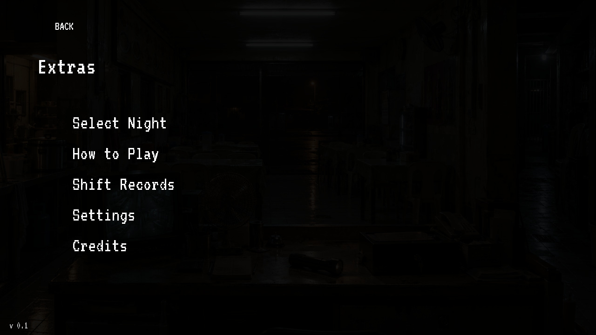

1. From the title click Extras -> Shift Records. Wait for the loading page if shown.
2. Point at the current player, attempted/completed counts, nights cleared, and table columns.
3. Explain: "The latest 200 rows are loaded; older rows remain in SQLite and still contribute to totals."
4. Back/Escape returns to the title. Go Extras -> Settings -> COPY DATA FOLDER.
5. In Windows File Explorer, paste the copied folder into the address bar. The explicit demo override determines the actual location.
6. Open settings.txt to show preferences and shift-log.txt to show readable reports. Use a copy of gudo.db in a SQLite viewer if you need to inspect tables; do not modify the running demo database.
7. Trace RecordsPanel <- Application.page(RECORDS) <- Database.loadProgress/loadRuns. The table renderer does not run SQL.

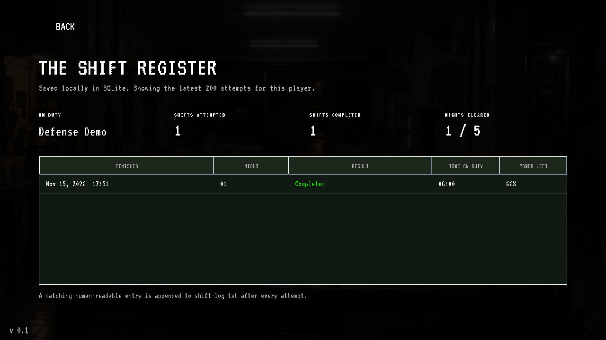

Source: [Application.page (Application.java:294)](https://github.com/itsnold/FiveNightsAtGudos/blob/7e6f0112de35a3fb648e45b1c0f53e876f6e98e4/src/main/java/com/gudos/Application.java#L294); [RecordsPanel.RecordsPanel (RecordsPanel.java:47)](https://github.com/itsnold/FiveNightsAtGudos/blob/7e6f0112de35a3fb648e45b1c0f53e876f6e98e4/src/main/java/com/gudos/ui/RecordsPanel.java#L47); [Database.loadRuns (Database.java:297)](https://github.com/itsnold/FiveNightsAtGudos/blob/7e6f0112de35a3fb648e45b1c0f53e876f6e98e4/src/main/java/com/gudos/persistence/Database.java#L297); [AppPaths.resolve (AppPaths.java:44)](https://github.com/itsnold/FiveNightsAtGudos/blob/7e6f0112de35a3fb648e45b1c0f53e876f6e98e4/src/main/java/com/gudos/persistence/AppPaths.java#L44).

## Demo F: preferences and separate local profiles

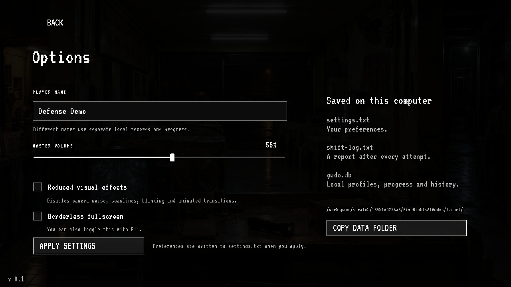

1. Title -> Extras -> Settings.
2. Enter a demo name, change volume, optionally enable reduced visual effects or fullscreen.
3. Click APPLY SETTINGS. Wait for the title. Apply persists settings and selects/loads that name's local profile.
4. Reopen Settings to show the persisted values. Restarting the application loads them from settings.txt as well.
5. Change to another name and Apply to show a separate profile summary. Names are local labels, not passwords/accounts.
6. Explain that Back without Apply discards the form edits. F11 separately persists/toggles fullscreen through Application.

**Expected result:** settings.txt contains playerName, volume, reducedEffects and fullscreen. Names are sanitized/capped, volume is clamped. An IO failure is reported instead of silently pretending Apply worked.

Source: [SettingsPanel.values (SettingsPanel.java:214)](https://github.com/itsnold/FiveNightsAtGudos/blob/7e6f0112de35a3fb648e45b1c0f53e876f6e98e4/src/main/java/com/gudos/ui/SettingsPanel.java#L214); [Application.saveSettings (Application.java:571)](https://github.com/itsnold/FiveNightsAtGudos/blob/7e6f0112de35a3fb648e45b1c0f53e876f6e98e4/src/main/java/com/gudos/Application.java#L571); [SettingsStore.save (SettingsStore.java:91)](https://github.com/itsnold/FiveNightsAtGudos/blob/7e6f0112de35a3fb648e45b1c0f53e876f6e98e4/src/main/java/com/gudos/persistence/SettingsStore.java#L91); [Settings.Settings (Settings.java:31)](https://github.com/itsnold/FiveNightsAtGudos/blob/7e6f0112de35a3fb648e45b1c0f53e876f6e98e4/src/main/java/com/gudos/persistence/Settings.java#L31).

## Demo G: replay an unlocked night

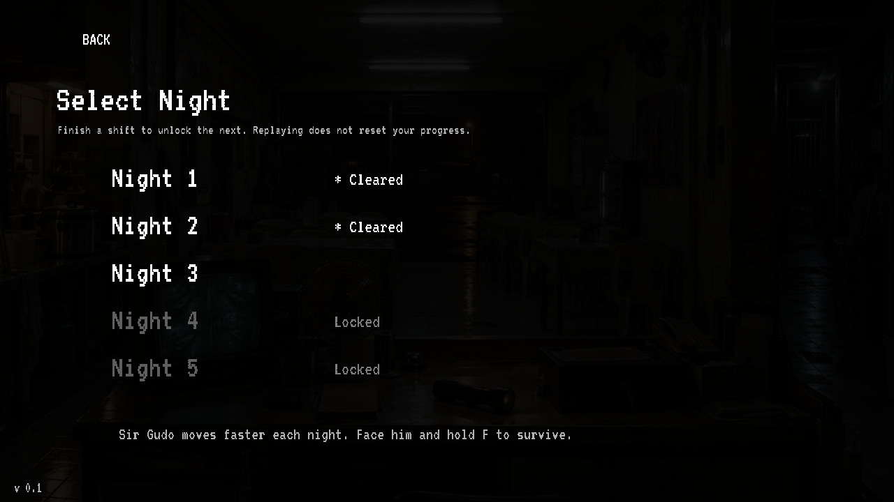

1. Title -> Extras -> Select Night.
2. Explain the current profile's Cleared and Locked labels. A new profile can choose only Night 1.
3. Select an enabled Night N. It calls the same Navigation.startNight operation used by New Game.
4. Show the button enabled check in NightSelectPanel and the repeated progress.unlocked guard in Application.startNight.
5. Explain that replaying an earlier night cannot reduce progress because Database.saveRun uses MAX for unlock fields.

**Expected result:** a fresh selected-night attempt. The screenshot uses demo progress with Nights 1-3 unlocked; an actual fresh profile will not have those buttons enabled.

## Demo H: show the hidden minigame

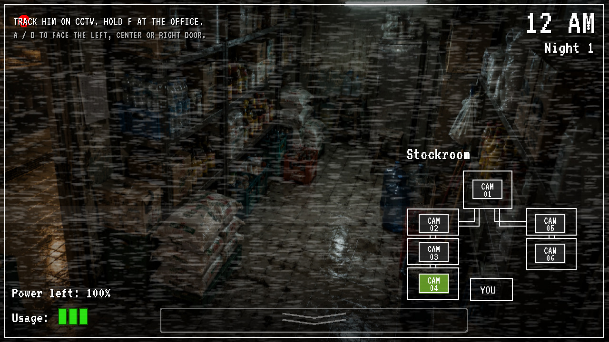

1. Start an available Night 1-4. Night 1 is easiest for a prepared demonstration.
2. Raise the monitor and choose CAM 04 (Stockroom).
3. Find the small paper on the stockroom image. Click the paper five times with the left mouse button. Follow its position as the camera sweeps; clicking the map/button area is not the target.
4. Only valid clicks inside the paper count. Invalid clicks do not reset the accumulated valid count. The fifth valid click invokes the hidden callback; Night 5 is rejected by Application.
5. The normal shift pauses while the side-view game opens. A/D or arrows move; Space jumps; E picks up/drops/delivers; Escape pauses this minigame.
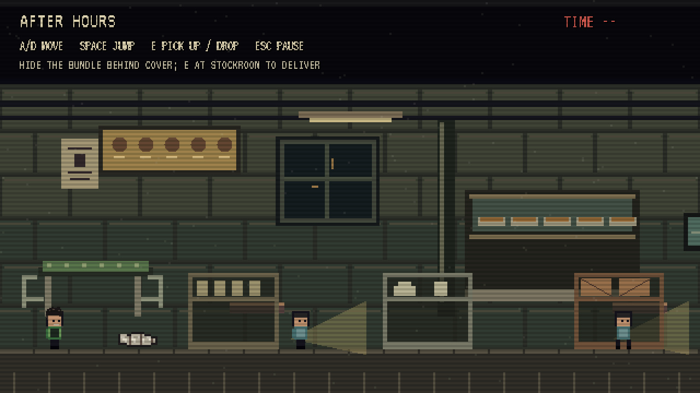

6. Before pickup, inspect the route freely. The sixty-second countdown starts on the first successful E pickup near the bundle.
7. Carry the bundle toward the stockroom at the far right. Use the six foreground cover areas; wait behind cover for an opening in the three patrol beams. The timer still runs while hidden or after dropping.
8. A witness detects the bundle center when exposed in its triangular beam. The player's unladen body alone does not cause detection.
9. While carrying and inside the destination, press E to deliver. If caught or time expires, the minigame loses.
10. Both endings silence audio and freeze the scene with fixed white bands for three unpaused seconds. Application saves MINIGAME_COMPLETED or MINIGAME_FAILED, waits for both stores, then starts the same normal night again.
11. A secret win does not unlock the next night and does not permanently lock the minigame. Do not describe the automatic same-night restart as a normal shift win.

**Code route to show:** GamePanel.mouseClicked -> secret.run -> Application.openSecret -> createSecretLevel -> SecretGame/SecretPanel -> finishSecret -> finishShift -> savePendingRun -> startNight(sameNight).

Source: [GamePanel.mouseClicked (GamePanel.java:199)](https://github.com/itsnold/FiveNightsAtGudos/blob/7e6f0112de35a3fb648e45b1c0f53e876f6e98e4/src/main/java/com/gudos/ui/GamePanel.java#L199); [Application.openSecret (Application.java:374)](https://github.com/itsnold/FiveNightsAtGudos/blob/7e6f0112de35a3fb648e45b1c0f53e876f6e98e4/src/main/java/com/gudos/Application.java#L374); [Application.createSecretLevel (Application.java:402)](https://github.com/itsnold/FiveNightsAtGudos/blob/7e6f0112de35a3fb648e45b1c0f53e876f6e98e4/src/main/java/com/gudos/Application.java#L402); [SecretGame.action (SecretGame.java:100)](https://github.com/itsnold/FiveNightsAtGudos/blob/7e6f0112de35a3fb648e45b1c0f53e876f6e98e4/src/main/java/com/gudos/game/minigame/SecretGame.java#L100); [SecretGame.update (SecretGame.java:121)](https://github.com/itsnold/FiveNightsAtGudos/blob/7e6f0112de35a3fb648e45b1c0f53e876f6e98e4/src/main/java/com/gudos/game/minigame/SecretGame.java#L121); [Application.finishSecret (Application.java:426)](https://github.com/itsnold/FiveNightsAtGudos/blob/7e6f0112de35a3fb648e45b1c0f53e876f6e98e4/src/main/java/com/gudos/Application.java#L426).

## Demo I: demonstrate an ending without inventing a shortcut

A normal victory requires surviving the full six active minutes. A quick natural loss is easier: ignore the first Night 1 threat; it catches at 60 active seconds. CAUGHT shows a 2.1-second jumpscare while saving starts, then the result screen. Power failure is separate and harder to demonstrate quickly without also defending Gudo; use the existing model test to explain it instead of claiming the game has a debug power-failure button.

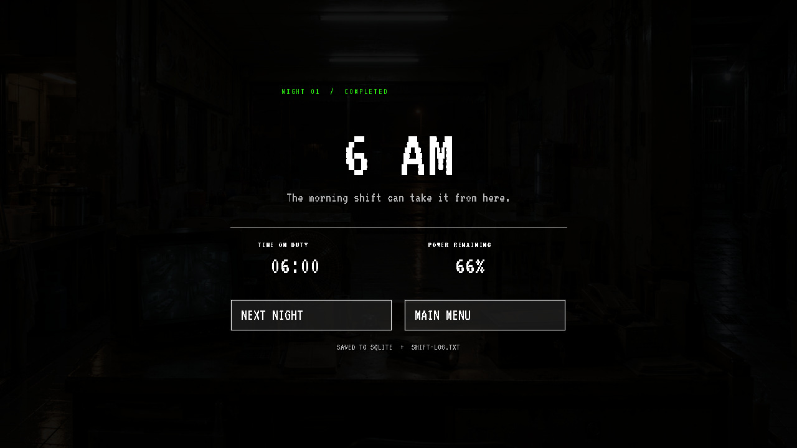

The illustrated completion was produced by advancing the real model with a controlled successful-defense sequence, then rendering its actual six-minute result. It is documentation/demo data, not evidence of a real-time manual playthrough in this session.

# 4. Where to find every important feature

| Requested feature | First file to open | Follow next |
| --- | --- | --- |
| Entry point/window boot | Main.java: main/launch | SwingWorker doInBackground/done -> Application constructor |
| New Game facade | MenuPanel constructor | Navigation.startNight -> Application.startNight |
| Continue | MenuPanel constructor | Progress.nextNight -> Application.startNight |
| Extras/page navigation | ExtrasPanel constructor | Application.page |
| Night locking | NightSelectPanel constructor | Progress.unlocked and Application.startNight |
| Monitor toggle | GamePanel.toggleMonitor | GameSession.toggleMonitor |
| Flashlight | GamePanel.updateLight | GameSession.setLight/update -> GudoEncounter.advance |
| Office panning | GamePanel.tick | GameSession.setOfficePan -> GudoEncounter.Approach.faces |
| CCTV sweep | CameraSceneRenderer.render | CameraMotion.pan -> PanoramaRenderer.render |
| Camera effects/Decorator | GamePanel constructor/renderCamera | ui/rendering classes -> VhsOverlay.paint |
| Gudo movement/defense | GudoEncounter.advance | GameSession.update/sceneState |
| Power and win/loss | GameSession.update | drainPerSecond -> finish -> RunRecord |
| Pause/auto-pause | Application.pauseShift/windowLostFocus | GameSession.pause/resume -> PausePanel |
| Abandon/normal exit | Application.leaveShift/quit | finishShift -> savePendingRun -> close |
| Jumpscare | Application.finishShift | JumpscarePanel.tick/render |
| Save/retry | Application.savePendingRun | Database.saveRun -> ShiftLogStore.append |
| SQLite schema/migrations | Database constructor/runsTable | connect/profile/loadProgress/loadRuns |
| Settings/profile change | SettingsPanel.values | Application.saveSettings -> SettingsStore/Database |
| Files/folder paths | AppPaths.resolve | database/settings/shiftLog accessors |
| Hidden paper trigger | GamePanel constructor mouseClicked | PanoramaRenderer.sourcePoint -> Application.openSecret |
| Level Builder | Application.createSecretLevel | SecretLevelBuilder.build -> SecretLevel |
| Minigame rules | SecretGame.action/update | bundleHidden/witnessBeam |
| Minigame transition/restart | SecretPanel.tick | Application.finishSecret/savePendingRun |
| Audio facade | AudioService.play/ambience/gameplay | clip/applyGain/applyPan/executor |
| Active audio files | Sound enum | src/main/resources/audio; source archive is separate |
| Asset selection/fallback | AssetManager.scene | config/scenes.properties and GameSession.sceneState |
| UI scaling/input mapping | ScenePanel.doLayout/scenePoint | GamePanel pointer/paper callbacks |
| Shared painting template | ScenePanel.paintComponent/paintChildren | subclass render/renderOverlay |
| Proof/automated tests | Matching src/test/java file | inspect assertions; run Maven verify |

# 5. Architecture, ownership and threads

## Who owns which responsibility?

Main assembles the startup dependencies. Application is the coordinator and concrete Navigation facade. Panels request intent and display values. GameSession/GudoEncounter/SecretGame enforce rules without Swing components or audio services. Persistence classes read/write actual files. AssetManager serves decoded images. AudioService queues Java Sound operations. Renderer objects compose the CCTV drawing layers.

The model uses some java.awt geometry for the minigame, so "UI-independent" means no Swing window/widgets/audio ownership, not absolutely zero classes from the Java desktop module. The architecture resembles separation of model, view and coordination; it is not a textbook strict MVC implementation because panels also translate input and Application handles several controller responsibilities.

## Three important execution contexts

| Context | Owns | Why |
| --- | --- | --- |
| Swing EDT | Screen creation/changes, key/button callbacks, timer ticks, painting | Swing components are accessed consistently; callbacks return here after IO |
| gudo-storage | JDBC, settings load/save, report append | Prevent disk/database waits from freezing UI; preserve task order |
| gudo-audio | Clip decoding, mixer controls, start/stop/loop/close | Audio hardware and decoding do not block painting/input |

Main uses a SwingWorker during boot. Its doInBackground is off EDT and its done is on EDT. Application.submit uses Callable<T> for background work and Consumer callbacks posted with SwingUtilities.invokeLater. The generic T allows the same helper to return Settings, Progress or a Register bundle.

The audio worker is daemon; it alone does not keep the JVM alive. The storage worker is an ordinary worker and is shut down on orderly close. AudioService.close queues clip cleanup before shutdown. Application.close stops the UI timer and removes the global key dispatcher as well as disposing the frame.

## The frame loop, in the actual order

1. A coalesced Swing Timer requests a tick approximately every 33 milliseconds. This is a target, not a guaranteed frame rate.
2. tick measures elapsed nanoTime since the last tick and clamps the supplied delta to 0..0.25 seconds.
3. If the current panel is the normal GamePanel and its session is unfinished, update the simulation.
4. If that ends the session, finishShift may replace the screen immediately.
5. Update the currently visible panel's visual/input state, then request repaint.
6. If still on active normal gameplay, refresh the desired audio layers.

**Subtle follow-up:** the panel sends its smoothed office pan back to the model after that frame's model update. This introduces a small update-step delay in model direction. It is a current implementation detail, not a separate rendering thread.

**Tradeoff of the 0.25 cap:** a very long UI stall will not advance all real wall time. It avoids a huge jump after the stall, but means active simulation may run slower than elapsed wall time during severe stalls. Inside each supplied delta the model still splits exact event boundaries.

Source: [Application.tick (Application.java:198)](https://github.com/itsnold/FiveNightsAtGudos/blob/7e6f0112de35a3fb648e45b1c0f53e876f6e98e4/src/main/java/com/gudos/Application.java#L198); [Application.submit (Application.java:697)](https://github.com/itsnold/FiveNightsAtGudos/blob/7e6f0112de35a3fb648e45b1c0f53e876f6e98e4/src/main/java/com/gudos/Application.java#L697); [Main.doInBackground (Main.java:93)](https://github.com/itsnold/FiveNightsAtGudos/blob/7e6f0112de35a3fb648e45b1c0f53e876f6e98e4/src/main/java/com/gudos/Main.java#L93); [Main.done (Main.java:112)](https://github.com/itsnold/FiveNightsAtGudos/blob/7e6f0112de35a3fb648e45b1c0f53e876f6e98e4/src/main/java/com/gudos/Main.java#L112).

# 6. Normal-night rules with worked numbers

## Time, drain and equipment

| State | Drain calculation | Percent points per active second | Example |
| --- | --- | --- | --- |
| No extra device | 0.085 | 0.085 | 10 seconds costs 0.85 |
| Monitor open | 0.085 + 0.22 | 0.305 | 10 seconds costs 3.05 |
| Light on | 0.085 + 0.20 | 0.285 | 10 seconds costs 2.85 |

For example, ten idle seconds followed by ten monitor seconds leaves 100 - 0.85 - 3.05 = 96.10 percent, assuming no other ending. Base drain for the entire six-minute night is 0.085*360 = 30.6, so an otherwise idle shift would have 69.4 percent left. Actually surviving also uses light, so a realistic successful run ends below that value.

An always-open monitor would mathematically deplete 100/0.305 = about 327.87 active seconds. However, ignoring Gudo normally causes an earlier caught result; do not claim every unattended monitor run necessarily ends in power failure. An always-held light alone also cannot defend incorrect directions.

Usage is a display indicator: 1 base bar and +2 for a device. Because monitor and light are exclusive, ordinary play shows 1 or 3 bars. Those bars are not subtracted as a percentage every frame. The HUD ceil display may show 100 percent even when the underlying double is already slightly below 100.

## Why GameSession.update uses a loop instead of one subtraction

Suppose a supplied frame is long enough to include a camera arrival and its next deadline. A single subtraction could skip an important state. The model instead takes the smallest of remaining frame time, time to morning, time to power failure and time to the next enemy event. It processes that boundary, then repeats for the rest of the delta.

Pseudocode matching the implementation:

```text
while frame time remains and there is no final result:
    check whether light is effective in the current direction
    step = minimum(frame, morning, power deadline, enemy deadline)
    advance elapsed and subtract drain for step
    if morning reached: finish COMPLETED
    else if power deadline reached: finish POWER_OUT
    else advance enemy; if caught: finish CAUGHT
```

At simultaneous deadlines morning wins first, then power failure, then attack. Inside the encounter, enough exposure is checked before the caught deadline. This is a chosen rule for deterministic boundary behavior, not random event order. The tests include a sixty-second short shift whose morning ties the first Night 1 attack.

## Ending an attempt

finish checks whether a result already exists. If not, it creates the RunRecord once and switches monitor/light off. Later updates or abandonment requests do not replace that record. id was created when the session was created; startedAt/endedAt are wall-clock Instants, while elapsedSeconds counts active simulation only.

That distinction explains why a long pause increases the real gap between timestamps without increasing time-on-duty. It also explains why Continue cannot reconstruct an active game: the saved RunRecord is a final receipt, with no current enemy route/input/live state to restore.

Source: [GameSession.update (GameSession.java:86)](https://github.com/itsnold/FiveNightsAtGudos/blob/7e6f0112de35a3fb648e45b1c0f53e876f6e98e4/src/main/java/com/gudos/game/GameSession.java#L86); [GameSession.finish (GameSession.java:119)](https://github.com/itsnold/FiveNightsAtGudos/blob/7e6f0112de35a3fb648e45b1c0f53e876f6e98e4/src/main/java/com/gudos/game/GameSession.java#L119); [GameSession.drainPerSecond (GameSession.java:249)](https://github.com/itsnold/FiveNightsAtGudos/blob/7e6f0112de35a3fb648e45b1c0f53e876f6e98e4/src/main/java/com/gudos/game/GameSession.java#L249); [RunRecord.durationLabel (RunRecord.java:31)](https://github.com/itsnold/FiveNightsAtGudos/blob/7e6f0112de35a3fb648e45b1c0f53e876f6e98e4/src/main/java/com/gudos/game/RunRecord.java#L31).

# 7. Gudo's routes and flashlight algorithm

## The three routes

| Approach | Camera order | Office state key | Correct view range | Target pan |
| --- | --- | --- | --- | --- |
| LEFT | 04 Stockroom -> 03 Kitchen -> 02 Serving counter | left-occupied | pan<=0.30 | 0.12 |
| RIGHT | 06 Back alley -> 05 Side corridor | right-occupied | pan>=0.70 | 0.88 |
| FRONT | 01 Front entrance | front-occupied | abs(pan-0.50)<=0.22 | 0.50 |

CAM 01 currently points to the outside front entrance. Some retained filenames or historical README paragraphs still use dining terminology. Use the current Scene enum and scenes.properties mapping when identifying the active room.

The normalized pan is 0 at far left, 0.5 centered and 1 at far right. There is a small overlap at the view-range edges (front overlaps part of left/right thresholds); only the currently active approach is checked, so there is no simultaneous three-enemy defense.

## State sequence, step by step

1. approach starts LEFT; routeIndex=-1 means waiting with location=null.
2. The first wait is 18-(night-1)*2 seconds.
3. When timer reaches zero, increment routeIndex and enter the first camera. Each camera remains occupied for the route-step interval.
4. After the last route camera, atOffice=true, exposure=0 and timer=attackSeconds.
5. Correct effective light adds exposure. Ineffective/no light subtracts exposure at 0.65 per second, floored at zero.
6. If exposure reaches flashSeconds, clear office occupancy, reset routeIndex/exposure, increment repelled and choose Approach.values()[repelled % 3].
7. Wait again, then travel the new route. If office attack time expires before sufficient exposure, caught=true.

Only one location is returned. GameSession.sceneState checks that location, so the room Gudo just left automatically returns to its default/custom state. The renderer does not analyze images to decide where he is.

## Difficulty table

| Night | First wait | Route step before any repels | Office attack window | Effective light required |
| --- | --- | --- | --- | --- |
| 1 | 18.0 s | 11.0 s | 9.0 s | 1.6 s |
| 2 | 16.0 s | 9.7 s | 8.2 s | 1.8 s |
| 3 | 14.0 s | 8.4 s | 7.4 s | 2.0 s |
| 4 | 12.0 s | 7.1 s | 6.6 s | 2.2 s |
| 5 | 10.0 s | 5.8 s | 5.8 s | 2.4 s |

After repels, route step = max(4, 11-(night-1)*1.3-min(3,repelled*0.3)). Between encounters, wait = max(5, 13-(night-1)-min(4,repelled)). Later successful defenses therefore also shorten travel/wait within a night, subject to floors.

## First Night 1 encounter: an exact timeline

| Active time | State |
| --- | --- |
| 0-18 s | Waiting; no room occupied |
| 18 s | Enter CAM 04 |
| 29 s | Enter CAM 03 |
| 40 s | Enter CAM 02 |
| 51 s | Arrive left office; nine-second defense deadline starts |
| 52.6 s | Earliest repel if correct light was effective immediately at 51 |
| 60 s | Caught if there was no successful defense |

If the player gains 0.8 seconds of Night 1 effective exposure, fade is 0.8/1.6=50 percent. Releasing for 0.4 seconds loses 0.4*0.65=0.26 exposure, leaving 0.54 seconds. The player then needs 1.06 more effective seconds, still within the continuing attack timer. Looking away does not pause the attack deadline.

Source: [GudoEncounter.untilEvent (GudoEncounter.java:117)](https://github.com/itsnold/FiveNightsAtGudos/blob/7e6f0112de35a3fb648e45b1c0f53e876f6e98e4/src/main/java/com/gudos/game/GudoEncounter.java#L117); [GudoEncounter.advance (GudoEncounter.java:130)](https://github.com/itsnold/FiveNightsAtGudos/blob/7e6f0112de35a3fb648e45b1c0f53e876f6e98e4/src/main/java/com/gudos/game/GudoEncounter.java#L130); [GudoEncounter.flashSeconds (GudoEncounter.java:199)](https://github.com/itsnold/FiveNightsAtGudos/blob/7e6f0112de35a3fb648e45b1c0f53e876f6e98e4/src/main/java/com/gudos/game/GudoEncounter.java#L199); [GudoEncounter.attackSeconds (GudoEncounter.java:206)](https://github.com/itsnold/FiveNightsAtGudos/blob/7e6f0112de35a3fb648e45b1c0f53e876f6e98e4/src/main/java/com/gudos/game/GudoEncounter.java#L206).

# 8. Drawing, resizing, input and the hidden hitbox

## Two different image operations

Theme.cover scales an image to fill a rectangle and crops overflow. PanoramaRenderer performs a different operation: it samples a curved panoramic view using angle-based math. It is still a 2D image transformation, not a 3D room mesh, depth buffer or free-moving camera.

PanoramaRenderer outputs 854x480 to reduce per-frame pixel work, then the UI draws that result at logical 1280x720. The horizontal field is 80 degrees. atan maps horizontal output rays; cos changes vertical sampling toward edges. Source pixels and row lookups are reused until the image changes; pan is quantized to 2049 positions and an unchanged source/yaw pair reuses the last result.

**Important ownership detail:** render returns its reused output image. If two simultaneous results are needed, do not keep two references from the same renderer and assume they are independent snapshots. GamePanel has separate clean/occupied projection instances for the flashlight blend.

## Screen coordinates and source-image coordinates

ScenePanel uses logical 1280x720 coordinates. sceneScale=min(actualWidth/1280,actualHeight/720). offsetX/offsetY center the scaled scene. Actual Swing controls use that same scale and offsets in doLayout. scenePoint subtracts offsets and divides by scale, so mouse input still aligns after resizing.

The secret paper needs a second reverse mapping because the camera image itself is being projected. The click path is:

1. Window-local event point -> logical scenePoint.
2. Logical coordinate -> 854x480 projection coordinate.
3. Re-render the current CAM 04 image at CameraMotion.pan(CAM_04,session.elapsed).
4. sourcePoint returns the original image pixel sampled for that projected position.
5. Accept only source x fractions 0.285..0.325 and y fractions 0.24..0.40.
6. Increment paperClicks; the fifth valid click invokes secret.run and resets the counter.

A fixed window-pixel rectangle would drift away from the paper when the camera swept or the window changed. Source coordinates keep the click bound attached to the artwork. Application.openSecret independently enforces Night<5 and the active normal-game screen.

## What reduced visual effects actually changes

It disables menu flicker, optional VHS/scanlines, blinking record-dot behavior, the animated normal-night intro, and scare motion/blur. GamePanel bypasses the switching decorator chain. It does not change Gudo timing, power rules or camera room selection.

A garbled watched feed is still unavailable in reduced mode; the view draws a still dark SIGNAL LOST screen instead of animated noise. This preserves the information-hiding rule while reducing motion. The minigame ending still has fixed signal lines with lower opacity and a frozen transition.

Source: [ScenePanel.scenePoint (ScenePanel.java:101)](https://github.com/itsnold/FiveNightsAtGudos/blob/7e6f0112de35a3fb648e45b1c0f53e876f6e98e4/src/main/java/com/gudos/ui/ScenePanel.java#L101); [ScenePanel.doLayout (ScenePanel.java:113)](https://github.com/itsnold/FiveNightsAtGudos/blob/7e6f0112de35a3fb648e45b1c0f53e876f6e98e4/src/main/java/com/gudos/ui/ScenePanel.java#L113); [PanoramaRenderer.render (PanoramaRenderer.java:72)](https://github.com/itsnold/FiveNightsAtGudos/blob/7e6f0112de35a3fb648e45b1c0f53e876f6e98e4/src/main/java/com/gudos/assets/PanoramaRenderer.java#L72); [PanoramaRenderer.sourcePoint (PanoramaRenderer.java:59)](https://github.com/itsnold/FiveNightsAtGudos/blob/7e6f0112de35a3fb648e45b1c0f53e876f6e98e4/src/main/java/com/gudos/assets/PanoramaRenderer.java#L59); [GamePanel.mouseClicked (GamePanel.java:199)](https://github.com/itsnold/FiveNightsAtGudos/blob/7e6f0112de35a3fb648e45b1c0f53e876f6e98e4/src/main/java/com/gudos/ui/GamePanel.java#L199); [GamePanel.renderCamera (GamePanel.java:465)](https://github.com/itsnold/FiveNightsAtGudos/blob/7e6f0112de35a3fb648e45b1c0f53e876f6e98e4/src/main/java/com/gudos/ui/GamePanel.java#L465).

# 9. Audio: why a cue happens and what the facade hides

GamePanel compares the new encounter location with lastGudoLocation. A nonnull new location plays deep steps once. Office arrival chooses a left knock, right pound or front whisper. With <=3 seconds left, rushPlayed ensures one urgency cue. A change in repelled gives one retreat cue. At power<=20, lowPowerPlayed produces one warning. Alternating creak/rattle cues occur on scheduled active-clock intervals outside an office encounter.

A watched camera arrival/departure marks only that watched feed for two active seconds. Looking at a different feed stays clear. Leaving and returning before expiry reuses the same cue/deadline; it does not restart two seconds. The layer includes one rotating garble variant plus a digital loop. Merely switching to an already occupied camera does not create a separate sighting sting.

Application supplies a sound callback and converts approach pan to audio pan with pan*2-1. Left 0.12 becomes -0.76; front 0.5 becomes 0; right 0.88 becomes 0.76. AudioService uses PAN/BALANCE when hardware supports it. Missing controls or a mixer may reduce audio capabilities without breaking gameplay.

## Inside AudioService, in order

1. Client requests play(sound,pan), ambience(...), menuMusic or gameplay.
2. Enqueue the operation on one audio worker.
3. Obtain a cached Clip; if absent decode the WAV or synthesize a null-path secret cue.
4. Open/cache it, combine master volume and cue gain, apply supported gain/mute/pan controls.
5. For a one-shot: stop, reset frame position, then start. Repeated identical cues restart that cached sound; there is not an unlimited voice pool.
6. For ambience: compare desired loop sets, stop removed loops and start added ones. Preserve loops common to both sets.
7. On cleanup: queue clip close operations and shut down the worker.

Linear level is master/100*cueGain; decibels use 20*log10(level), clamped to the supported control range. At zero master volume, one-shots are skipped; mute/gain controls handle cached clips where supported. If decoding or opening a cue fails, unavailable remembers it so each tick does not repeat the same failure.

**Source accuracy:** Sound.path is the authoritative active cue list. There are many archived source WAVs under asset-sources that are not automatically all played or bundled. Current ordinary encounter cues are WAV resources; Chiptune synthesizes the three minigame cues only. Older text claiming all new encounter sounds are synthesized is stale.

Source: [GamePanel.tick (GamePanel.java:356)](https://github.com/itsnold/FiveNightsAtGudos/blob/7e6f0112de35a3fb648e45b1c0f53e876f6e98e4/src/main/java/com/gudos/ui/GamePanel.java#L356); [Application.updateGameAudio (Application.java:359)](https://github.com/itsnold/FiveNightsAtGudos/blob/7e6f0112de35a3fb648e45b1c0f53e876f6e98e4/src/main/java/com/gudos/Application.java#L359); [AudioService.play (AudioService.java:132)](https://github.com/itsnold/FiveNightsAtGudos/blob/7e6f0112de35a3fb648e45b1c0f53e876f6e98e4/src/main/java/com/gudos/audio/AudioService.java#L132); [AudioService.ambience (AudioService.java:201)](https://github.com/itsnold/FiveNightsAtGudos/blob/7e6f0112de35a3fb648e45b1c0f53e876f6e98e4/src/main/java/com/gudos/audio/AudioService.java#L201); [AudioService.clip (AudioService.java:70)](https://github.com/itsnold/FiveNightsAtGudos/blob/7e6f0112de35a3fb648e45b1c0f53e876f6e98e4/src/main/java/com/gudos/audio/AudioService.java#L70); [Chiptune.create (Chiptune.java:41)](https://github.com/itsnold/FiveNightsAtGudos/blob/7e6f0112de35a3fb648e45b1c0f53e876f6e98e4/src/main/java/com/gudos/audio/Chiptune.java#L41).

# 10. SQLite, text files and a complete save explanation

## Three files with three distinct jobs

| File | Stores | Does not do |
| --- | --- | --- |
| settings.txt | playerName, volume, reducedEffects, fullscreen | Unlock nights or restore a live shift |
| gudo.db | profiles, progress, ended night_runs | Serve as an online account system |
| shift-log.txt | Readable append-only-style result reports | Replace authoritative progress or resume a game |

AppPaths chooses gudo.dataDir first, then LOCALAPPDATA/FiveNightsAtGudos if available, then user.home/.five-nights-at-gudos. Data lives outside the JAR. SQLite may also create WAL/SHM sidecar files; those are normal implementation files of WAL mode, not additional manually designed save formats.

## Actual table structure and relationships

| Table | Key and columns | Important rule |
| --- | --- | --- |
| profiles | id INTEGER PK; name TEXT NOT NULL COLLATE NOCASE UNIQUE; created_at TEXT NOT NULL | One local identity per case-insensitive name under SQLite NOCASE behavior |
| progress | profile_id INTEGER PK/FK; next_night INTEGER (1 to 5) default 1; highest_completed INTEGER (0 to 5) default 0; updated_at TEXT | At most one summary row per profile |
| night_runs | id TEXT PK; profile_id INTEGER FK; night INTEGER (1 to 5); elapsed_seconds REAL >= 0; power_remaining REAL (0 to 100); outcome TEXT; started_at/ended_at TEXT | Many immutable attempt receipts can refer to one profile |

The foreign-key relationships are profiles.id -> progress.profile_id and profiles.id -> night_runs.profile_id. The first is one-to-one for initialized profiles; the second is one-to-many. There is no separate accounts/login/password table. Timestamps are serialized Instant strings. Outcome has a CHECK over the six enum names. The index runs_by_profile(profile_id,ended_at DESC) matches the recent-history query.

SQLite's built-in NOCASE behavior should not be described as complete Unicode case folding. It provides the actual database's comparison behavior; ordinary ASCII case variations map to the same local profile. Names are labels, not authentication or identity verification.

## Decode the database vocabulary

| SQL term | Plain-language meaning | Example here |
| --- | --- | --- |
| Primary key (PK) | Unique identity of a row | A run UUID identifies one attempt |
| Foreign key (FK) | A value referring to a row in another table | night_runs.profile_id refers to profiles.id |
| NOT NULL | A required value cannot be absent | Every run needs an outcome |
| UNIQUE | Duplicate values are rejected under the column comparison rules | Profile names have a unique NOCASE constraint |
| CHECK | A stored value must satisfy the specified condition | Night must be between 1 and 5 |
| Index | Extra lookup structure supporting a query | Profile plus descending end time supports recent records |

A database constraint is a final storage boundary, separate from the UI's friendly validation. For example, a locked button prevents a normal request, Application checks eligibility, and the table still rejects an invalid night number if a bad record reaches storage.

## What a PreparedStatement does

SQL text has placeholders and values are bound separately with setString/setInt/etc. A player name containing a quote is data, not SQL syntax. DatabaseTest includes an SQL-looking name to prove the tables remain usable. runsTable formats an internal fixed migration table name; it is not a player-supplied identifier. Prepared statements are valuable, but they do not by themselves encrypt the database or authenticate a user.

## Save a normal success: exact sequence

1. GameSession reaches morning and creates one COMPLETED RunRecord.
2. Application.finishShift retains it as pendingRun and captures activeProfile into pendingProfile.
3. ResultPanel.saving disables next/menu. savePendingRun captures the same record/profile for its worker task.
4. Database.saveRun opens a connection, selects/creates the profile/progress, then begins the attempt/unlock transaction with auto-commit false.
5. INSERT night_runs uses the UUID primary key and ON CONFLICT(id) DO NOTHING.
6. If one row was inserted and outcome is COMPLETED, UPDATE progress using MAX(highest_completed,night) and MAX(next_night,min(5,night+1)).
7. Commit both database operations. A SQLException inside that block rolls them back together. The earlier profile creation is outside this transaction.
8. Close the connection, then reload Progress through another operation.
9. ShiftLogStore.append checks for the same run marker and appends the readable line if absent.
10. The success callback returns to EDT, replaces loaded progress, marks pendingSaved=true and enables result navigation or performs the queued menu/quit/same-night restart.

## Retry after a partial save: a panel question worth preparing for

Suppose SQLite commits, then shift-log.txt append fails. The project does not undo the committed database transaction. Application keeps pendingRun with the same UUID and reports failure. On Retry, Database INSERT conflicts on that UUID and inserts zero rows, so it does not duplicate the run or reapply unlocks. The text store scans for run=UUID; if no completed matching line exists, it appends it. The application calls the attempt fully saved only after both operations return.

This is **idempotent application retry across separate stores**, not one atomic cross-file transaction. A crash during a plain text append can leave a partial line; marker scanning is not a crash-proof journaling protocol. A force-killed process cannot save a currently active unfinished attempt. These are honest limits, not reasons to claim the normal retry path is broken.

## Why replays never relock progress

If a profile already has next_night=4 and replays/completes Night 1, MAX(4,2) remains4. highest_completed similarly stays at its maximum. Completing Night 5 sets min(5,6)=5; the game has no Night 6. Secret/abandoned/caught/power outcomes insert history without executing this normal-completion update.

## Schema migration: answer at the correct level

Constructor checks PRAGMA user_version. More than5 is rejected to avoid writing an unknown newer schema. It creates required tables/indexes when absent. Version1 uses a transactional table rebuild/copy that accommodates caught outcomes; versions1-2 also pass the later outcome migration block; version3 uses a transactional version4 rebuild path; all supported paths finish at version5. Existing rows are copied before the old constrained table is dropped/renamed. Legacy secret completion tables remain, but do not gate minigame replay.

Do not say the entire constructor is one transaction: individual rebuild blocks are transactional, while surrounding CREATE/PRAGMA work is not all wrapped as one unit. Version5 describes the current resulting compatibility state, not five separate databases.

## Settings are replaced, reports are appended

SettingsStore.save writes all preferences into a temporary file in the same parent directory, then attempts an atomic move over settings.txt, with a regular replacement fallback when unsupported. It cleans temporary residue in finally. SettingsStore.load creates defaults on first launch, uses UTF-8 Properties, defined parse fallbacks and the Settings constructor normalization. IO errors still propagate; not every error silently becomes default.

ShiftLogStore writes a line with timestamp, run UUID, sanitized player, night, outcome label, active duration and power. It appends and checks existing markers. The single storage worker serializes the normal application's operations; the code does not implement multi-process locking for this report file.

Source: [Database.Database (Database.java:49)](https://github.com/itsnold/FiveNightsAtGudos/blob/7e6f0112de35a3fb648e45b1c0f53e876f6e98e4/src/main/java/com/gudos/persistence/Database.java#L49); [Database.profile (Database.java:182)](https://github.com/itsnold/FiveNightsAtGudos/blob/7e6f0112de35a3fb648e45b1c0f53e876f6e98e4/src/main/java/com/gudos/persistence/Database.java#L182); [Database.saveRun (Database.java:243)](https://github.com/itsnold/FiveNightsAtGudos/blob/7e6f0112de35a3fb648e45b1c0f53e876f6e98e4/src/main/java/com/gudos/persistence/Database.java#L243); [Database.loadRuns (Database.java:297)](https://github.com/itsnold/FiveNightsAtGudos/blob/7e6f0112de35a3fb648e45b1c0f53e876f6e98e4/src/main/java/com/gudos/persistence/Database.java#L297); [SettingsStore.save (SettingsStore.java:91)](https://github.com/itsnold/FiveNightsAtGudos/blob/7e6f0112de35a3fb648e45b1c0f53e876f6e98e4/src/main/java/com/gudos/persistence/SettingsStore.java#L91); [ShiftLogStore.append (ShiftLogStore.java:51)](https://github.com/itsnold/FiveNightsAtGudos/blob/7e6f0112de35a3fb648e45b1c0f53e876f6e98e4/src/main/java/com/gudos/persistence/ShiftLogStore.java#L51).

# 11. Design patterns: exact participants and defense answers

## Facade A: Navigation and Application.startNight, including New Game

**Simple definition:** a facade gives a client a small operation that hides coordination of a larger subsystem.

| Participant | Project evidence |
| --- | --- |
| Client | MenuPanel, NightSelectPanel, ResultPanel and other panels |
| Screen-facing contract | Navigation |
| Concrete coordinating facade | Application implements Navigation |
| Facade operation | startNight(int night) |
| Hidden work | Guard checks, profile capture, GameSession creation, GamePanel callbacks, secret wiring, card switch and audio request |

New Game -> navigation.startNight(1). Continue -> navigation.startNight(progress.nextNight()). Selection -> startNight(selected). Result -> startNight(nextNight). All reach the same concrete coordinator operation.

**Ready answer:** "Yes, the New Game button uses our navigation facade. The button itself is only a client callback. It calls Navigation.startNight, and Application's implementation hides the checks and coordination needed to create and show a fresh playable night with audio. The facade is that simplified boundary over the subsystem, not the spelling of the method."

**If asked why an interface counts:** "An interface alone does not prove a facade. Our evidence is the Application implementation coordinating multiple objects behind one screen request. The interface keeps the panel coupled only to the small contract."

**If asked why there is no newGame():** "New Game is the button label; its operation is startNight(1). Reusing the same operation for several start routes avoids duplicated startup behavior."

## Facade B: AudioService

Client calls play(Sound.JUMPSCARE), ambience(...) or menuMusic. The facade hides worker scheduling, resource/synthesis selection, AudioInputStream, Clip cache, mixer controls, pan, loop set changes and cleanup.

**Ready answer:** "Application asks for an intention such as play a cue or set gameplay layers. AudioService translates that into Java Sound operations. That is a second facade over a different subsystem."

A call to audio.play alone is not the entire explanation. Be ready to show clip, applyGain, applyPan and executor.execute as the complexity hidden behind it.

## Decorator: the custom renderer chain

**Simple definition:** wrap an object with another object that supports the same interface, delegates the original work, and adds behavior before/after it.

| Role | Exact class |
| --- | --- |
| Component interface | SceneRenderer |
| Concrete component | CameraSceneRenderer |
| Base decorator | RendererDecorator implements SceneRenderer and holds a SceneRenderer |
| Concrete wrappers | VhsRendererDecorator and DimmedRendererDecorator |
| Composition client | GamePanel constructor |

```java
SceneRenderer camera = new VhsRendererDecorator(
    new CameraSceneRenderer(session, assets), assets, 0.25f);
SceneRenderer switching = new VhsRendererDecorator(
    new DimmedRendererDecorator(camera, 115), assets, 0.85f, 3);
```

These locals illustrate the exact construction shapes used for GamePanel's cameraRenderer and cameraTransitionRenderer fields. Normal: room -> VHS0.25. Switching draw order: room -> normal VHS -> darkness115 -> stronger VHS0.85 at triple speed. Outer render calls inner render first, so the innermost room is drawn before the outer layers.

**Why order matters:** darkening after noise also darkens that noise; noise after darkening remains bright on top. RendererDecoratorTest compares the different pixel outputs.

**Why same interface matters:** GamePanel can call render through SceneRenderer whether the object is a room or a wrapped room. A decorator can wrap another decorator without knowing its concrete class. RendererDecorator both IS a SceneRenderer and HAS a SceneRenderer.

**Reduced mode nuance:** VhsRendererDecorator always delegates the room first and then skips its noise. DimmedRendererDecorator itself always dims when called; GamePanel avoids the switching chain when reduced effects is true. Avoid saying every decorator individually checks the preference.

**Timing nuance:** VhsRendererDecorator forwards original time to the wrapped object, then multiplies time only for its own effect. Triple-speed outer interference does not speed up enemy rules or the inner render.

**Graphics-state nuance:** wrappers draw effects on graphics.create() copies disposed in finally. The base component may legitimately change its drawing context; the guarantee is that wrapper-specific effect state does not leak into later drawing. The standalone VhsOverlay helper does not restore every possible graphics property.

## Builder: the hidden level

SecretLevelBuilder is the builder; Application.createSecretLevel is the client/director-like recipe; SecretLevel is the product; SecretGame consumes it. Repeated platform/cover/witness methods accumulate parts. Each method returns this so calls chain; build validates and creates the final configuration. Constructor copies input rectangles/lists.

**Ready answer:** "The minigame has many optional and repeated pieces. A fluent builder names each construction step, makes the production recipe readable, validates basic completeness at build, and produces a level separate from the running game."

Builder is **creational**. Facade and Decorator are **structural**. If the course specifically asks for structural patterns, lead with the facade and decorator; use Builder as an additional example.

**Honest boundary:** SecretLevel returns mutable Rectangle objects through record accessors, so it is defensively copied on input but not deeply immutable after access. Builder validation is basic and not a complete numeric/geometry validator.

## Template Method style: shared Swing scene painting

ScenePanel.paintComponent is final and fixes setup -> transform -> render hook -> cleanup. Subclasses implement render. paintChildren similarly invokes an optional renderOverlay after real controls. This is a recognizable behavioral template-method structure. Treat it as an additional code observation; it does not replace the project's structural pattern requirements.

## Labels to avoid overstating

- An enum state machine is not automatically the GoF State pattern with separate polymorphic state objects.
- A single shared AssetManager instance is not a formal Singleton: its constructor is public and tests create instances.
- A callback/action listener uses event-driven behavior, but the project does not define a separate custom Observer subject/subscriber framework.
- A static helper class such as Theme is not automatically a facade or Singleton.
- Navigation does not adapt an incompatible interface, so Adapter is not the best explanation for this boundary.
- Renderer wrappers are not Proxy: their main purpose is to add visual layers, not control remote/lazy access to a target.

Source: [Application.startNight (Application.java:328)](https://github.com/itsnold/FiveNightsAtGudos/blob/7e6f0112de35a3fb648e45b1c0f53e876f6e98e4/src/main/java/com/gudos/Application.java#L328); [AudioService.play (AudioService.java:132)](https://github.com/itsnold/FiveNightsAtGudos/blob/7e6f0112de35a3fb648e45b1c0f53e876f6e98e4/src/main/java/com/gudos/audio/AudioService.java#L132); [RendererDecorator.render (RendererDecorator.java:44)](https://github.com/itsnold/FiveNightsAtGudos/blob/7e6f0112de35a3fb648e45b1c0f53e876f6e98e4/src/main/java/com/gudos/ui/rendering/RendererDecorator.java#L44); [VhsRendererDecorator.render (VhsRendererDecorator.java:66)](https://github.com/itsnold/FiveNightsAtGudos/blob/7e6f0112de35a3fb648e45b1c0f53e876f6e98e4/src/main/java/com/gudos/ui/rendering/VhsRendererDecorator.java#L66); [SecretLevelBuilder.build (SecretLevelBuilder.java:105)](https://github.com/itsnold/FiveNightsAtGudos/blob/7e6f0112de35a3fb648e45b1c0f53e876f6e98e4/src/main/java/com/gudos/game/minigame/SecretLevelBuilder.java#L105); [ScenePanel.paintComponent (ScenePanel.java:132)](https://github.com/itsnold/FiveNightsAtGudos/blob/7e6f0112de35a3fb648e45b1c0f53e876f6e98e4/src/main/java/com/gudos/ui/ScenePanel.java#L132).

# 12. Explain OOP and implementation choices with evidence

| Concept/decision | Where to point | Why it helps / tradeoff |
| --- | --- | --- |
| Encapsulation | private GameSession state and guarded methods | UI cannot directly set power/result; changes pass through model rules |
| Abstraction | Navigation and SceneRenderer | Callers depend on a small contract rather than all concrete internals |
| Inheritance | ScenePanel -> GamePanel; RendererDecorator -> VHS/dim | Shares a painting skeleton or delegation code; deep inheritance is avoided |
| Polymorphism | current ScenePanel; SceneRenderer wrapper/component | Same call reaches the active subclass/implementation |
| Composition | GameSession owns GudoEncounter; decorator owns wrapped renderer | Combine responsibilities/behavior without making one huge subclass per combination |
| Dependency injection | Main -> Application constructor; GamePanel callbacks | Dependencies are supplied rather than recreated by every panel; tests use no-op callbacks |
| Records | Settings, Progress, RunRecord, level/config bundles | Clear value transfer/equality; Rectangle members still need mutability care |
| Enums | Scene, Outcome, Approach, Page, Style | Central finite names reduce magic strings; persisted Outcome names need compatibility care |
| Generics | submit<T>, place<T extends JComponent> | Reuse helpers while preserving returned value/component type |
| Lambdas/method references | () -> startNight(1), this::pauseShift, audio::play | Supply behavior while avoiding panel ownership of the entire subsystem |
| EnumMap/EnumSet | sceneStates, clips, loop sets | Appropriate compact typed keys from fixed enum domains |
| Prepared SQL | Database.profile/saveRun/loadRuns | Bind user values and preserve relational constraints; does not add authentication |
| Try-with-resources | JDBC streams/connections/readers | Close resources even when a method throws |
| finally | graphics disposal, temporary cleanup, migration auto-commit restoration | Cleanup remains on exceptional paths |
| Single serial IO worker | Application.submit | Consistent operation order and responsive EDT; long IO can delay later tasks |
| Cached assets/projection/blur | AssetManager/PanoramaRenderer/JumpscarePanel | Less per-frame IO/allocation; larger retained memory and shared mutable image buffers |
| Immutable final run | GameSession.finish | Stable retry identity and display values; cannot resume a live game from this receipt |
| Explicit guard checks | Application and GameSession | Reject invalid/conflicting requests at coordination and rule boundaries |

**How to discuss a design choice honestly:** "The code does X. A practical benefit is Y. The tradeoff is Z." For example, SQLite is practical for an offline single-computer game because it needs no server, but it does not provide online synchronization or user authentication. A local text preferences file is easy to inspect, but changing it does not change authoritative database progress.


# 13. Every production Java file, explained

Every card contains a role, execution flow, state, rationale, live navigation and every explicitly declared method/constructor. The method line is for the annotated source; the base line locates the original executable revision. Inherited/generated Java methods are explained through their defining type rather than invented as extra files.


## 13.1 Main.java

**Path:** `src/main/java/com/gudos/Main.java`

**Role:** Starts the desktop application and loads its dependencies.

**Follow the execution:** main schedules launch on Swing; launch shows LoadingPanel; SwingWorker loads paths, settings, database, progress and images; done constructs Application.

**State and data to recognize:** Boot contains AppPaths, SettingsStore, Settings, Database, Progress and AssetManager. The loading Timer exists only during startup.

**Why this arrangement / tradeoff:** The window can repaint while disk and image loading happen. Boot is a record that transfers the loaded values together. Startup failures display a message and dispose the window.

**Navigate live:** Launch run.cmd or the shaded JAR; observe LoadingPanel before the title.

**Ready-to-say answer:** "Main is the entry point, not the gameplay loop. It prepares the program and hands control to Application."


### Main constructor

`private Main()`

**Find:** [Main.java:38](https://github.com/itsnold/FiveNightsAtGudos/blob/7e6f0112de35a3fb648e45b1c0f53e876f6e98e4/src/main/java/com/gudos/Main.java#L38) | original base line 14.

**Walkthrough:** Private constructor prevents creating utility entry-point objects. main and launch are static; this is not a Singleton instance.


### main

`public static void main(String[] args)`

**Find:** [Main.java:47](https://github.com/itsnold/FiveNightsAtGudos/blob/7e6f0112de35a3fb648e45b1c0f53e876f6e98e4/src/main/java/com/gudos/Main.java#L47) | original base line 16.

**Walkthrough:** Queue launch on the Swing event dispatch thread, then return. Swing component creation belongs on that thread; doing all startup synchronously here would either use the wrong thread or block the window.


### launch

`private static void launch()`

**Find:** [Main.java:60](https://github.com/itsnold/FiveNightsAtGudos/blob/7e6f0112de35a3fb648e45b1c0f53e876f6e98e4/src/main/java/com/gudos/Main.java#L60) | original base line 21.

**Walkthrough:** Set the visual defaults, create and show a loading window, and start a SwingWorker. doInBackground loads writable paths, preferences, SQLite progress and assets; done stops the loading timer and constructs Application on the EDT. A failed boot displays the real cause and closes the window.


### doInBackground (listener/test-double callback)

`@Override protected Boot doInBackground() throws Exception`

**Find:** [Main.java:93](https://github.com/itsnold/FiveNightsAtGudos/blob/7e6f0112de35a3fb648e45b1c0f53e876f6e98e4/src/main/java/com/gudos/Main.java#L93) | original base line 46.

**Walkthrough:** Run boot IO and image decoding on the SwingWorker background thread. Resolve paths first, because the stores need those paths; load Settings before profile progress, because the saved playerName selects the profile. Return every dependency in one Boot value.


### done (listener/test-double callback)

`@Override protected void done()`

**Find:** [Main.java:112](https://github.com/itsnold/FiveNightsAtGudos/blob/7e6f0112de35a3fb648e45b1c0f53e876f6e98e4/src/main/java/com/gudos/Main.java#L112) | original base line 57.

**Walkthrough:** Run after the boot worker finishes, on the EDT. Stop loading animation; ignore completion if the window was closed; otherwise get the Boot result and create Application. Unwrap/report a failed worker instead of opening a partly initialized game.


### icon

`private static Image icon()`

**Find:** [Main.java:138](https://github.com/itsnold/FiveNightsAtGudos/blob/7e6f0112de35a3fb648e45b1c0f53e876f6e98e4/src/main/java/com/gudos/Main.java#L138) | original base line 77.

**Walkthrough:** Draw a small G icon into an in-memory image and dispose its Graphics2D. This avoids relying on another icon resource file.


## 13.2 Application.java

**Path:** `src/main/java/com/gudos/Application.java`

**Role:** Coordinates screens, active attempts, audio and asynchronous storage; implements the Navigation facade contract.

**Follow the execution:** Panels call Navigation; Application checks guards, creates or reuses the required model/view, changes the visible card, requests audio, and sends storage work to one IO worker.

**State and data to recognize:** current is the visible ScenePanel; session is the active simulation; gamePanel and secretPanel are views. settings/progress are current loaded values. pendingRun/pendingProfile preserve a result across retries. io owns disk work; timer owns EDT ticks. nextNightAfterSecret actually stores the same night to restart.

**Why this arrangement / tradeoff:** One coordinator keeps panels from opening database connections or managing the window. busy/savingRun and pendingRun protect saves from conflicting navigation. This is a practical application coordinator with a facade role, not a claim that every method is a GoF pattern.

**Navigate live:** Trace any screen request; New Game -> Navigation.startNight -> this.startNight is the fastest demonstration.

**Ready-to-say answer:** "New Game calls navigation.startNight(1). Application.startNight checks eligibility, resets pending state, captures the profile, creates GameSession and GamePanel, wires callbacks, shows the panel and requests gameplay audio. That one request hides the startup subsystem."


### Application constructor

`public Application(JFrame frame, AssetManager assets, AppPaths paths, Database database, SettingsStore settingsStore, Settings settings, Progress progress)`

**Find:** [Application.java:102](https://github.com/itsnold/FiveNightsAtGudos/blob/7e6f0112de35a3fb648e45b1c0f53e876f6e98e4/src/main/java/com/gudos/Application.java#L102) | original base line 70.

**Walkthrough:** Receive the dependencies loaded by Main, create the shift log/audio service and current-card window, install orderly close/focus/global-key handling, create a coalesced 33 ms Swing Timer, show the menu, apply saved display mode and start ticking. Storage remains on the serial IO executor.


### windowClosing (listener/test-double callback)

`@Override public void windowClosing(WindowEvent event)`

**Find:** [Application.java:123](https://github.com/itsnold/FiveNightsAtGudos/blob/7e6f0112de35a3fb648e45b1c0f53e876f6e98e4/src/main/java/com/gudos/Application.java#L123) | original base line 85.

**Walkthrough:** Route the window X button through quit, so an active attempt can be recorded rather than silently discarded.


### windowLostFocus (listener/test-double callback)

`@Override public void windowLostFocus(WindowEvent event)`

**Find:** [Application.java:134](https://github.com/itsnold/FiveNightsAtGudos/blob/7e6f0112de35a3fb648e45b1c0f53e876f6e98e4/src/main/java/com/gudos/Application.java#L134) | original base line 89.

**Walkthrough:** Unless fullscreen is currently rebuilding the native window, clear global held-key flags and pause the active normal or secret game. This prevents inactive-window gameplay from continuing.


### actionPerformed (listener/test-double callback)

`@Override public void actionPerformed(java.awt.event.ActionEvent event)`

**Find:** [Application.java:151](https://github.com/itsnold/FiveNightsAtGudos/blob/7e6f0112de35a3fb648e45b1c0f53e876f6e98e4/src/main/java/com/gudos/Application.java#L151) | original base line 100.

**Walkthrough:** Request the coordinator fullscreen operation from the root-pane F11 action; the same method performs persistence and window handling.


### dispatchKey

`private boolean dispatchKey(KeyEvent event)`

**Find:** [Application.java:170](https://github.com/itsnold/FiveNightsAtGudos/blob/7e6f0112de35a3fb648e45b1c0f53e876f6e98e4/src/main/java/com/gudos/Application.java#L170) | original base line 112.

**Walkthrough:** Ignore events from other windows/dialogs or a closed application. Debounce held F11 and Escape; route global fullscreen first, then let the visible ScenePanel dispatch its own bindings. This prevents Swing traversal/default-button handling from swallowing gameplay keys.


### tick

`private void tick()`

**Find:** [Application.java:198](https://github.com/itsnold/FiveNightsAtGudos/blob/7e6f0112de35a3fb648e45b1c0f53e876f6e98e4/src/main/java/com/gudos/Application.java#L198) | original base line 132.

**Walkthrough:** Measure real elapsed time with nanoTime, clamp one frame to 0.25 seconds, and update the normal model only when its GamePanel is visible. Handle a finished attempt before updating/repainting the current view. Finally refresh scene audio for an ongoing normal shift. The clamp intentionally discards excess stalled wall time.


### show

`private void show(ScenePanel panel)`

**Find:** [Application.java:222](https://github.com/itsnold/FiveNightsAtGudos/blob/7e6f0112de35a3fb648e45b1c0f53e876f6e98e4/src/main/java/com/gudos/Application.java#L222) | original base line 149.

**Walkthrough:** Replace the active card with the requested ScenePanel, revalidate/repaint, reset lastFrame and request focus later on the EDT. Resetting the clock avoids charging the new screen for time spent on the old one.


### showMenu

`private void showMenu()`

**Find:** [Application.java:241](https://github.com/itsnold/FiveNightsAtGudos/blob/7e6f0112de35a3fb648e45b1c0f53e876f6e98e4/src/main/java/com/gudos/Application.java#L241) | original base line 161.

**Walkthrough:** Stop transient effects and clear session, panel and pending-result references, then create the title screen and request menu music. Saved Progress is retained; this does not delete database history.


### menu

`@Override public void menu()`

**Find:** [Application.java:262](https://github.com/itsnold/FiveNightsAtGudos/blob/7e6f0112de35a3fb648e45b1c0f53e876f6e98e4/src/main/java/com/gudos/Application.java#L262) | original base line 175.

**Walkthrough:** Reject navigation during an IO/save operation. An active session goes through leaveShift. An incompletely saved result requires an explicit warning and a background progress refresh before the title menu; ordinary menu navigation uses showMenu.


### page

`@Override public void page(Page page)`

**Find:** [Application.java:294](https://github.com/itsnold/FiveNightsAtGudos/blob/7e6f0112de35a3fb648e45b1c0f53e876f6e98e4/src/main/java/com/gudos/Application.java#L294) | original base line 200.

**Walkthrough:** Reject conflicting requests and active-shift navigation. Switch on the Page enum to build a screen; RECORDS instead shows loading, reads progress plus latest attempts on the IO worker, then constructs RecordsPanel on the EDT.


### startNight

`@Override public void startNight(int night)`

**Find:** [Application.java:328](https://github.com/itsnold/FiveNightsAtGudos/blob/7e6f0112de35a3fb648e45b1c0f53e876f6e98e4/src/main/java/com/gudos/Application.java#L328) | original base line 225.

**Walkthrough:** Facade operation used by New Game, Continue, selection and replay: reject busy/saving/active/locked/incomplete-save cases; clear old result state; capture playerName; create a fresh GameSession; create GamePanel with settings/audio/pause callbacks; attach the secret callback; show it and request gameplay audio. No checkpoint is restored and no old records are deleted.


### updateGameAudio

`private void updateGameAudio()`

**Find:** [Application.java:359](https://github.com/itsnold/FiveNightsAtGudos/blob/7e6f0112de35a3fb648e45b1c0f53e876f6e98e4/src/main/java/com/gudos/Application.java#L359) | original base line 249.

**Walkthrough:** Translate session state into audio-layer requests: monitor hiss, office breathing, tension at power<=25 or shift progress>=0.65, approach pan and any watched-feed garble. AudioService owns loop/clip operations.


### openSecret

`private void openSecret()`

**Find:** [Application.java:374](https://github.com/itsnold/FiveNightsAtGudos/blob/7e6f0112de35a3fb648e45b1c0f53e876f6e98e4/src/main/java/com/gudos/Application.java#L374) | original base line 256.

**Walkthrough:** Allow Nights 1-4 only while the normal GamePanel is active. Release controls, pause the original session and stop audio; build SecretGame/SecretPanel and show it. If construction fails, resume the existing night and restore gameplay audio. Previous wins do not block another launch.


### createSecretLevel

`static SecretLevel createSecretLevel()`

**Find:** [Application.java:402](https://github.com/itsnold/FiveNightsAtGudos/blob/7e6f0112de35a3fb648e45b1c0f53e876f6e98e4/src/main/java/com/gudos/Application.java#L402) | original base line 277.

**Walkthrough:** Use the Builder to create the exact production level: width 2560, player x80, bundle x240, destination x2410/y510/125x130, three platforms, six cover rectangles, three patrols, and 60 seconds. Tests can call this package-visible factory without opening Application.


### finishSecret

`private void finishSecret(boolean won)`

**Find:** [Application.java:426](https://github.com/itsnold/FiveNightsAtGudos/blob/7e6f0112de35a3fb648e45b1c0f53e876f6e98e4/src/main/java/com/gudos/Application.java#L426) | original base line 294.

**Walkthrough:** Accept the callback only for the currently visible secret and an unfinished session. Retain the original night number, finish it as MINIGAME_COMPLETED or MINIGAME_FAILED, then use the normal finish/save pipeline. Neither secret result completes a normal night.


### pauseShift

`private void pauseShift()`

**Find:** [Application.java:442](https://github.com/itsnold/FiveNightsAtGudos/blob/7e6f0112de35a3fb648e45b1c0f53e876f6e98e4/src/main/java/com/gudos/Application.java#L442) | original base line 303.

**Walkthrough:** Only pause an active visible normal GamePanel. Clear held inputs, pause the model, replace the screen with PausePanel and switch ambience. Clearing held F prevents a stuck flashlight on resume.


### resumeShift

`@Override public void resumeShift()`

**Find:** [Application.java:458](https://github.com/itsnold/FiveNightsAtGudos/blob/7e6f0112de35a3fb648e45b1c0f53e876f6e98e4/src/main/java/com/gudos/Application.java#L458) | original base line 313.

**Walkthrough:** Resume the same unfinished session if no conflicting load is running. Show its existing GamePanel and restore gameplay audio. A new GameSession is not constructed here.


### leaveShift

`@Override public void leaveShift()`

**Find:** [Application.java:472](https://github.com/itsnold/FiveNightsAtGudos/blob/7e6f0112de35a3fb648e45b1c0f53e876f6e98e4/src/main/java/com/gudos/Application.java#L472) | original base line 321.

**Walkthrough:** Pause the normal shift, confirm early departure, set menuAfterSave, finish ABANDONED and run finishShift. A canceled confirmation leaves the session paused so the player can resume.


### finishShift

`private void finishShift()`

**Find:** [Application.java:492](https://github.com/itsnold/FiveNightsAtGudos/blob/7e6f0112de35a3fb648e45b1c0f53e876f6e98e4/src/main/java/com/gudos/Application.java#L492) | original base line 334.

**Walkthrough:** Release controls, capture the immutable result and the profile recorded at start, and construct ResultPanel. Choose result sound/transition; CAUGHT shows JumpscarePanel while saving begins. Secret outcomes retain their frozen minigame screen until saving completes.


### savePendingRun

`private void savePendingRun()`

**Find:** [Application.java:526](https://github.com/itsnold/FiveNightsAtGudos/blob/7e6f0112de35a3fb648e45b1c0f53e876f6e98e4/src/main/java/com/gudos/Application.java#L526) | original base line 360.

**Walkthrough:** Ignore absent/already-saved/in-flight results. Capture the same pending UUID/profile, run Database.saveRun followed by ShiftLogStore.append on IO, then enable result navigation. Honor queued quit/menu or restart the same night after secret outcomes. On failure keep the result and expose Retry Save; SQLite may already have committed.


### saveSettings

`@Override public void saveSettings(Settings updated)`

**Find:** [Application.java:571](https://github.com/itsnold/FiveNightsAtGudos/blob/7e6f0112de35a3fb648e45b1c0f53e876f6e98e4/src/main/java/com/gudos/Application.java#L571) | original base line 397.

**Walkthrough:** Only accept Apply from the visible SettingsPanel and while storage/display work is idle. Load or create the requested profile and save text preferences in the worker; on success replace settings/progress, set volume, apply any display change and show the title menu. On failure re-enable Apply and report the error.


### toggleFullscreen

`private void toggleFullscreen()`

**Find:** [Application.java:602](https://github.com/itsnold/FiveNightsAtGudos/blob/7e6f0112de35a3fb648e45b1c0f53e876f6e98e4/src/main/java/com/gudos/Application.java#L602) | original base line 421.

**Walkthrough:** Guard concurrent changes, create a replacement Settings with the flipped fullscreen value, persist it on IO, and only then change the native window. Synchronize a visible SettingsPanel checkbox after success.


### applyDisplay

`private void applyDisplay(boolean fullscreen)`

**Find:** [Application.java:626](https://github.com/itsnold/FiveNightsAtGudos/blob/7e6f0112de35a3fb648e45b1c0f53e876f6e98e4/src/main/java/com/gudos/Application.java#L626) | original base line 438.

**Walkthrough:** Skip if already in the requested mode. Remember windowed bounds, dispose the native window, change undecorated state, apply fullscreen or restored bounds, and show it again. changingDisplay suppresses the temporary focus-loss pause caused by this operation.


### quit

`@Override public void quit()`

**Find:** [Application.java:647](https://github.com/itsnold/FiveNightsAtGudos/blob/7e6f0112de35a3fb648e45b1c0f53e876f6e98e4/src/main/java/com/gudos/Application.java#L647) | original base line 452.

**Walkthrough:** Wait if a save/load/display preference is pending. For an active normal or secret attempt, pause, confirm, mark ABANDONED and save before closing. An incompletely saved result has a separate exit warning. Otherwise close immediately.


### close

`private void close()`

**Find:** [Application.java:679](https://github.com/itsnold/FiveNightsAtGudos/blob/7e6f0112de35a3fb648e45b1c0f53e876f6e98e4/src/main/java/com/gudos/Application.java#L679) | original base line 477.

**Walkthrough:** Mark closed, stop the Swing timer, unregister the global key dispatcher, queue audio cleanup, shut down the storage executor and dispose the frame. Background completion callbacks check closed before touching UI.


### submit

`private <T> void submit(Callable<T> work, Consumer<T> success, Consumer<Exception> failure)`

**Find:** [Application.java:697](https://github.com/itsnold/FiveNightsAtGudos/blob/7e6f0112de35a3fb648e45b1c0f53e876f6e98e4/src/main/java/com/gudos/Application.java#L697) | original base line 488.

**Walkthrough:** Generic asynchronous bridge: execute Callable<T> on the one IO worker, then schedule success or failure Consumer callbacks on Swing EDT. Disk/JDBC work belongs inside work; screen mutation belongs inside the delivered callback.


### error

`private void error(String message, Exception error)`

**Find:** [Application.java:714](https://github.com/itsnold/FiveNightsAtGudos/blob/7e6f0112de35a3fb648e45b1c0f53e876f6e98e4/src/main/java/com/gudos/Application.java#L714) | original base line 499.

**Walkthrough:** Print the exception for diagnosis, request the ERROR cue, and show a storage-error dialog containing the human message plus exception message.


## 13.3 Navigation.java

**Path:** `src/main/java/com/gudos/ui/Navigation.java`

**Role:** Defines the small screen-facing facade contract implemented by Application.

**Follow the execution:** MenuPanel, ExtrasPanel, NightSelectPanel, SettingsPanel, PausePanel and ResultPanel depend on this interface.

**State and data to recognize:** Page enumerates EXTRAS, NIGHTS, GUIDE, SETTINGS, RECORDS, CREDITS. Operations include menu, page, startNight, saveSettings, resumeShift, leaveShift, quit.

**Why this arrangement / tradeoff:** Screens request intent without knowing JFrame, storage workers, GameSession construction or AudioService internals. An interface alone is not proof of Facade; the hidden orchestration in Application supplies the evidence.

**Navigate live:** Start at a panel constructor and follow its navigation callback into Application.

**Ready-to-say answer:** "startNight is the facade operation used by New Game, Continue, night selection and replay/next-night buttons. There is no method named facade and no separate newGame method."


### menu

`void menu();`

**Find:** [Navigation.java:37](https://github.com/itsnold/FiveNightsAtGudos/blob/7e6f0112de35a3fb648e45b1c0f53e876f6e98e4/src/main/java/com/gudos/ui/Navigation.java#L37) | original base line 8.

**Walkthrough:** Request the main menu through Application. Active attempts and incomplete saves may trigger the coordinator abandonment/save flow; the caller does not manipulate cards directly.


### page

`void page(Page page);`

**Find:** [Navigation.java:44](https://github.com/itsnold/FiveNightsAtGudos/blob/7e6f0112de35a3fb648e45b1c0f53e876f6e98e4/src/main/java/com/gudos/ui/Navigation.java#L44) | original base line 9.

**Walkthrough:** Request one Page enum. Application selects the panel and asynchronously loads records when needed; panels do not issue SQL themselves.


### startNight

`void startNight(int night);`

**Find:** [Navigation.java:52](https://github.com/itsnold/FiveNightsAtGudos/blob/7e6f0112de35a3fb648e45b1c0f53e876f6e98e4/src/main/java/com/gudos/ui/Navigation.java#L52) | original base line 10.

**Walkthrough:** Facade contract for starting an eligible fresh attempt. New Game passes 1; Continue passes progress.nextNight; selected/replay/next buttons pass their chosen night. Application hides validation, model/view construction, callback wiring, navigation and audio coordination.


### saveSettings

`void saveSettings(Settings settings);`

**Find:** [Navigation.java:59](https://github.com/itsnold/FiveNightsAtGudos/blob/7e6f0112de35a3fb648e45b1c0f53e876f6e98e4/src/main/java/com/gudos/ui/Navigation.java#L59) | original base line 11.

**Walkthrough:** Submit an immutable Settings value to Application for background preference/profile work and later application. A screen never writes settings.txt directly.


### resumeShift

`void resumeShift();`

**Find:** [Navigation.java:66](https://github.com/itsnold/FiveNightsAtGudos/blob/7e6f0112de35a3fb648e45b1c0f53e876f6e98e4/src/main/java/com/gudos/ui/Navigation.java#L66) | original base line 12.

**Walkthrough:** Request resumption of the same paused in-memory normal shift. This is not a database checkpoint restore.


### leaveShift

`void leaveShift();`

**Find:** [Navigation.java:73](https://github.com/itsnold/FiveNightsAtGudos/blob/7e6f0112de35a3fb648e45b1c0f53e876f6e98e4/src/main/java/com/gudos/ui/Navigation.java#L73) | original base line 13.

**Walkthrough:** Request confirmed early departure. Application records ABANDONED and waits for saving before returning to the menu.


### quit

`void quit();`

**Find:** [Navigation.java:80](https://github.com/itsnold/FiveNightsAtGudos/blob/7e6f0112de35a3fb648e45b1c0f53e876f6e98e4/src/main/java/com/gudos/ui/Navigation.java#L80) | original base line 14.

**Walkthrough:** Request orderly exit. Application handles active/incomplete attempts and resource cleanup before disposing the window.


## 13.4 GameSession.java

**Path:** `src/main/java/com/gudos/game/GameSession.java`

**Role:** Owns the UI-independent rules and state of one normal night attempt.

**Follow the execution:** Application.tick calls update; GamePanel requests monitor/light/camera/pan changes; update drains power, advances encounter events and freezes one RunRecord at an ending.

**State and data to recognize:** elapsed is active seconds; power starts at 100; duration defaults to 360; monitor/light are exclusive; officePan is normalized; camera starts at 1; result=null means active; sceneStates stores optional visual overrides.

**Why this arrangement / tradeoff:** The simulation can run without a Swing window. It splits long frames at deadlines and defines tie priority: morning, then power failure, then encounter attack. UUID identity makes one attempt stable across save retries.

**Navigate live:** Use the same normal-shift demonstration, then show the guarded model methods and update rules.

**Ready-to-say answer:** "GamePanel is the screen; GameSession is the rules. The model enforces monitor/light exclusion even if the UI sends an invalid combination."


### GameSession constructor

`public GameSession(int night)`

**Find:** [GameSession.java:59](https://github.com/itsnold/FiveNightsAtGudos/blob/7e6f0112de35a3fb648e45b1c0f53e876f6e98e4/src/main/java/com/gudos/game/GameSession.java#L59) | original base line 33.

**Walkthrough:** The one-night overload delegates to the duration overload with 360 seconds. The full constructor rejects a night outside 1..5 and nonfinite/nonpositive duration, then creates one GudoEncounter. Field initializers create UUID/start time, power100, centered pan and camera1.


### GameSession constructor

`public GameSession(int night, double duration)`

**Find:** [GameSession.java:69](https://github.com/itsnold/FiveNightsAtGudos/blob/7e6f0112de35a3fb648e45b1c0f53e876f6e98e4/src/main/java/com/gudos/game/GameSession.java#L69) | original base line 36.

**Walkthrough:** The one-night overload delegates to the duration overload with 360 seconds. The full constructor rejects a night outside 1..5 and nonfinite/nonpositive duration, then creates one GudoEncounter. Field initializers create UUID/start time, power100, centered pan and camera1.


### update

`public void update(double seconds)`

**Find:** [GameSession.java:86](https://github.com/itsnold/FiveNightsAtGudos/blob/7e6f0112de35a3fb648e45b1c0f53e876f6e98e4/src/main/java/com/gudos/game/GameSession.java#L86) | original base line 45.

**Walkthrough:** Validate a finite nonnegative delta; ignore paused/finished sessions. Repeatedly choose the nearest remaining-frame, morning, power or encounter deadline. Advance elapsed/drain by that step; finish morning first on a tie, then power, otherwise advance Gudo and test caught. Splitting prevents a large delta from jumping over an arrival or attack.


### finish

`private void finish(Outcome outcome)`

**Find:** [GameSession.java:119](https://github.com/itsnold/FiveNightsAtGudos/blob/7e6f0112de35a3fb648e45b1c0f53e876f6e98e4/src/main/java/com/gudos/game/GameSession.java#L119) | original base line 71.

**Walkthrough:** Do nothing if result already exists. Otherwise create one RunRecord using this UUID/start time/current elapsed/power/outcome, capture the end Instant, and turn off monitor and light. The snapshot remains stable for retries.


### abandon

`public void abandon()`

**Find:** [GameSession.java:132](https://github.com/itsnold/FiveNightsAtGudos/blob/7e6f0112de35a3fb648e45b1c0f53e876f6e98e4/src/main/java/com/gudos/game/GameSession.java#L132) | original base line 79.

**Walkthrough:** Finish once with ABANDONED. It creates history but does not represent normal survival.


### completeSecret

`public void completeSecret()`

**Find:** [GameSession.java:140](https://github.com/itsnold/FiveNightsAtGudos/blob/7e6f0112de35a3fb648e45b1c0f53e876f6e98e4/src/main/java/com/gudos/game/GameSession.java#L140) | original base line 81.

**Walkthrough:** Finish once with MINIGAME_COMPLETED, a separate result from COMPLETED. The database therefore does not unlock the next night.


### failSecret

`public void failSecret()`

**Find:** [GameSession.java:147](https://github.com/itsnold/FiveNightsAtGudos/blob/7e6f0112de35a3fb648e45b1c0f53e876f6e98e4/src/main/java/com/gudos/game/GameSession.java#L147) | original base line 82.

**Walkthrough:** Finish once with MINIGAME_FAILED. Application still records it and starts a fresh attempt of the same night after saving.


### pause

`public void pause()`

**Find:** [GameSession.java:154](https://github.com/itsnold/FiveNightsAtGudos/blob/7e6f0112de35a3fb648e45b1c0f53e876f6e98e4/src/main/java/com/gudos/game/GameSession.java#L154) | original base line 83.

**Walkthrough:** If not finished, set paused and force light off. update then leaves elapsed/power/Gudo unchanged; resume does not restore a held flashlight.


### resume

`public void resume()`

**Find:** [GameSession.java:161](https://github.com/itsnold/FiveNightsAtGudos/blob/7e6f0112de35a3fb648e45b1c0f53e876f6e98e4/src/main/java/com/gudos/game/GameSession.java#L161) | original base line 84.

**Walkthrough:** If not finished, clear paused on the same in-memory session. It does not load a file or create a checkpoint.


### toggleMonitor

`public void toggleMonitor()`

**Find:** [GameSession.java:170](https://github.com/itsnold/FiveNightsAtGudos/blob/7e6f0112de35a3fb648e45b1c0f53e876f6e98e4/src/main/java/com/gudos/game/GameSession.java#L170) | original base line 87.

**Walkthrough:** Ignore paused/finished input. Toggle monitor, then clear light even when lowering it. This enforces the equipment exclusion inside the model, independent of UI behavior.


### setLight

`public void setLight(boolean on)`

**Find:** [GameSession.java:182](https://github.com/itsnold/FiveNightsAtGudos/blob/7e6f0112de35a3fb648e45b1c0f53e876f6e98e4/src/main/java/com/gudos/game/GameSession.java#L182) | original base line 93.

**Walkthrough:** Always allow switching light off. Allow switching on only for an unfinished, unpaused session with monitor closed. A blocked request leaves the model authoritative.


### selectCamera

`public void selectCamera(int camera)`

**Find:** [GameSession.java:194](https://github.com/itsnold/FiveNightsAtGudos/blob/7e6f0112de35a3fb648e45b1c0f53e876f6e98e4/src/main/java/com/gudos/game/GameSession.java#L194) | original base line 99.

**Walkthrough:** Validate 1-6 through Scene.camera even when the action will otherwise be ignored. Store the selection only while monitor is open and gameplay is active.


### setSceneState

`public void setSceneState(Scene scene, String state)`

**Find:** [GameSession.java:206](https://github.com/itsnold/FiveNightsAtGudos/blob/7e6f0112de35a3fb648e45b1c0f53e876f6e98e4/src/main/java/com/gudos/game/GameSession.java#L206) | original base line 105.

**Walkthrough:** Reject null room or blank/null state, then store a custom visual override. This does not move Gudo; real occupancy takes priority when sceneState is queried.


### sceneState

`public String sceneState(Scene scene)`

**Find:** [GameSession.java:219](https://github.com/itsnold/FiveNightsAtGudos/blob/7e6f0112de35a3fb648e45b1c0f53e876f6e98e4/src/main/java/com/gudos/game/GameSession.java#L219) | original base line 111.

**Walkthrough:** If Gudo occupies this room, return the appropriate office direction state or occupied camera state. Otherwise return a custom override or default. The renderer uses the key; it does not infer enemy location from image pixels.


### setOfficePan

`public void setOfficePan(double pan)`

**Find:** [GameSession.java:230](https://github.com/itsnold/FiveNightsAtGudos/blob/7e6f0112de35a3fb648e45b1c0f53e876f6e98e4/src/main/java/com/gudos/game/GameSession.java#L230) | original base line 116.

**Walkthrough:** Reject nonfinite values, then clamp pan into 0..1 only while active. The encounter uses this normalized direction to decide whether the flashlight actually faces its door.


### gudo

`public GudoEncounter gudo()`

**Find:** [GameSession.java:241](https://github.com/itsnold/FiveNightsAtGudos/blob/7e6f0112de35a3fb648e45b1c0f53e876f6e98e4/src/main/java/com/gudos/game/GameSession.java#L241) | original base line 121.

**Walkthrough:** Read the encounter model owned by this session. This accessor does not advance time, save data or change the model; callers use it to draw or coordinate behavior.


### drainPerSecond

`public double drainPerSecond()`

**Find:** [GameSession.java:249](https://github.com/itsnold/FiveNightsAtGudos/blob/7e6f0112de35a3fb648e45b1c0f53e876f6e98e4/src/main/java/com/gudos/game/GameSession.java#L249) | original base line 122.

**Walkthrough:** Return 0.085 base drain plus 0.22 for the monitor or 0.20 for light. The model prevents simultaneous monitor/light. These are percentage points per active second, not the usage-bar count.


### usage

`public int usage()`

**Find:** [GameSession.java:256](https://github.com/itsnold/FiveNightsAtGudos/blob/7e6f0112de35a3fb648e45b1c0f53e876f6e98e4/src/main/java/com/gudos/game/GameSession.java#L256) | original base line 123.

**Walkthrough:** Return one base bar plus two for each active device. Under normal rules the possible values are 1 or 3; the bars summarize usage and are not the actual percentage drain formula.


### night

`public int night()`

**Find:** [GameSession.java:263](https://github.com/itsnold/FiveNightsAtGudos/blob/7e6f0112de35a3fb648e45b1c0f53e876f6e98e4/src/main/java/com/gudos/game/GameSession.java#L263) | original base line 124.

**Walkthrough:** Read the difficulty night of this attempt. This accessor does not advance time, save data or change the model; callers use it to draw or coordinate behavior.


### elapsed

`public double elapsed()`

**Find:** [GameSession.java:270](https://github.com/itsnold/FiveNightsAtGudos/blob/7e6f0112de35a3fb648e45b1c0f53e876f6e98e4/src/main/java/com/gudos/game/GameSession.java#L270) | original base line 125.

**Walkthrough:** Read active simulation seconds, excluding pause time. This accessor does not advance time, save data or change the model; callers use it to draw or coordinate behavior.


### progress

`public double progress()`

**Find:** [GameSession.java:277](https://github.com/itsnold/FiveNightsAtGudos/blob/7e6f0112de35a3fb648e45b1c0f53e876f6e98e4/src/main/java/com/gudos/game/GameSession.java#L277) | original base line 126.

**Walkthrough:** Return elapsed/duration capped at one. The normalized fraction drives the clock, late-shift audio and progress display.


### power

`public double power()`

**Find:** [GameSession.java:284](https://github.com/itsnold/FiveNightsAtGudos/blob/7e6f0112de35a3fb648e45b1c0f53e876f6e98e4/src/main/java/com/gudos/game/GameSession.java#L284) | original base line 127.

**Walkthrough:** Read unrounded remaining power percentage. This accessor does not advance time, save data or change the model; callers use it to draw or coordinate behavior.


### paused

`public boolean paused()`

**Find:** [GameSession.java:291](https://github.com/itsnold/FiveNightsAtGudos/blob/7e6f0112de35a3fb648e45b1c0f53e876f6e98e4/src/main/java/com/gudos/game/GameSession.java#L291) | original base line 128.

**Walkthrough:** Read whether the model currently ignores updates/input. This accessor does not advance time, save data or change the model; callers use it to draw or coordinate behavior.


### monitorOpen

`public boolean monitorOpen()`

**Find:** [GameSession.java:298](https://github.com/itsnold/FiveNightsAtGudos/blob/7e6f0112de35a3fb648e45b1c0f53e876f6e98e4/src/main/java/com/gudos/game/GameSession.java#L298) | original base line 129.

**Walkthrough:** Read whether CCTV is raised. This accessor does not advance time, save data or change the model; callers use it to draw or coordinate behavior.


### lightOn

`public boolean lightOn()`

**Find:** [GameSession.java:305](https://github.com/itsnold/FiveNightsAtGudos/blob/7e6f0112de35a3fb648e45b1c0f53e876f6e98e4/src/main/java/com/gudos/game/GameSession.java#L305) | original base line 130.

**Walkthrough:** Read whether the accepted flashlight state is on. This accessor does not advance time, save data or change the model; callers use it to draw or coordinate behavior.


### camera

`public int camera()`

**Find:** [GameSession.java:312](https://github.com/itsnold/FiveNightsAtGudos/blob/7e6f0112de35a3fb648e45b1c0f53e876f6e98e4/src/main/java/com/gudos/game/GameSession.java#L312) | original base line 131.

**Walkthrough:** Read the selected camera number. This accessor does not advance time, save data or change the model; callers use it to draw or coordinate behavior.


### finished

`public boolean finished()`

**Find:** [GameSession.java:319](https://github.com/itsnold/FiveNightsAtGudos/blob/7e6f0112de35a3fb648e45b1c0f53e876f6e98e4/src/main/java/com/gudos/game/GameSession.java#L319) | original base line 132.

**Walkthrough:** Return whether a nonnull RunRecord exists. A frozen final record, rather than a second mutable finished flag, is the ending marker.


### result

`public RunRecord result()`

**Find:** [GameSession.java:327](https://github.com/itsnold/FiveNightsAtGudos/blob/7e6f0112de35a3fb648e45b1c0f53e876f6e98e4/src/main/java/com/gudos/game/GameSession.java#L327) | original base line 134.

**Walkthrough:** Reject a request before the attempt ends; after finishing return the same immutable record. Application must wait for finished() before obtaining a final result.


### clockLabel

`public String clockLabel()`

**Find:** [GameSession.java:340](https://github.com/itsnold/FiveNightsAtGudos/blob/7e6f0112de35a3fb648e45b1c0f53e876f6e98e4/src/main/java/com/gudos/game/GameSession.java#L340) | original base line 140.

**Walkthrough:** Map progress 0..1 onto six fictional hours using integer truncation. Zero is displayed as 12 AM; full duration is 6 AM. One real minute corresponds to one displayed hour in a normal six-minute shift.


### preciseClock

`public String preciseClock()`

**Find:** [GameSession.java:352](https://github.com/itsnold/FiveNightsAtGudos/blob/7e6f0112de35a3fb648e45b1c0f53e876f6e98e4/src/main/java/com/gudos/game/GameSession.java#L352) | original base line 146.

**Walkthrough:** Map progress onto 360 fictional minutes and format hour/minute for pause. This is a fictional 12:00-06:00 AM clock, not the actual wall clock or the RunRecord duration.


## 13.5 GudoEncounter.java

**Path:** `src/main/java/com/gudos/game/GudoEncounter.java`

**Role:** Implements one deterministic enemy encounter state machine and three approach routes.

**Follow the execution:** GameSession asks untilEvent, advances that exact step, then checks caught. The UI reads location, approach, exposure/fade and attack countdown.

**State and data to recognize:** timer is active seconds to the next event; exposure is effective flashlight time; repelled counts successful defenses. Approach stores route, source-state name, label and target pan.

**Why this arrangement / tradeoff:** routeIndex=-1 represents waiting, camera indices represent travel, atOffice represents defense, and caught is terminal. Successful flashlight exposure repels Gudo; interrupted exposure decays rather than instantly resetting.

**Navigate live:** Night1: 18s CAM04, 29s CAM03, 40s CAM02, 51s left-office arrival, 60s caught if ignored.

**Ready-to-say answer:** "Gudo is not moving randomly or using machine learning. Successful defenses cycle left, right, center, then left again; timing becomes harder by night."


### Approach.Approach constructor

`Approach(String state, String label, double pan, Scene[] route)`

**Find:** [GudoEncounter.java:47](https://github.com/itsnold/FiveNightsAtGudos/blob/7e6f0112de35a3fb648e45b1c0f53e876f6e98e4/src/main/java/com/gudos/game/GudoEncounter.java#L47) | original base line 16.

**Walkthrough:** Retain the approach state key, readable label, normalized pan and camera route. Each enum entry supplies its own fixed metadata for the same encounter algorithm.


### Approach.label

`public String label()`

**Find:** [GudoEncounter.java:60](https://github.com/itsnold/FiveNightsAtGudos/blob/7e6f0112de35a3fb648e45b1c0f53e876f6e98e4/src/main/java/com/gudos/game/GudoEncounter.java#L60) | original base line 23.

**Walkthrough:** Read the readable UI label. This accessor does not advance time, save data or change the model; callers use it to draw or coordinate behavior.


### Approach.pan

`public double pan()`

**Find:** [GudoEncounter.java:67](https://github.com/itsnold/FiveNightsAtGudos/blob/7e6f0112de35a3fb648e45b1c0f53e876f6e98e4/src/main/java/com/gudos/game/GudoEncounter.java#L67) | original base line 24.

**Walkthrough:** Read the normalized direction associated with this value. This accessor does not advance time, save data or change the model; callers use it to draw or coordinate behavior.


### Approach.officeState

`public String officeState()`

**Find:** [GudoEncounter.java:74](https://github.com/itsnold/FiveNightsAtGudos/blob/7e6f0112de35a3fb648e45b1c0f53e876f6e98e4/src/main/java/com/gudos/game/GudoEncounter.java#L74) | original base line 25.

**Walkthrough:** Append -occupied to the approach state: left-occupied, right-occupied or front-occupied. These keys match the office manifest entries.


### Approach.faces

`public boolean faces(double officePan)`

**Find:** [GudoEncounter.java:82](https://github.com/itsnold/FiveNightsAtGudos/blob/7e6f0112de35a3fb648e45b1c0f53e876f6e98e4/src/main/java/com/gudos/game/GudoEncounter.java#L82) | original base line 27.

**Walkthrough:** Use an approach-specific normalized viewing range: LEFT pan<=0.30, RIGHT pan>=0.70, FRONT within 0.22 of 0.50. Correct direction is required as well as holding the light.


### GudoEncounter constructor

`GudoEncounter(int night)`

**Find:** [GudoEncounter.java:104](https://github.com/itsnold/FiveNightsAtGudos/blob/7e6f0112de35a3fb648e45b1c0f53e876f6e98e4/src/main/java/com/gudos/game/GudoEncounter.java#L104) | original base line 43.

**Walkthrough:** Store the difficulty night and begin the first wait at 18 - (night-1)*2 seconds. Initial approach is LEFT and routeIndex=-1 means no occupied room yet.


### untilEvent

`double untilEvent(boolean illuminated)`

**Find:** [GudoEncounter.java:117](https://github.com/itsnold/FiveNightsAtGudos/blob/7e6f0112de35a3fb648e45b1c0f53e876f6e98e4/src/main/java/com/gudos/game/GudoEncounter.java#L117) | original base line 49.

**Walkthrough:** For an illuminated office encounter return the earlier of remaining attack time and exposure needed to repel; otherwise return timer. GameSession uses this to split its frame at the exact next state boundary.


### advance

`void advance(double seconds, boolean illuminated)`

**Find:** [GudoEncounter.java:130](https://github.com/itsnold/FiveNightsAtGudos/blob/7e6f0112de35a3fb648e45b1c0f53e876f6e98e4/src/main/java/com/gudos/game/GudoEncounter.java#L130) | original base line 54.

**Walkthrough:** Subtract the supplied event-bounded step from timer. At the office, add effective exposure or decay it at 0.65 per second; enough exposure repels, resets travel and cycles approach, otherwise an expired timer catches. During travel, an expired timer enters the next camera or the office. Small epsilons handle floating-point rounding.


### location

`public Scene location()`

**Find:** [GudoEncounter.java:163](https://github.com/itsnold/FiveNightsAtGudos/blob/7e6f0112de35a3fb648e45b1c0f53e876f6e98e4/src/main/java/com/gudos/game/GudoEncounter.java#L163) | original base line 81.

**Walkthrough:** Return OFFICE during an office encounter, null during the wait between encounters, or the current route camera. A single location makes the previous room clean automatically.


### approach

`public Approach approach()`

**Find:** [GudoEncounter.java:170](https://github.com/itsnold/FiveNightsAtGudos/blob/7e6f0112de35a3fb648e45b1c0f53e876f6e98e4/src/main/java/com/gudos/game/GudoEncounter.java#L170) | original base line 82.

**Walkthrough:** Read the current LEFT/RIGHT/FRONT approach. This accessor does not advance time, save data or change the model; callers use it to draw or coordinate behavior.


### atOffice

`public boolean atOffice()`

**Find:** [GudoEncounter.java:177](https://github.com/itsnold/FiveNightsAtGudos/blob/7e6f0112de35a3fb648e45b1c0f53e876f6e98e4/src/main/java/com/gudos/game/GudoEncounter.java#L177) | original base line 83.

**Walkthrough:** Read whether the enemy is currently in an office defense encounter. This accessor does not advance time, save data or change the model; callers use it to draw or coordinate behavior.


### caught

`public boolean caught()`

**Find:** [GudoEncounter.java:184](https://github.com/itsnold/FiveNightsAtGudos/blob/7e6f0112de35a3fb648e45b1c0f53e876f6e98e4/src/main/java/com/gudos/game/GudoEncounter.java#L184) | original base line 84.

**Walkthrough:** Read whether the attack deadline has expired. This accessor does not advance time, save data or change the model; callers use it to draw or coordinate behavior.


### repelled

`public int repelled()`

**Find:** [GudoEncounter.java:191](https://github.com/itsnold/FiveNightsAtGudos/blob/7e6f0112de35a3fb648e45b1c0f53e876f6e98e4/src/main/java/com/gudos/game/GudoEncounter.java#L191) | original base line 85.

**Walkthrough:** Read the number of successful flashlight defenses. This accessor does not advance time, save data or change the model; callers use it to draw or coordinate behavior.


### flashSeconds

`public double flashSeconds()`

**Find:** [GudoEncounter.java:199](https://github.com/itsnold/FiveNightsAtGudos/blob/7e6f0112de35a3fb648e45b1c0f53e876f6e98e4/src/main/java/com/gudos/game/GudoEncounter.java#L199) | original base line 87.

**Walkthrough:** Require 1.6 + (night-1)*0.2 seconds of effective light: 1.6 on Night 1 through 2.4 on Night 5. Interrupted light reduces accumulated exposure.


### attackSeconds

`public double attackSeconds()`

**Find:** [GudoEncounter.java:206](https://github.com/itsnold/FiveNightsAtGudos/blob/7e6f0112de35a3fb648e45b1c0f53e876f6e98e4/src/main/java/com/gudos/game/GudoEncounter.java#L206) | original base line 88.

**Walkthrough:** Allow 9 - (night-1)*0.8 seconds at the office: 9.0 on Night 1 through 5.8 on Night 5. This timer continues during ineffective or interrupted defense.


### fadeProgress

`public double fadeProgress()`

**Find:** [GudoEncounter.java:213](https://github.com/itsnold/FiveNightsAtGudos/blob/7e6f0112de35a3fb648e45b1c0f53e876f6e98e4/src/main/java/com/gudos/game/GudoEncounter.java#L213) | original base line 89.

**Walkthrough:** While at the office, return exposure/required exposure; otherwise return zero. GamePanel uses this fraction to blend the occupied room toward the clean room.


### attackRemaining

`public double attackRemaining()`

**Find:** [GudoEncounter.java:220](https://github.com/itsnold/FiveNightsAtGudos/blob/7e6f0112de35a3fb648e45b1c0f53e876f6e98e4/src/main/java/com/gudos/game/GudoEncounter.java#L220) | original base line 90.

**Walkthrough:** Expose timer only for the office encounter. GamePanel uses <=3 seconds to emit one urgency/rush cue; zero outside the office is not an active attack.


## 13.6 Scene.java

**Path:** `src/main/java/com/gudos/game/Scene.java`

**Role:** Defines the office and six canonical camera rooms.

**Follow the execution:** Game controls validate a camera number with Scene.camera(number); logic and AssetManager share the enum id.

**State and data to recognize:** OFFICE has camera=0; camera rooms occupy enum positions 1-6. id values such as cam04 match scenes.properties.

**Why this arrangement / tradeoff:** Central identifiers keep camera labels, route locations and image manifest keys aligned. CAM 01 is currently Front entrance, despite some older dining filenames/text.

**Navigate live:** Monitor -> keys1-6; match the camera label to the enum and scenes.properties id.

**Ready-to-say answer:** "Scene identifies a place; the separate state string identifies clean, occupied or another render for that place."


### Scene constructor

`Scene(String id, String label, int camera)`

**Find:** [Scene.java:41](https://github.com/itsnold/FiveNightsAtGudos/blob/7e6f0112de35a3fb648e45b1c0f53e876f6e98e4/src/main/java/com/gudos/game/Scene.java#L41) | original base line 17.

**Walkthrough:** Store canonical manifest id, readable label and camera number for this enum entry. Logic, UI and assets all share the same room identity.


### id

`public String id()`

**Find:** [Scene.java:53](https://github.com/itsnold/FiveNightsAtGudos/blob/7e6f0112de35a3fb648e45b1c0f53e876f6e98e4/src/main/java/com/gudos/game/Scene.java#L53) | original base line 23.

**Walkthrough:** Read the stable attempt UUID used for save deduplication. This accessor does not advance time, save data or change the model; callers use it to draw or coordinate behavior.


### label

`public String label()`

**Find:** [Scene.java:60](https://github.com/itsnold/FiveNightsAtGudos/blob/7e6f0112de35a3fb648e45b1c0f53e876f6e98e4/src/main/java/com/gudos/game/Scene.java#L60) | original base line 24.

**Walkthrough:** Read the readable UI label. This accessor does not advance time, save data or change the model; callers use it to draw or coordinate behavior.


### camera

`public int camera()`

**Find:** [Scene.java:68](https://github.com/itsnold/FiveNightsAtGudos/blob/7e6f0112de35a3fb648e45b1c0f53e876f6e98e4/src/main/java/com/gudos/game/Scene.java#L68) | original base line 25.

**Walkthrough:** The instance accessor returns this scene camera number; the static overload validates an input in 1..6 and uses its enum position. OFFICE is position zero, so values()[number] matches the camera scenes. Reordering enum entries without updating this rule would break that mapping.


### camera

`public static Scene camera(int number)`

**Find:** [Scene.java:77](https://github.com/itsnold/FiveNightsAtGudos/blob/7e6f0112de35a3fb648e45b1c0f53e876f6e98e4/src/main/java/com/gudos/game/Scene.java#L77) | original base line 27.

**Walkthrough:** The instance accessor returns this scene camera number; the static overload validates an input in 1..6 and uses its enum position. OFFICE is position zero, so values()[number] matches the camera scenes. Reordering enum entries without updating this rule would break that mapping.


## 13.7 Outcome.java

**Path:** `src/main/java/com/gudos/game/Outcome.java`

**Role:** Defines the six final result categories stored in SQLite.

**Follow the execution:** GameSession.finish selects the enum; Database stores name(); UI/logs display label().

**State and data to recognize:** COMPLETED, POWER_OUT, ABANDONED, CAUGHT, MINIGAME_FAILED, MINIGAME_COMPLETED.

**Why this arrangement / tradeoff:** Stable machine names separate storage from readable labels. Only COMPLETED advances normal-night progress; MINIGAME_COMPLETED is a different outcome.

**Navigate live:** Compare normal survival, caught, power, abandoned and secret endings in the model/tests; no debug button is supplied.

**Ready-to-say answer:** "Caught, power failure, leaving early and secret results all count as attempts; only normal survival unlocks nights."


### Outcome constructor

`Outcome(String label)`

**Find:** [Outcome.java:31](https://github.com/itsnold/FiveNightsAtGudos/blob/7e6f0112de35a3fb648e45b1c0f53e876f6e98e4/src/main/java/com/gudos/game/Outcome.java#L31) | original base line 9.

**Walkthrough:** Store the readable label alongside the stable enum name. SQL uses the name; UI and text reports use the label.


### label

`public String label()`

**Find:** [Outcome.java:38](https://github.com/itsnold/FiveNightsAtGudos/blob/7e6f0112de35a3fb648e45b1c0f53e876f6e98e4/src/main/java/com/gudos/game/Outcome.java#L38) | original base line 10.

**Walkthrough:** Read the readable UI label. This accessor does not advance time, save data or change the model; callers use it to draw or coordinate behavior.


## 13.8 RunRecord.java

**Path:** `src/main/java/com/gudos/game/RunRecord.java`

**Role:** Carries the immutable snapshot of one ended attempt.

**Follow the execution:** GameSession creates it once; Application retains it; Database and ShiftLogStore save the same ID and values; RecordsPanel displays it.

**State and data to recognize:** id, night, elapsedSeconds, powerRemaining, outcome, startedAt and endedAt. durationLabel uses actual active seconds, not the fictional clock.

**Why this arrangement / tradeoff:** A record supplies value equality and accessors. Capture final values once so retries cannot silently turn the attempt into a new one.

**Navigate live:** End or abandon a shift -> result -> Extras -> Shift Records; compare its UUID/fields with stored data.

**Ready-to-say answer:** "The record is the receipt for an attempt, not a resumable checkpoint. Its UUID identifies the attempt independently of the player profile."


### durationLabel

`public String durationLabel()`

**Find:** [RunRecord.java:31](https://github.com/itsnold/FiveNightsAtGudos/blob/7e6f0112de35a3fb648e45b1c0f53e876f6e98e4/src/main/java/com/gudos/game/RunRecord.java#L31) | original base line 8.

**Walkthrough:** Round active elapsed seconds to the nearest whole second and format minutes:seconds. A paused 18-second attempt displays 00:18 even if more real wall time passed.


## 13.9 CameraMotion.java

**Path:** `src/main/java/com/gudos/game/CameraMotion.java`

**Role:** Computes the automatic CCTV sweep from camera identity and active shift time.

**Follow the execution:** CameraSceneRenderer and the secret-paper hit test call pan(scene,elapsed).

**State and data to recognize:** period = 22 + cameraNumber * 2.3; phase = elapsed/period + cameraNumber * 0.137; pan stays between 0.04 and 0.96.

**Why this arrangement / tradeoff:** A cosine gives smooth reversal. Each camera has a different phase and period. Using elapsed means unseen cameras continue their sweep and all sweeps freeze during pause.

**Navigate live:** New Game -> monitor -> switch feeds; watch a feed sweep without moving the mouse.

**Ready-to-say answer:** "Office panning is player-controlled; CCTV panning is an automatic function of the session clock."


### CameraMotion constructor

`private CameraMotion()`

**Find:** [CameraMotion.java:27](https://github.com/itsnold/FiveNightsAtGudos/blob/7e6f0112de35a3fb648e45b1c0f53e876f6e98e4/src/main/java/com/gudos/game/CameraMotion.java#L27) | original base line 5.

**Walkthrough:** Private constructor prevents instantiating this stateless mathematical utility.


### pan

`public static double pan(Scene scene, double elapsedSeconds)`

**Find:** [CameraMotion.java:36](https://github.com/itsnold/FiveNightsAtGudos/blob/7e6f0112de35a3fb648e45b1c0f53e876f6e98e4/src/main/java/com/gudos/game/CameraMotion.java#L36) | original base line 7.

**Walkthrough:** Validate that this is a finite-time camera scene, derive period/phase from its camera number, and return 0.5 - 0.46*cos(2*pi*phase). Reading session elapsed gives smooth independent sweeps that pause with the night.


## 13.10 AssetManager.java

**Path:** `src/main/java/com/gudos/assets/AssetManager.java`

**Role:** Loads bundled images, the scene manifest and decoded TV-noise frames, then serves cached lookups.

**Follow the execution:** Main constructs one manager in the boot worker. Screens ask scene(scene,state), menuRender(index) or noise(frame); resource opens a classpath stream.

**State and data to recognize:** scenes maps keys such as cam03.occupied to images; menuRenders holds five portraits; noise holds five alpha-masked GIF frames.

**Why this arrangement / tradeoff:** Decode each referenced path once, require a default for all rooms, and fail startup for a listed missing asset. Unknown state names fall back to a clean default. This separates a bad key from a broken packaged asset.

**Navigate live:** Open any room or title image; match GameSession.sceneState to the active manifest key.

**Ready-to-say answer:** "Gameplay supplies a room and state key; AssetManager supplies the corresponding cached image. It does not decide where Gudo moves."


### AssetManager constructor

`public AssetManager() throws IOException`

**Find:** [AssetManager.java:47](https://github.com/itsnold/FiveNightsAtGudos/blob/7e6f0112de35a3fb648e45b1c0f53e876f6e98e4/src/main/java/com/gudos/assets/AssetManager.java#L47) | original base line 21.

**Walkthrough:** Decode five title portraits; load scenes.properties and decode each unique referenced image once; require a default for all seven scenes. Decode all GIF frames and turn luminance into alpha for white TV noise. Missing listed resources throw IOException during boot.


### scene

`public BufferedImage scene(Scene scene, String state)`

**Find:** [AssetManager.java:103](https://github.com/itsnold/FiveNightsAtGudos/blob/7e6f0112de35a3fb648e45b1c0f53e876f6e98e4/src/main/java/com/gudos/assets/AssetManager.java#L103) | original base line 70.

**Walkthrough:** Look up scene.id + dot + state in cached images; if the key is unknown return that scene default. A manifest entry with a missing file already fails during construction instead of silently falling back.


### noise

`public BufferedImage noise(int frame)`

**Find:** [AssetManager.java:114](https://github.com/itsnold/FiveNightsAtGudos/blob/7e6f0112de35a3fb648e45b1c0f53e876f6e98e4/src/main/java/com/gudos/assets/AssetManager.java#L114) | original base line 75.

**Walkthrough:** Use floorMod to wrap positive or negative frame indices through the cached GIF frames. The returned image is shared, so callers should draw rather than mutate it.


### noiseFrameCount

`public int noiseFrameCount()`

**Find:** [AssetManager.java:121](https://github.com/itsnold/FiveNightsAtGudos/blob/7e6f0112de35a3fb648e45b1c0f53e876f6e98e4/src/main/java/com/gudos/assets/AssetManager.java#L121) | original base line 76.

**Walkthrough:** Return the decoded GIF frame count. Tests check the bundled static contains five distinct animation frames.


### menuRender

`public BufferedImage menuRender(int index)`

**Find:** [AssetManager.java:128](https://github.com/itsnold/FiveNightsAtGudos/blob/7e6f0112de35a3fb648e45b1c0f53e876f6e98e4/src/main/java/com/gudos/assets/AssetManager.java#L128) | original base line 77.

**Walkthrough:** Return one of the five decoded title portraits by index. The caller supplies a valid 0..4 index; this method does not clamp it.


### resource

`public static InputStream resource(String path) throws IOException`

**Find:** [AssetManager.java:138](https://github.com/itsnold/FiveNightsAtGudos/blob/7e6f0112de35a3fb648e45b1c0f53e876f6e98e4/src/main/java/com/gudos/assets/AssetManager.java#L138) | original base line 81.

**Walkthrough:** Open a classpath resource, including when the game is packaged in a JAR. Throw IOException if absent; the caller must close the stream using try-with-resources.


## 13.11 PanoramaRenderer.java

**Path:** `src/main/java/com/gudos/assets/PanoramaRenderer.java`

**Role:** Projects a wide room image into a curved-looking view and maps clicks back to source pixels.

**Follow the execution:** render clamps/quantizes pan, prepares sampling maps when the source changes, fills a reused 854x480 image, and returns it. sourcePoint reverses the latest sampling for a hit test.

**State and data to recognize:** output/pixels are reused; sourceRows and sourceColumns locate input samples; lastSource/lastYaw skip unchanged work. HALF_FOV is 40 degrees, so the horizontal field is 80 degrees.

**Why this arrangement / tradeoff:** atan maps horizontal rays and cos changes vertical sampling near the edges. Cached pixel maps and one output buffer reduce allocation. A separate renderer is needed when two outputs must coexist for a blend.

**Navigate live:** Pan the office or watch CCTV; explain sourcePoint using the moving CAM04 paper hitbox.

**Ready-to-say answer:** "This is a Java2D image projection, not a 3D world or a plain sliding crop. Only the room is transformed; HUD text stays flat."


### sourcePoint

`public java.awt.Point sourcePoint(int x, int y)`

**Find:** [PanoramaRenderer.java:59](https://github.com/itsnold/FiveNightsAtGudos/blob/7e6f0112de35a3fb648e45b1c0f53e876f6e98e4/src/main/java/com/gudos/assets/PanoramaRenderer.java#L59) | original base line 31.

**Walkthrough:** For a valid projected coordinate after render, return the source image column and row used for that output pixel. Return null if there is no prepared source or the point is outside 854x480. This keeps the CAM 04 paper hitbox attached to the moving image.


### render

`public BufferedImage render(BufferedImage source, double pan)`

**Find:** [PanoramaRenderer.java:72](https://github.com/itsnold/FiveNightsAtGudos/blob/7e6f0112de35a3fb648e45b1c0f53e876f6e98e4/src/main/java/com/gudos/assets/PanoramaRenderer.java#L72) | original base line 36.

**Walkthrough:** Reject null/nonfinite inputs; clamp pan and quantize to 0..2048. Reuse output when source/yaw are unchanged; prepare new lookup data when source identity changes. Compute columns for current yaw, sample the source into the shared output pixel array, remember yaw and return the same mutable output image.


### prepare

`private void prepare(BufferedImage source)`

**Find:** [PanoramaRenderer.java:97](https://github.com/itsnold/FiveNightsAtGudos/blob/7e6f0112de35a3fb648e45b1c0f53e876f6e98e4/src/main/java/com/gudos/assets/PanoramaRenderer.java#L97) | original base line 54.

**Walkthrough:** Cache source pixels and construct curved sampling lookups for this source image. atan converts screen column to ray angle; cos varies vertical span. Clamp every sample into the source bounds. This work is reused until the source image changes.


## 13.12 AudioService.java

**Path:** `src/main/java/com/gudos/audio/AudioService.java`

**Role:** Provides the audio facade over Java Sound and a serial audio worker.

**Follow the execution:** Application or a panel callback requests play, ambience, menuMusic or gameplay. The worker lazily decodes/caches a Clip, sets gain/pan, starts or loops it, and later stops/closes it.

**State and data to recognize:** clips caches by Sound; unavailable remembers failed cues; volatile volume is shared with the worker; requestedLoops records desired scene layers. Runtime audio requests are expected from the coordinator/UI thread.

**Why this arrangement / tradeoff:** One facade hides stream decoding, mixer access, caching, thread scheduling, layers and cleanup. Missing hardware is remembered as unavailable and gameplay continues. The worker is daemon; the storage worker is not.

**Navigate live:** Switch title/game/pause, toggle devices or defend; trace the supplied sound callback into the facade.

**Ready-to-say answer:** "The client asks for a sound rather than manually creating AudioInputStream, Clip, FloatControl and loop logic. That is the facade boundary."


### AudioService constructor

`public AudioService(int volume)`

**Find:** [AudioService.java:59](https://github.com/itsnold/FiveNightsAtGudos/blob/7e6f0112de35a3fb648e45b1c0f53e876f6e98e4/src/main/java/com/gudos/audio/AudioService.java#L59) | original base line 33.

**Walkthrough:** Clamp the initial master volume into 0..100. Clip decoding stays lazy, so constructing this facade does not eagerly open every WAV or require a functioning mixer.


### clip

`private Clip clip(Sound sound)`

**Find:** [AudioService.java:70](https://github.com/itsnold/FiveNightsAtGudos/blob/7e6f0112de35a3fb648e45b1c0f53e876f6e98e4/src/main/java/com/gudos/audio/AudioService.java#L70) | original base line 36.

**Walkthrough:** Return a cached Clip or lazily decode a bundled WAV/Chiptune stream and open one. Cache success; remember failure in unavailable and return null so missing audio hardware does not stop gameplay. BufferedInputStream is a Java-library decorator; the custom renderer decorators are separate project evidence.


### applyGain

`private void applyGain(Sound sound, Clip clip)`

**Find:** [AudioService.java:99](https://github.com/itsnold/FiveNightsAtGudos/blob/7e6f0112de35a3fb648e45b1c0f53e876f6e98e4/src/main/java/com/gudos/audio/AudioService.java#L99) | original base line 58.

**Walkthrough:** Combine volume/100 with the cue gain, convert positive linear gain using 20*log10, and clamp to the mixer control range. If MUTE exists set it for zero volume. Unsupported hardware controls are skipped.


### setVolume

`public void setVolume(int volume)`

**Find:** [AudioService.java:118](https://github.com/itsnold/FiveNightsAtGudos/blob/7e6f0112de35a3fb648e45b1c0f53e876f6e98e4/src/main/java/com/gudos/audio/AudioService.java#L118) | original base line 71.

**Walkthrough:** Clamp/store the new master value, then enqueue gain updates for every cached clip on the audio worker. The volatile field makes the latest value visible across threads.


### play

`public void play(Sound sound)`

**Find:** [AudioService.java:132](https://github.com/itsnold/FiveNightsAtGudos/blob/7e6f0112de35a3fb648e45b1c0f53e876f6e98e4/src/main/java/com/gudos/audio/AudioService.java#L132) | original base line 77.

**Walkthrough:** The one-argument overload forwards with centered pan. The worker-based overload skips muted requests, stops stale approach cues on retreat, obtains the cached clip, restarts it from frame zero, applies gain/pan and starts it. This is a facade call over several Java Sound operations.


### play

`public void play(Sound sound, float pan)`

**Find:** [AudioService.java:145](https://github.com/itsnold/FiveNightsAtGudos/blob/7e6f0112de35a3fb648e45b1c0f53e876f6e98e4/src/main/java/com/gudos/audio/AudioService.java#L145) | original base line 82.

**Walkthrough:** The one-argument overload forwards with centered pan. The worker-based overload skips muted requests, stops stale approach cues on retreat, obtains the cached clip, restarts it from frame zero, applies gain/pan and starts it. This is a facade call over several Java Sound operations.


### stopAll

`public void stopAll()`

**Find:** [AudioService.java:173](https://github.com/itsnold/FiveNightsAtGudos/blob/7e6f0112de35a3fb648e45b1c0f53e876f6e98e4/src/main/java/com/gudos/audio/AudioService.java#L173) | original base line 104.

**Walkthrough:** Clear the requested loop set and queue stopping every cached clip, including secret ambience and transient cues. It keeps the decoded clips available for later reuse.


### applyPan

`private void applyPan(Clip clip, float pan)`

**Find:** [AudioService.java:184](https://github.com/itsnold/FiveNightsAtGudos/blob/7e6f0112de35a3fb648e45b1c0f53e876f6e98e4/src/main/java/com/gudos/audio/AudioService.java#L184) | original base line 109.

**Walkthrough:** Prefer PAN and fall back to BALANCE if supported; clamp the requested -1..1-style position to the actual control bounds. Unsupported positional audio simply remains centered.


### ambience

`public void ambience(Sound sound, Sound... layers)`

**Find:** [AudioService.java:201](https://github.com/itsnold/FiveNightsAtGudos/blob/7e6f0112de35a3fb648e45b1c0f53e876f6e98e4/src/main/java/com/gudos/audio/AudioService.java#L201) | original base line 119.

**Walkthrough:** Build the requested set of loops; return if unchanged. Stop only removed loops and start only added ones on the worker, preserving the playback position of shared layers. Passing null with no extra layers means no ambience loops.


### stopEffects

`public void stopEffects()`

**Find:** [AudioService.java:234](https://github.com/itsnold/FiveNightsAtGudos/blob/7e6f0112de35a3fb648e45b1c0f53e876f6e98e4/src/main/java/com/gudos/audio/AudioService.java#L234) | original base line 146.

**Walkthrough:** Capture the current desired loops, then stop cached sounds outside that set. This removes transient cues without restarting or stopping ambience shared by the current scene.


### menuMusic

`public void menuMusic()`

**Find:** [AudioService.java:247](https://github.com/itsnold/FiveNightsAtGudos/blob/7e6f0112de35a3fb648e45b1c0f53e876f6e98e4/src/main/java/com/gudos/audio/AudioService.java#L247) | original base line 153.

**Walkthrough:** Request menu darkness music plus static through ambience. The client does not manage two Clips or looping details.


### gameplay

`public void gameplay(boolean monitor, boolean atOffice, boolean tense, float approachPan, Sound cameraGarble)`

**Find:** [AudioService.java:257](https://github.com/itsnold/FiveNightsAtGudos/blob/7e6f0112de35a3fb648e45b1c0f53e876f6e98e4/src/main/java/com/gudos/audio/AudioService.java#L257) | original base line 156.

**Walkthrough:** Build the desired room layers from monitor/office/tension/garble state, then pass them to ambience. Camera garble brings both its variant and digital layer; office breathing is panned toward the approach. Shared loops are not restarted every frame.


### close

`@Override public void close()`

**Find:** [AudioService.java:281](https://github.com/itsnold/FiveNightsAtGudos/blob/7e6f0112de35a3fb648e45b1c0f53e876f6e98e4/src/main/java/com/gudos/audio/AudioService.java#L281) | original base line 174.

**Walkthrough:** Queue closing every cached Clip after already queued work, then shut down the executor. Audio resource cleanup is still owned by the same worker.


## 13.13 Sound.java

**Path:** `src/main/java/com/gudos/audio/Sound.java`

**Role:** Names each cue and stores its classpath path and relative gain.

**Follow the execution:** GamePanel/SecretPanel/Application choose a Sound enum; AudioService reads path and gain.

**State and data to recognize:** path is prefixed with /audio/ for WAVs; gain scales the master volume. The active cue list is this enum, not every file in asset-sources.

**Why this arrangement / tradeoff:** Enum values avoid scattered filename strings. Master volume and per-sound gain are separate. Null paths mark the three Chiptune sounds.

**Navigate live:** Find a cue request in GamePanel/Application, then inspect its enum path and gain.

**Ready-to-say answer:** "Sound is metadata, AudioService performs playback, and GamePanel decides when gameplay cues should occur."


### Sound constructor

`Sound(String path, float gain)`

**Find:** [Sound.java:65](https://github.com/itsnold/FiveNightsAtGudos/blob/7e6f0112de35a3fb648e45b1c0f53e876f6e98e4/src/main/java/com/gudos/audio/Sound.java#L65) | original base line 42.

**Walkthrough:** Store a null path for synthesized secret cues or prefix a WAV path with /audio/. Retain relative gain; AudioService later combines it with master volume.


### path

`public String path()`

**Find:** [Sound.java:72](https://github.com/itsnold/FiveNightsAtGudos/blob/7e6f0112de35a3fb648e45b1c0f53e876f6e98e4/src/main/java/com/gudos/audio/Sound.java#L72) | original base line 43.

**Walkthrough:** Read the resource path, or null for a synthesized secret cue. This accessor does not advance time, save data or change the model; callers use it to draw or coordinate behavior.


### gain

`public float gain()`

**Find:** [Sound.java:79](https://github.com/itsnold/FiveNightsAtGudos/blob/7e6f0112de35a3fb648e45b1c0f53e876f6e98e4/src/main/java/com/gudos/audio/Sound.java#L79) | original base line 44.

**Walkthrough:** Read the sound multiplier relative to master volume. This accessor does not advance time, save data or change the model; callers use it to draw or coordinate behavior.


### Complete active sound catalogue

| Sound | Resource relative to /audio/ | Gain |
| --- | --- | --- |
| MENU_MUSIC | music/menu-darkness.wav | 0.65 |
| MENU_STATIC | effects/menu-static.wav | 0.22 |
| HUM | ambience/electrical-hum.wav | 0.32 |
| FAN | ambience/office-fan.wav | 0.45 |
| CAMERA_SWITCH | effects/camera-switch.wav | 0.38 |
| MONITOR_OPEN | effects/monitor-open.wav | 0.35 |
| MONITOR_CLOSE | effects/monitor-close.wav | 0.50 |
| COMPLETE | effects/shift-complete.wav | 0.50 |
| POWER_DOWN | effects/power-down.wav | 0.45 |
| ERROR | effects/error.wav | 0.30 |
| ROOM_TONE | ambience/room-tone.wav | 0.12 |
| CAMERA_HISS | ambience/camera-hiss.wav | 0.09 |
| TENSION | ambience/late-shift.wav | 0.10 |
| GUDO_BREATH | ambience/gudo-breath.wav | 0.24 |
| FLASHLIGHT_ON | effects/flashlight-on.wav | 0.24 |
| FLASHLIGHT_OFF | effects/flashlight-off.wav | 0.20 |
| GARBLE_1 | effects/garble1.wav | 0.32 |
| GARBLE_2 | effects/garble2.wav | 0.32 |
| GARBLE_3 | effects/garble3.wav | 0.32 |
| CAMERA_DIGITAL | effects/camera-garble-digital.wav | 0.24 |
| METAL_CREAK | effects/metal-creak.wav | 0.18 |
| METAL_RATTLE | effects/metal-rattle.wav | 0.16 |
| LOW_POWER | effects/low-power.wav | 0.32 |
| GUDO_STEP | effects/deep-steps.wav | 0.42 |
| GUDO_WARNING | effects/entrance-knock.wav | 0.48 |
| GUDO_POUND | effects/corridor-pound.wav | 0.42 |
| GUDO_WHISPER | effects/entrance-whisper.wav | 0.30 |
| GUDO_RUSH | effects/attack-rush.wav | 0.44 |
| GUDO_RETREAT | effects/retreat-fast.wav | 0.34 |
| JUMPSCARE | effects/caught-scream2.wav | 0.40 |
| SECRET_AMBIENCE | Chiptune synthesis | 0.20 |
| SECRET_JUMP | Chiptune synthesis | 0.35 |
| SECRET_PICKUP | Chiptune synthesis | 0.35 |


## 13.14 Chiptune.java

**Path:** `src/main/java/com/gudos/audio/Chiptune.java`

**Role:** Generates only the hidden minigame audio in memory.

**Follow the execution:** create returns an AudioInputStream for SECRET_JUMP, SECRET_PICKUP or SECRET_AMBIENCE. AudioService opens it through the same clip path used for WAVs.

**State and data to recognize:** The generated format is 22,050 Hz, signed eight-bit, mono PCM. The phase accumulates frequency/sampleRate; the envelope fades edges.

**Why this arrangement / tradeoff:** Square waves and envelopes create small retro cues without another library. The eight-second drone uses a deterministic noise sequence and quiet endpoints. Current ordinary encounter sounds are bundled WAVs.

**Navigate live:** Enter the hidden minigame; jump or pick up the bundle; these three secret cues are generated.

**Ready-to-say answer:** "A null Sound.path means synthesize this secret cue. Other cues load their WAV file; the whole audio system is not synthesized."


### Chiptune constructor

`private Chiptune()`

**Find:** [Chiptune.java:32](https://github.com/itsnold/FiveNightsAtGudos/blob/7e6f0112de35a3fb648e45b1c0f53e876f6e98e4/src/main/java/com/gudos/audio/Chiptune.java#L32) | original base line 9.

**Walkthrough:** Private constructor prevents instantiating this stateless audio generator.


### create

`public static AudioInputStream create(Sound sound)`

**Find:** [Chiptune.java:41](https://github.com/itsnold/FiveNightsAtGudos/blob/7e6f0112de35a3fb648e45b1c0f53e876f6e98e4/src/main/java/com/gudos/audio/Chiptune.java#L41) | original base line 11.

**Walkthrough:** Accept only the three secret cues; delegate ambience to its generator. For jump/pickup allocate 8-bit mono PCM, advance square-wave phase at stepped frequencies, fade sample amplitude at the ends and wrap it as AudioInputStream. Ordinary WAV cues are rejected here.


### ambience

`private static AudioInputStream ambience()`

**Find:** [Chiptune.java:71](https://github.com/itsnold/FiveNightsAtGudos/blob/7e6f0112de35a3fb648e45b1c0f53e876f6e98e4/src/main/java/com/gudos/audio/Chiptune.java#L71) | original base line 34.

**Walkthrough:** Generate an eight-second signed 8-bit mono drone using two detuned square waves plus deterministic coarse noise. Fade both endpoints toward silence so repeated looping avoids a sharp boundary click.


## 13.15 AppPaths.java

**Path:** `src/main/java/com/gudos/persistence/AppPaths.java`

**Role:** Resolves writable player-data paths outside the packaged game.

**Follow the execution:** Main calls resolve; SettingsPanel displays the folder; Database, SettingsStore and ShiftLogStore use the three child paths.

**State and data to recognize:** directory is normalized absolute. database() -> gudo.db, settings() -> settings.txt, shiftLog() -> shift-log.txt.

**Why this arrangement / tradeoff:** A JAR contains read-only resources; user saves need a writable external folder. gudo.dataDir supports isolated demos/tests without changing ordinary player data.

**Navigate live:** Extras -> Settings -> Copy Data Folder; compare with an explicit -Dgudo.dataDir demo launch.

**Ready-to-say answer:** "The priority is explicit system property, then LOCALAPPDATA if present, then the home directory fallback. It is based on the available environment value, not an explicit operating-system check."


### AppPaths constructor

`public AppPaths`

**Find:** [AppPaths.java:33](https://github.com/itsnold/FiveNightsAtGudos/blob/7e6f0112de35a3fb648e45b1c0f53e876f6e98e4/src/main/java/com/gudos/persistence/AppPaths.java#L33) | original base line 9.

**Walkthrough:** Normalize the supplied directory into an absolute path. resolve is responsible for creating it; direct construction alone does not create the directory.


### resolve

`public static AppPaths resolve() throws IOException`

**Find:** [AppPaths.java:44](https://github.com/itsnold/FiveNightsAtGudos/blob/7e6f0112de35a3fb648e45b1c0f53e876f6e98e4/src/main/java/com/gudos/persistence/AppPaths.java#L44) | original base line 13.

**Walkthrough:** Prefer nonblank -Dgudo.dataDir; otherwise use LOCALAPPDATA/FiveNightsAtGudos when that environment variable exists; otherwise use user.home/.five-nights-at-gudos. Create the folder and return normalized paths. The override is useful for safe isolated demos.


### database

`public Path database()`

**Find:** [AppPaths.java:62](https://github.com/itsnold/FiveNightsAtGudos/blob/7e6f0112de35a3fb648e45b1c0f53e876f6e98e4/src/main/java/com/gudos/persistence/AppPaths.java#L62) | original base line 25.

**Walkthrough:** Resolve gudo.db beneath the chosen writable directory. This is SQLite storage, not a bundled resource.


### settings

`public Path settings()`

**Find:** [AppPaths.java:69](https://github.com/itsnold/FiveNightsAtGudos/blob/7e6f0112de35a3fb648e45b1c0f53e876f6e98e4/src/main/java/com/gudos/persistence/AppPaths.java#L69) | original base line 26.

**Walkthrough:** Resolve settings.txt beneath the chosen writable directory. Preferences are editable UTF-8 key/value text.


### shiftLog

`public Path shiftLog()`

**Find:** [AppPaths.java:76](https://github.com/itsnold/FiveNightsAtGudos/blob/7e6f0112de35a3fb648e45b1c0f53e876f6e98e4/src/main/java/com/gudos/persistence/AppPaths.java#L76) | original base line 27.

**Walkthrough:** Resolve shift-log.txt beneath the chosen writable directory. This is a report, not the authoritative progress file.


## 13.16 Settings.java

**Path:** `src/main/java/com/gudos/persistence/Settings.java`

**Role:** Validates and carries immutable user preferences.

**Follow the execution:** SettingsStore loads it; SettingsPanel creates a replacement; Application persists and applies it.

**State and data to recognize:** DEFAULT: Night Guard, 55 percent volume, reduced effects false, fullscreen false. Name length is at most 32 Java characters.

**Why this arrangement / tradeoff:** Sanitize control characters, trim/fallback/cap the name, and clamp volume at the value boundary as well as the UI. A record replacement makes updates explicit.

**Navigate live:** Use the preferences form or settings.txt; compare submitted values after normalization.

**Ready-to-say answer:** "Changing playerName selects a local profile, not an authenticated online account. withFullscreen preserves the other three preferences."


### Settings constructor

`public Settings`

**Find:** [Settings.java:31](https://github.com/itsnold/FiveNightsAtGudos/blob/7e6f0112de35a3fb648e45b1c0f53e876f6e98e4/src/main/java/com/gudos/persistence/Settings.java#L31) | original base line 7.

**Walkthrough:** Strip control characters/outer whitespace from playerName, use Night Guard for empty input, cap at32 and clamp volume to0..100. This compact record constructor runs regardless of whether values came from UI or a file.


### withFullscreen

`public Settings withFullscreen(boolean value)`

**Find:** [Settings.java:46](https://github.com/itsnold/FiveNightsAtGudos/blob/7e6f0112de35a3fb648e45b1c0f53e876f6e98e4/src/main/java/com/gudos/persistence/Settings.java#L46) | original base line 16.

**Walkthrough:** Create a new Settings with the supplied fullscreen value and the same name/volume/effects. Records are immutable values, so replacing the value is the update mechanism.


## 13.17 Progress.java

**Path:** `src/main/java/com/gudos/persistence/Progress.java`

**Role:** Provides a loaded summary for menu, night-selection and records screens.

**Follow the execution:** Database.loadProgress calculates counts and reads unlock fields; Application passes the value to panels.

**State and data to recognize:** EMPTY=(1,0,0,0). unlocked accepts nights from 1 through nextNight; application data comes from constrained database rows.

**Why this arrangement / tradeoff:** Keep one summarized value for UI decisions instead of running SQL during every repaint. EMPTY represents a fresh profile.

**Navigate live:** After a saved result inspect title Continue and Extras -> Select Night/Shift Records.

**Ready-to-say answer:** "nextNight is capped at five. highestCompleted is the furthest normal night survived; totalRuns and completedRuns are counts, not night identifiers."


### unlocked

`public boolean unlocked(int night)`

**Find:** [Progress.java:30](https://github.com/itsnold/FiveNightsAtGudos/blob/7e6f0112de35a3fb648e45b1c0f53e876f6e98e4/src/main/java/com/gudos/persistence/Progress.java#L30) | original base line 6.

**Walkthrough:** Return true for a requested night>=1 and <=nextNight. Normal nextNight values are constrained/capped at five by database/application writes. The UI and Application both use this eligibility check.


## 13.18 SettingsStore.java

**Path:** `src/main/java/com/gudos/persistence/SettingsStore.java`

**Role:** Reads and replaces the UTF-8 settings.txt preferences file.

**Follow the execution:** load creates defaults on first launch or parses Properties. save writes a temporary neighbor, then replaces the real file.

**State and data to recognize:** file identifies one path. Keys: playerName, volume, reducedEffects, fullscreen. Malformed Properties syntax returns defaults; IO failures still propagate.

**Why this arrangement / tradeoff:** Use explicit true/false parsing, volume fallback and Settings normalization. Atomic replacement reduces truncated settings; filesystems without atomic move use a regular replacement fallback.

**Navigate live:** Apply settings, exit/relaunch, and reopen the same profile; inspect settings.txt.

**Ready-to-say answer:** "settings.txt stores preferences. It does not unlock nights or restore a live session; SQLite supplies progress."


### SettingsStore constructor

`public SettingsStore(Path file)`

**Find:** [SettingsStore.java:40](https://github.com/itsnold/FiveNightsAtGudos/blob/7e6f0112de35a3fb648e45b1c0f53e876f6e98e4/src/main/java/com/gudos/persistence/SettingsStore.java#L40) | original base line 17.

**Walkthrough:** Retain the settings.txt path. File loading/writing happens only when load/save is called.


### load

`public Settings load() throws IOException`

**Find:** [SettingsStore.java:50](https://github.com/itsnold/FiveNightsAtGudos/blob/7e6f0112de35a3fb648e45b1c0f53e876f6e98e4/src/main/java/com/gudos/persistence/SettingsStore.java#L50) | original base line 20.

**Walkthrough:** On first launch save and return DEFAULT. Otherwise read UTF-8 Properties; malformed escapes use DEFAULT, invalid volume text uses 55, booleans accept explicit true/false or fall back. Construct Settings to sanitize name and clamp numeric bounds; ordinary IO errors propagate.


### booleanValue

`private boolean booleanValue(Properties values, String key, boolean fallback)`

**Find:** [SettingsStore.java:75](https://github.com/itsnold/FiveNightsAtGudos/blob/7e6f0112de35a3fb648e45b1c0f53e876f6e98e4/src/main/java/com/gudos/persistence/SettingsStore.java#L75) | original base line 39.

**Walkthrough:** Strip a property, compare true/false ignoring case, and return the supplied fallback for any other text. This prevents an unrecognized preference from silently meaning true.


### save

`public void save(Settings settings) throws IOException`

**Find:** [SettingsStore.java:91](https://github.com/itsnold/FiveNightsAtGudos/blob/7e6f0112de35a3fb648e45b1c0f53e876f6e98e4/src/main/java/com/gudos/persistence/SettingsStore.java#L91) | original base line 47.

**Walkthrough:** Create the parent folder and write all four keys to a temporary UTF-8 file in that same folder. Move it over settings.txt with ATOMIC_MOVE plus replacement, falling back only when atomic move is unsupported. Finally delete any temporary residue. This is replacement, not append.


## 13.19 ShiftLogStore.java

**Path:** `src/main/java/com/gudos/persistence/ShiftLogStore.java`

**Role:** Appends a readable one-line report for each ended attempt.

**Follow the execution:** Application.savePendingRun calls append after Database.saveRun.

**State and data to recognize:** One report line includes end time, UUID, sanitized name, night, outcome label, actual duration and remaining power.

**Why this arrangement / tradeoff:** A run=UUID marker detects an already-written report on retry. Locale.ROOT stabilizes decimal formatting; UTF-8 preserves names. This is best-effort application-level deduplication, not a transactional database.

**Navigate live:** Record two attempts or retry one -> open shift-log.txt in the copied data folder.

**Ready-to-say answer:** "The log is an audit-style readable report. Continue does not parse it. A scan of existing lines avoids normal retry duplicates, but a process crash during append is not fully atomic."


### ShiftLogStore constructor

`public ShiftLogStore(Path file)`

**Find:** [ShiftLogStore.java:41](https://github.com/itsnold/FiveNightsAtGudos/blob/7e6f0112de35a3fb648e45b1c0f53e876f6e98e4/src/main/java/com/gudos/persistence/ShiftLogStore.java#L41) | original base line 17.

**Walkthrough:** Retain the report path. append performs directory creation, retry-marker detection and writing later.


### append

`public void append(String profile, RunRecord run) throws IOException`

**Find:** [ShiftLogStore.java:51](https://github.com/itsnold/FiveNightsAtGudos/blob/7e6f0112de35a3fb648e45b1c0f53e876f6e98e4/src/main/java/com/gudos/persistence/ShiftLogStore.java#L51) | original base line 19.

**Walkthrough:** Ensure the parent folder exists; scan existing UTF-8 lines for run=UUID plus delimiter and return if already present. Sanitize the name, format a stable report with Locale.ROOT and append one line. Database may already be committed when this fails; retry reuses the same UUID.


## 13.20 Database.java

**Path:** `src/main/java/com/gudos/persistence/Database.java`

**Role:** Persists local profiles, unlock summaries and attempt history using SQLite/JDBC.

**Follow the execution:** Constructor configures/migrates schema; loadProgress selects/creates a profile; saveRun inserts an attempt and updates unlocks transactionally; loadRuns returns latest rows.

**State and data to recognize:** url points at one file. Schema user_version=5; profiles 1-to-1 progress and 1-to-many night_runs. Index runs_by_profile(profile_id,ended_at DESC). busy_timeout=5000; foreign_keys=ON per connection; WAL requested at initialization.

**Why this arrangement / tradeoff:** Prepared statements bind player values. Foreign keys and CHECK/UNIQUE constraints protect relations and ranges. A UUID primary key supports idempotent retries; MAX preserves unlocks when replaying earlier nights.

**Navigate live:** Record an attempt -> Shift Records; open a copy of gudo.db for table inspection.

**Ready-to-say answer:** "The attempt insert and unlock update share one SQLite transaction. The text report is a second operation outside that transaction. A failed text append may follow a committed database save."


### Database constructor

`public Database(Path file) throws SQLException`

**Find:** [Database.java:49](https://github.com/itsnold/FiveNightsAtGudos/blob/7e6f0112de35a3fb648e45b1c0f53e876f6e98e4/src/main/java/com/gudos/persistence/Database.java#L49) | original base line 21.

**Walkthrough:** Build the JDBC file URL, request WAL, inspect user_version and reject newer-than-five data. Ensure profiles/progress/night_runs exist; rebuild legacy outcome-constrained tables in transactions for supported versions, preserve existing rows/indexes, leave legacy completion flags untouched and set user_version=5. Each connection enables foreign keys and lock timeout.


### runsTable

`private static String runsTable(String table)`

**Find:** [Database.java:137](https://github.com/itsnold/FiveNightsAtGudos/blob/7e6f0112de35a3fb648e45b1c0f53e876f6e98e4/src/main/java/com/gudos/persistence/Database.java#L137) | original base line 102.

**Walkthrough:** Return the internal CREATE TABLE statement with UUID primary key, profile foreign key, range checks and all six allowed Outcome names. The formatted table name is a fixed internal migration identifier, not player input.


### connect

`private Connection connect() throws SQLException`

**Find:** [Database.java:160](https://github.com/itsnold/FiveNightsAtGudos/blob/7e6f0112de35a3fb648e45b1c0f53e876f6e98e4/src/main/java/com/gudos/persistence/Database.java#L160) | original base line 118.

**Walkthrough:** Open one JDBC SQLite connection; enable foreign_keys and a five-second busy timeout for that connection. If configuration fails, close before rethrowing. Callers close the connection with try-with-resources.


### profile

`private long profile(Connection connection, String name) throws SQLException`

**Find:** [Database.java:182](https://github.com/itsnold/FiveNightsAtGudos/blob/7e6f0112de35a3fb648e45b1c0f53e876f6e98e4/src/main/java/com/gudos/persistence/Database.java#L182) | original base line 133.

**Walkthrough:** Bind the name/time into INSERT ... ON CONFLICT(name) DO NOTHING, select the case-insensitive profile ID, and ensure a default progress row exists. Return the relational ID; player names never become executable SQL syntax.


### loadProgress

`public Progress loadProgress(String name) throws SQLException`

**Find:** [Database.java:213](https://github.com/itsnold/FiveNightsAtGudos/blob/7e6f0112de35a3fb648e45b1c0f53e876f6e98e4/src/main/java/com/gudos/persistence/Database.java#L213) | original base line 157.

**Walkthrough:** Open a connection, select/create the profile, and read next_night/highest_completed plus COUNT subqueries for all and normally completed runs. Return one Progress value. This read may create a new profile/progress row.


### saveRun

`public Progress saveRun(String name, RunRecord run) throws SQLException`

**Find:** [Database.java:243](https://github.com/itsnold/FiveNightsAtGudos/blob/7e6f0112de35a3fb648e45b1c0f53e876f6e98e4/src/main/java/com/gudos/persistence/Database.java#L243) | original base line 178.

**Walkthrough:** Get/create the profile, then disable auto-commit. Insert the stable run UUID with ON CONFLICT(id) DO NOTHING. Only a newly inserted COMPLETED result updates progress using MAX and a five-night cap. Commit attempt plus unlock update together; rollback on SQLException, close connection, then reload Progress. The earlier profile setup and later text append are outside this transaction.


### loadRuns

`public List<RunRecord> loadRuns(String name) throws SQLException`

**Find:** [Database.java:297](https://github.com/itsnold/FiveNightsAtGudos/blob/7e6f0112de35a3fb648e45b1c0f53e876f6e98e4/src/main/java/com/gudos/persistence/Database.java#L297) | original base line 225.

**Walkthrough:** Bind this profile ID into a SELECT ordered by ended_at DESC LIMIT 200. Reconstruct typed RunRecord/Outcome/Instant values and return an unmodifiable list. Older rows stay stored and still contribute to progress counts.


## 13.21 ScenePanel.java

**Path:** `src/main/java/com/gudos/ui/ScenePanel.java`

**Role:** Provides a common scaled scene, real Swing component layout and keyboard routing.

**Follow the execution:** Subclasses place controls in 1280x720 coordinates and implement render; Swing invokes paintComponent/paintChildren/doLayout.

**State and data to recognize:** Slot preserves original bounds/font to avoid cumulative resizing errors. age measures panel animation time and differs from GameSession.elapsed.

**Why this arrangement / tradeoff:** Uniform scale and centered offsets preserve aspect ratio. Reverse transforms preserve input accuracy. The final paint skeleton is a Template Method style design with subclass hooks.

**Navigate live:** Resize any screen and show controls remain aligned; trace scenePoint for reverse input mapping.

**Ready-to-say answer:** "The room is drawn first, then Swing children, then an optional overlay. ScenePanel shares mechanics; each screen supplies its content."


### ScenePanel constructor

`protected ScenePanel()`

**Find:** [ScenePanel.java:50](https://github.com/itsnold/FiveNightsAtGudos/blob/7e6f0112de35a3fb648e45b1c0f53e876f6e98e4/src/main/java/com/gudos/ui/ScenePanel.java#L50) | original base line 21.

**Walkthrough:** Initialize a focusable black 1280x720 logical scene with null layout. place/doLayout implement its intentional proportional layout for real Swing children.


### place

`protected <T extends JComponent> T place(T component, int x, int y, int w, int h)`

**Find:** [ScenePanel.java:65](https://github.com/itsnold/FiveNightsAtGudos/blob/7e6f0112de35a3fb648e45b1c0f53e876f6e98e4/src/main/java/com/gudos/ui/ScenePanel.java#L65) | original base line 29.

**Walkthrough:** Remember the control, its original logical bounds and font; add it as a real Swing child and return it. doLayout can recalculate from the original design on every resize without accumulating scale error.


### sceneScale

`public double sceneScale()`

**Find:** [ScenePanel.java:78](https://github.com/itsnold/FiveNightsAtGudos/blob/7e6f0112de35a3fb648e45b1c0f53e876f6e98e4/src/main/java/com/gudos/ui/ScenePanel.java#L78) | original base line 36.

**Walkthrough:** Use the smaller of physical-width/1280 and physical-height/720. Uniform scaling keeps the scene aspect ratio; extra space becomes letterboxing.


### offsetX

`public int offsetX()`

**Find:** [ScenePanel.java:85](https://github.com/itsnold/FiveNightsAtGudos/blob/7e6f0112de35a3fb648e45b1c0f53e876f6e98e4/src/main/java/com/gudos/ui/ScenePanel.java#L85) | original base line 37.

**Walkthrough:** Center the scaled logical width inside the physical component. This offset must also be subtracted from mouse coordinates.


### offsetY

`public int offsetY()`

**Find:** [ScenePanel.java:92](https://github.com/itsnold/FiveNightsAtGudos/blob/7e6f0112de35a3fb648e45b1c0f53e876f6e98e4/src/main/java/com/gudos/ui/ScenePanel.java#L92) | original base line 38.

**Walkthrough:** Center the scaled logical height inside the physical component. Rendering, Swing controls and reverse input all use the same transform.


### scenePoint

`public Point2D scenePoint(Point point)`

**Find:** [ScenePanel.java:101](https://github.com/itsnold/FiveNightsAtGudos/blob/7e6f0112de35a3fb648e45b1c0f53e876f6e98e4/src/main/java/com/gudos/ui/ScenePanel.java#L101) | original base line 41.

**Walkthrough:** Reverse letterbox offset and uniform scale to turn window-local pixels into logical scene coordinates. If there is no positive size, return a neutral point instead of dividing by zero.


### doLayout

`@Override public void doLayout()`

**Find:** [ScenePanel.java:113](https://github.com/itsnold/FiveNightsAtGudos/blob/7e6f0112de35a3fb648e45b1c0f53e876f6e98e4/src/main/java/com/gudos/ui/ScenePanel.java#L113) | original base line 47.

**Walkthrough:** For every original Slot, apply current scene scale/offset to bounds and derive its font size from the stored original. This keeps actual Swing controls aligned with Java2D artwork.


### paintComponent

`@Override protected final void paintComponent(Graphics graphics)`

**Find:** [ScenePanel.java:132](https://github.com/itsnold/FiveNightsAtGudos/blob/7e6f0112de35a3fb648e45b1c0f53e876f6e98e4/src/main/java/com/gudos/ui/ScenePanel.java#L132) | original base line 59.

**Walkthrough:** Template Method skeleton: clear background through Swing, copy Graphics2D, apply quality/translation/scale/clip, call subclass render, then dispose the copy. final keeps subclasses from bypassing the common scene transform.


### render

`protected abstract void render(Graphics2D g);`

**Find:** [ScenePanel.java:150](https://github.com/itsnold/FiveNightsAtGudos/blob/7e6f0112de35a3fb648e45b1c0f53e876f6e98e4/src/main/java/com/gudos/ui/ScenePanel.java#L150) | original base line 71.

**Walkthrough:** Subclass hook for logical 1280x720 background/content drawing. ScenePanel owns transform setup and disposal; subclasses supply only what the screen looks like.


### paintChildren

`@Override protected void paintChildren(Graphics graphics)`

**Find:** [ScenePanel.java:159](https://github.com/itsnold/FiveNightsAtGudos/blob/7e6f0112de35a3fb648e45b1c0f53e876f6e98e4/src/main/java/com/gudos/ui/ScenePanel.java#L159) | original base line 74.

**Walkthrough:** Let Swing paint actual controls, then create a transformed graphics copy and invoke renderOverlay. This permits static/intro effects to cover controls after they are drawn.


### renderOverlay

`protected void renderOverlay(Graphics2D g)`

**Find:** [ScenePanel.java:177](https://github.com/itsnold/FiveNightsAtGudos/blob/7e6f0112de35a3fb648e45b1c0f53e876f6e98e4/src/main/java/com/gudos/ui/ScenePanel.java#L177) | original base line 86.

**Walkthrough:** Optional hook after children are painted. The base implementation is deliberately empty; MenuPanel/GamePanel supply their own visual overlay.


### tick

`public void tick(double seconds)`

**Find:** [ScenePanel.java:185](https://github.com/itsnold/FiveNightsAtGudos/blob/7e6f0112de35a3fb648e45b1c0f53e876f6e98e4/src/main/java/com/gudos/ui/ScenePanel.java#L185) | original base line 88.

**Walkthrough:** Add seconds to the panel age used by visual animation. This age is separate from the simulation elapsed clock, so decorative animation and rule timing are not confused.


### dispatchKey

`public boolean dispatchKey(KeyEvent event)`

**Find:** [ScenePanel.java:195](https://github.com/itsnold/FiveNightsAtGudos/blob/7e6f0112de35a3fb648e45b1c0f53e876f6e98e4/src/main/java/com/gudos/ui/ScenePanel.java#L195) | original base line 91.

**Walkthrough:** Only dispatch while showing. Resolve the exact KeyStroke from the focused-window InputMap and corresponding enabled Action, invoke it, and report handled. Application calls this before Swing defaults consume game keys.


### bind

`protected void bind(String stroke, String name, Runnable action)`

**Find:** [ScenePanel.java:212](https://github.com/itsnold/FiveNightsAtGudos/blob/7e6f0112de35a3fb648e45b1c0f53e876f6e98e4/src/main/java/com/gudos/ui/ScenePanel.java#L212) | original base line 101.

**Walkthrough:** Associate a KeyStroke with a named Action in WHEN_IN_FOCUSED_WINDOW and store an AbstractAction that runs the supplied Runnable. Press/release bindings allow held-state controls.


### actionPerformed (listener/test-double callback)

`@Override public void actionPerformed(java.awt.event.ActionEvent event)`

**Find:** [ScenePanel.java:221](https://github.com/itsnold/FiveNightsAtGudos/blob/7e6f0112de35a3fb648e45b1c0f53e876f6e98e4/src/main/java/com/gudos/ui/ScenePanel.java#L221) | original base line 104.

**Walkthrough:** Run the Runnable associated with this named scene key binding. The callback owns the action; the shared binding adapter contains no game rule.


## 13.22 BackdropPanel.java

**Path:** `src/main/java/com/gudos/ui/BackdropPanel.java`

**Role:** Shares the dim office background and navigation chrome for secondary pages.

**Follow the execution:** Extras, settings, guide/credits, selection, pause, records and result reuse backdrop or pageChrome.

**State and data to recognize:** assets is inherited by secondary screens; pageChrome draws heading, subtitle and version.

**Why this arrangement / tradeoff:** Avoid duplicating the same drawing and Back binding. It is an abstract base class; inheritance alone is not the custom Decorator pattern.

**Navigate live:** Open Extras/settings/pause/records; all reuse the dim clean-office backdrop.

**Ready-to-say answer:** "Back and Escape request navigation.menu. This implementation returns to the title menu, even when the page was opened through Extras."


### BackdropPanel constructor

`protected BackdropPanel(AssetManager assets)`

**Find:** [BackdropPanel.java:35](https://github.com/itsnold/FiveNightsAtGudos/blob/7e6f0112de35a3fb648e45b1c0f53e876f6e98e4/src/main/java/com/gudos/ui/BackdropPanel.java#L35) | original base line 12.

**Walkthrough:** Pass through ScenePanel initialization and retain the shared AssetManager for secondary-screen backgrounds.


### backdrop

`protected void backdrop(Graphics2D g)`

**Find:** [BackdropPanel.java:43](https://github.com/itsnold/FiveNightsAtGudos/blob/7e6f0112de35a3fb648e45b1c0f53e876f6e98e4/src/main/java/com/gudos/ui/BackdropPanel.java#L43) | original base line 14.

**Walkthrough:** Fill black, draw the clean office as a cover image, then add a heavy black tint. It is a fixed background for secondary screens, not a live GameSession view.


### pageChrome

`protected void pageChrome(Graphics2D g, String title, String subtitle)`

**Find:** [BackdropPanel.java:57](https://github.com/itsnold/FiveNightsAtGudos/blob/7e6f0112de35a3fb648e45b1c0f53e876f6e98e4/src/main/java/com/gudos/ui/BackdropPanel.java#L57) | original base line 22.

**Walkthrough:** Reuse the backdrop, then draw heading/subtitle/version at consistent logical coordinates. Subclasses add their page-specific controls/content.


### backButton

`protected void backButton(Navigation navigation)`

**Find:** [BackdropPanel.java:71](https://github.com/itsnold/FiveNightsAtGudos/blob/7e6f0112de35a3fb648e45b1c0f53e876f6e98e4/src/main/java/com/gudos/ui/BackdropPanel.java#L71) | original base line 30.

**Walkthrough:** Install the Back GameButton and Escape binding, both pointing to navigation.menu. They return to the title menu rather than to the previous Extras card.


## 13.23 GameButton.java

**Path:** `src/main/java/com/gudos/ui/GameButton.java`

**Role:** Uses a real JButton with custom visual styles and a supplied action.

**Follow the execution:** Screens construct the button with label/style/callback; Swing fires ActionListener; the callback requests navigation or model input.

**State and data to recognize:** Style: PRIMARY, SECONDARY, QUIET, CAMERA, TEXT, MONITOR, LIGHT. The inherited button model owns selected/pressed/hover states.

**Why this arrangement / tradeoff:** Preserve enabled state, keyboard/button behavior and accessibility while drawing the game style. Painting only changes appearance, not game rules.

**Navigate live:** Pick any visible control; follow its constructor callback rather than its painting code.

**Ready-to-say answer:** "A label is not the implementation. Follow the callback passed into the GameButton constructor to find the actual feature."


### GameButton constructor

`public GameButton(String text, Style style, Runnable action)`

**Find:** [GameButton.java:40](https://github.com/itsnold/FiveNightsAtGudos/blob/7e6f0112de35a3fb648e45b1c0f53e876f6e98e4/src/main/java/com/gudos/ui/GameButton.java#L40) | original base line 11.

**Walkthrough:** Initialize a real JButton, configure its font/style/accessibility/cursor/transparent painting, and install one ActionListener that invokes the supplied Runnable. This retains Swing enabled/selected/input semantics while custom paintComponent supplies appearance.


### paintComponent

`@Override protected void paintComponent(Graphics graphics)`

**Find:** [GameButton.java:65](https://github.com/itsnold/FiveNightsAtGudos/blob/7e6f0112de35a3fb648e45b1c0f53e876f6e98e4/src/main/java/com/gudos/ui/GameButton.java#L65) | original base line 28.

**Walkthrough:** Read the inherited Swing model enabled/hover/selected/pressed states, then draw the chosen style. Monitor is a chevron tab, light is a hold indicator, camera is a two-line label, and normal/text buttons use measured clipping/selection arrows. Copy/dispose Graphics2D and leave click delivery to JButton; painting never starts a night or changes game rules.


## 13.24 Theme.java

**Path:** `src/main/java/com/gudos/ui/Theme.java`

**Role:** Centralizes the bundled pixel font, colors and reusable drawing utilities.

**Follow the execution:** Panels/buttons/renderers call static helpers instead of reproducing font/image/text code.

**State and data to recognize:** PIXEL is loaded from /fonts/VT323-Regular.ttf. Names such as sans/mono still derive the same pixel font; AMBER currently equals white.

**Why this arrangement / tradeoff:** One style source keeps UI consistent. Explicit wrap/ellipsize handle Java2D text limits. cover crops to fill while contain preserves the entire image.

**Navigate live:** Compare text/background style across pages; show bundled font and draw helpers.

**Ready-to-say answer:** "This is a static utility class, not a Singleton object or a game engine."


### Theme constructor

`private Theme()`

**Find:** [Theme.java:41](https://github.com/itsnold/FiveNightsAtGudos/blob/7e6f0112de35a3fb648e45b1c0f53e876f6e98e4/src/main/java/com/gudos/ui/Theme.java#L41) | original base line 19.

**Walkthrough:** Private constructor prevents utility instances. Static font/drawing helpers provide shared presentation services.


### loadPixelFont

`private static Font loadPixelFont()`

**Find:** [Theme.java:50](https://github.com/itsnold/FiveNightsAtGudos/blob/7e6f0112de35a3fb648e45b1c0f53e876f6e98e4/src/main/java/com/gudos/ui/Theme.java#L50) | original base line 22.

**Walkthrough:** Read the bundled VT323 TTF from the classpath and create a Font. Fail clearly if missing/unreadable instead of silently substituting a different layout.


### pixel

`public static Font pixel(int size)`

**Find:** [Theme.java:64](https://github.com/itsnold/FiveNightsAtGudos/blob/7e6f0112de35a3fb648e45b1c0f53e876f6e98e4/src/main/java/com/gudos/ui/Theme.java#L64) | original base line 31.

**Walkthrough:** Derive the shared VT323 font at the requested exact point size.


### sans

`public static Font sans(int size)`

**Find:** [Theme.java:71](https://github.com/itsnold/FiveNightsAtGudos/blob/7e6f0112de35a3fb648e45b1c0f53e876f6e98e4/src/main/java/com/gudos/ui/Theme.java#L71) | original base line 32.

**Walkthrough:** Derive VT323 at 1.25 times the requested size. Despite the helper name, this is the bundled pixel family, not a separate sans-serif resource.


### heading

`public static Font heading(int size)`

**Find:** [Theme.java:78](https://github.com/itsnold/FiveNightsAtGudos/blob/7e6f0112de35a3fb648e45b1c0f53e876f6e98e4/src/main/java/com/gudos/ui/Theme.java#L78) | original base line 33.

**Walkthrough:** Forward to pixel for title font sizing. Shared naming expresses usage rather than introducing another font family.


### mono

`public static Font mono(int size)`

**Find:** [Theme.java:85](https://github.com/itsnold/FiveNightsAtGudos/blob/7e6f0112de35a3fb648e45b1c0f53e876f6e98e4/src/main/java/com/gudos/ui/Theme.java#L85) | original base line 34.

**Walkthrough:** Derive VT323 at 1.25 times the size for monospaced-style UI text. It reuses the same loaded font object family.


### quality

`public static void quality(Graphics2D g)`

**Find:** [Theme.java:94](https://github.com/itsnold/FiveNightsAtGudos/blob/7e6f0112de35a3fb648e45b1c0f53e876f6e98e4/src/main/java/com/gudos/ui/Theme.java#L94) | original base line 37.

**Walkthrough:** Set Java2D hints: crisp un-antialiased pixel text/shapes, bilinear room image interpolation and render quality. Individual retro views can override sampling locally.


### text

`public static void text(Graphics2D g, String text, int x, int y, Font font, Color color)`

**Find:** [Theme.java:109](https://github.com/itsnold/FiveNightsAtGudos/blob/7e6f0112de35a3fb648e45b1c0f53e876f6e98e4/src/main/java/com/gudos/ui/Theme.java#L109) | original base line 46.

**Walkthrough:** Set font, optionally draw a small black shadow for opaque light text, then draw foreground text at its baseline. Coordinates are logical scene units.


### tracked

`public static void tracked(Graphics2D g, String text, int x, int y, int size, Color color)`

**Find:** [Theme.java:126](https://github.com/itsnold/FiveNightsAtGudos/blob/7e6f0112de35a3fb648e45b1c0f53e876f6e98e4/src/main/java/com/gudos/ui/Theme.java#L126) | original base line 57.

**Walkthrough:** Draw a small label character by character with added spacing based on FontMetrics. It is a presentation helper only.


### paragraph

`public static void paragraph(Graphics2D g, String text, int x, int y, int width, int lineHeight, Font font, Color color)`

**Find:** [Theme.java:144](https://github.com/itsnold/FiveNightsAtGudos/blob/7e6f0112de35a3fb648e45b1c0f53e876f6e98e4/src/main/java/com/gudos/ui/Theme.java#L144) | original base line 69.

**Walkthrough:** Split explicit newline paragraphs, add words until FontMetrics would exceed width, and advance baselines by lineHeight. Java2D drawString has no automatic wrapping.


### ellipsize

`public static String ellipsize(Graphics2D g, String text, int width)`

**Find:** [Theme.java:170](https://github.com/itsnold/FiveNightsAtGudos/blob/7e6f0112de35a3fb648e45b1c0f53e876f6e98e4/src/main/java/com/gudos/ui/Theme.java#L170) | original base line 89.

**Walkthrough:** Measure the whole string; if it does not fit, shorten the suffix until text plus ellipsis fits. This prevents long player names/paths from overrunning allotted space.


### cover

`public static void cover(Graphics2D g, BufferedImage image, int x, int y, int w, int h, double pan)`

**Find:** [Theme.java:184](https://github.com/itsnold/FiveNightsAtGudos/blob/7e6f0112de35a3fb648e45b1c0f53e876f6e98e4/src/main/java/com/gudos/ui/Theme.java#L184) | original base line 97.

**Walkthrough:** Use max(width scale,height scale) to fill the whole destination, clip overflow and choose horizontal crop by clamped pan. Restore the incoming clip afterward.


### contain

`public static void contain(Graphics2D g, BufferedImage image, int x, int y, int w, int h)`

**Find:** [Theme.java:201](https://github.com/itsnold/FiveNightsAtGudos/blob/7e6f0112de35a3fb648e45b1c0f53e876f6e98e4/src/main/java/com/gudos/ui/Theme.java#L201) | original base line 108.

**Walkthrough:** Use min(width scale,height scale) to fit the entire image centered without cropping. Empty borders may remain.


### vignette

`public static void vignette(Graphics2D g, int strength)`

**Find:** [Theme.java:215](https://github.com/itsnold/FiveNightsAtGudos/blob/7e6f0112de35a3fb648e45b1c0f53e876f6e98e4/src/main/java/com/gudos/ui/Theme.java#L215) | original base line 116.

**Walkthrough:** Draw a radial dark gradient at the logical screen edges without altering the source image pixels.


### cornerFrame

`public static void cornerFrame(Graphics2D g, int x, int y, int w, int h, Color color)`

**Find:** [Theme.java:228](https://github.com/itsnold/FiveNightsAtGudos/blob/7e6f0112de35a3fb648e45b1c0f53e876f6e98e4/src/main/java/com/gudos/ui/Theme.java#L228) | original base line 123.

**Walkthrough:** Draw four small line corners around a rectangle; this utility does not create a Swing border/control.


### rule

`public static void rule(Graphics2D g, int x, int y, int width)`

**Find:** [Theme.java:243](https://github.com/itsnold/FiveNightsAtGudos/blob/7e6f0112de35a3fb648e45b1c0f53e876f6e98e4/src/main/java/com/gudos/ui/Theme.java#L243) | original base line 133.

**Walkthrough:** Draw a horizontal separator using the shared LINE color.


## 13.25 VhsOverlay.java

**Path:** `src/main/java/com/gudos/ui/VhsOverlay.java`

**Role:** Draws animated noise, scanlines and a rolling band as a visual utility.

**Follow the execution:** Menu/GamePanel and VhsRendererDecorator call paint.

**State and data to recognize:** Noise frames advance at about 16.6667 per second; room simulation is unchanged by this layer.

**Why this arrangement / tradeoff:** It returns immediately for reduced effects and restores composite/interpolation. The decorator uses a copied Graphics2D so color/paint changes do not leak into later HUD drawing.

**Navigate live:** Toggle reduced visual effects in Settings and compare optional noise on title/CCTV.

**Ready-to-say answer:** "VhsOverlay is a helper function; VhsRendererDecorator is the custom Decorator because it wraps the shared SceneRenderer interface."


### VhsOverlay constructor

`private VhsOverlay()`

**Find:** [VhsOverlay.java:31](https://github.com/itsnold/FiveNightsAtGudos/blob/7e6f0112de35a3fb648e45b1c0f53e876f6e98e4/src/main/java/com/gudos/ui/VhsOverlay.java#L31) | original base line 9.

**Walkthrough:** Private constructor prevents utility instances; paint is a stateless visual-layer operation.


### paint

`public static void paint(Graphics2D g, AssetManager assets, double time, float opacity, boolean reducedEffects)`

**Find:** [VhsOverlay.java:40](https://github.com/itsnold/FiveNightsAtGudos/blob/7e6f0112de35a3fb648e45b1c0f53e876f6e98e4/src/main/java/com/gudos/ui/VhsOverlay.java#L40) | original base line 11.

**Walkthrough:** Return for reduced effects or nonpositive opacity. Preserve composite/interpolation, draw a wrapped noise frame scaled nearest-neighbor, restore those settings, then add scanlines and a moving tracking band. Caller-owned graphics isolation is still needed for color/paint changes.


## 13.26 MenuPanel.java

**Path:** `src/main/java/com/gudos/ui/MenuPanel.java`

**Role:** Displays the title menu, enabled Continue state and random portrait flicker.

**Follow the execution:** New Game -> startNight(1); Continue -> startNight(progress.nextNight()); Extras -> page(EXTRAS); Quit -> quit.

**State and data to recognize:** entries/selected track UI selection; renderIndex/flashesRemaining/untilFlicker drive the five menu portraits. reducedEffects selects the clean portrait.

**Why this arrangement / tradeoff:** New Game deliberately preserves existing history. Continue is enabled after any recorded attempt, even a loss. Keyboard selection skips disabled entries. Flicker randomness is visual only.

**Navigate live:** Title: New Game, Continue, Extras, Quit; Up/Down and Enter also select enabled main entries.

**Ready-to-say answer:** "The menu delegates the complex start operation to the Navigation/Application facade. It does not create the session itself."


### normalInterval

`private static double normalInterval()`

**Find:** [MenuPanel.java:49](https://github.com/itsnold/FiveNightsAtGudos/blob/7e6f0112de35a3fb648e45b1c0f53e876f6e98e4/src/main/java/com/gudos/ui/MenuPanel.java#L49) | original base line 25.

**Walkthrough:** Choose 3.5..10 seconds between visual flicker bursts using ThreadLocalRandom. This randomness affects portraits only; Gudo route order remains deterministic.


### tick

`@Override public void tick(double seconds)`

**Find:** [MenuPanel.java:61](https://github.com/itsnold/FiveNightsAtGudos/blob/7e6f0112de35a3fb648e45b1c0f53e876f6e98e4/src/main/java/com/gudos/ui/MenuPanel.java#L61) | original base line 30.

**Walkthrough:** Advance visual age; reduced effects resets to the normal portrait. Otherwise count down, choose a short burst of one to four different frightening portraits, then return to the normal waiting interval.


### MenuPanel constructor

`public MenuPanel(AssetManager assets, Navigation navigation, Settings settings, Progress progress)`

**Find:** [MenuPanel.java:92](https://github.com/itsnold/FiveNightsAtGudos/blob/7e6f0112de35a3fb648e45b1c0f53e876f6e98e4/src/main/java/com/gudos/ui/MenuPanel.java#L92) | original base line 54.

**Walkthrough:** Retain assets/settings/progress; wire New Game to startNight(1), Continue to startNight(nextNight), Extras and Quit. Enable Continue only when totalRuns>0; install hover and up/down/Enter selection. No database rows are erased.


### entry

`private GameButton entry(String text, int y, Runnable action)`

**Find:** [MenuPanel.java:118](https://github.com/itsnold/FiveNightsAtGudos/blob/7e6f0112de35a3fb648e45b1c0f53e876f6e98e4/src/main/java/com/gudos/ui/MenuPanel.java#L118) | original base line 73.

**Walkthrough:** Create a text-style button for a supplied navigation callback, capture its list index for hover selection, and register it at a logical position. The callback passed here is where menu functionality starts.


### mouseEntered (listener/test-double callback)

`@Override public void mouseEntered(MouseEvent event)`

**Find:** [MenuPanel.java:129](https://github.com/itsnold/FiveNightsAtGudos/blob/7e6f0112de35a3fb648e45b1c0f53e876f6e98e4/src/main/java/com/gudos/ui/MenuPanel.java#L129) | original base line 78.

**Walkthrough:** If the hovered menu button is enabled, select its captured entry index. Hover and keyboard navigation therefore update the same highlight state.


### move

`private void move(int direction)`

**Find:** [MenuPanel.java:142](https://github.com/itsnold/FiveNightsAtGudos/blob/7e6f0112de35a3fb648e45b1c0f53e876f6e98e4/src/main/java/com/gudos/ui/MenuPanel.java#L142) | original base line 85.

**Walkthrough:** Wrap the selected index using floorMod and skip disabled entries. Continue is disabled for zero recorded attempts, so keyboard navigation cannot select it prematurely.


### select

`private void select(int index)`

**Find:** [MenuPanel.java:154](https://github.com/itsnold/FiveNightsAtGudos/blob/7e6f0112de35a3fb648e45b1c0f53e876f6e98e4/src/main/java/com/gudos/ui/MenuPanel.java#L154) | original base line 91.

**Walkthrough:** Store the current index and update every button selected state. Mouse hover and keyboard movement share the same visible selection.


### render

`@Override protected void render(Graphics2D g)`

**Find:** [MenuPanel.java:165](https://github.com/itsnold/FiveNightsAtGudos/blob/7e6f0112de35a3fb648e45b1c0f53e876f6e98e4/src/main/java/com/gudos/ui/MenuPanel.java#L165) | original base line 96.

**Walkthrough:** Draw the chosen title portrait, title, completion stars and next-night text from saved Progress. Drawing progress does not itself unlock or save anything.


### renderOverlay

`@Override protected void renderOverlay(Graphics2D g)`

**Find:** [MenuPanel.java:182](https://github.com/itsnold/FiveNightsAtGudos/blob/7e6f0112de35a3fb648e45b1c0f53e876f6e98e4/src/main/java/com/gudos/ui/MenuPanel.java#L182) | original base line 108.

**Walkthrough:** Draw the title VHS overlay at panel age and skip it when reducedEffects is enabled.


## 13.27 ExtrasPanel.java

**Path:** `src/main/java/com/gudos/ui/ExtrasPanel.java`

**Role:** Routes five text entries to secondary pages.

**Follow the execution:** Select Night, How to Play, Shift Records, Settings and Credits map in order to Navigation.Page values.

**State and data to recognize:** Labels and Page arrays must stay in the same order.

**Why this arrangement / tradeoff:** Keep a small routing screen without placing database or gameplay logic here. Capturing index per loop keeps each callback attached to the correct page.

**Navigate live:** Title -> Extras; select one of the five entries.

**Ready-to-say answer:** "Extras is an entry menu; Application.page chooses and loads the actual panel."


### ExtrasPanel constructor

`public ExtrasPanel(AssetManager assets, Navigation navigation)`

**Find:** [ExtrasPanel.java:30](https://github.com/itsnold/FiveNightsAtGudos/blob/7e6f0112de35a3fb648e45b1c0f53e876f6e98e4/src/main/java/com/gudos/ui/ExtrasPanel.java#L30) | original base line 9.

**Walkthrough:** Install shared Back and build the five label/Page pairs. Capture each iteration index for its callback so buttons navigate to the intended page.


### render

`@Override protected void render(Graphics2D g)`

**Find:** [ExtrasPanel.java:49](https://github.com/itsnold/FiveNightsAtGudos/blob/7e6f0112de35a3fb648e45b1c0f53e876f6e98e4/src/main/java/com/gudos/ui/ExtrasPanel.java#L49) | original base line 22.

**Walkthrough:** Draw the shared Extras page chrome. The five real navigation buttons were constructed earlier and Swing paints them as children.


## 13.28 NightSelectPanel.java

**Path:** `src/main/java/com/gudos/ui/NightSelectPanel.java`

**Role:** Shows five night buttons gated by the loaded progress.

**Follow the execution:** Extras -> Select Night -> enabled Night N -> navigation.startNight(N).

**State and data to recognize:** progress supplies nextNight/highestCompleted; the page renders Cleared, Locked or no status.

**Why this arrangement / tradeoff:** UI disables locked nights; Application rechecks unlocked before starting. Capture the loop value in selected so each listener keeps its own night.

**Navigate live:** Title -> Extras -> Select Night -> enabled night; locked buttons remain disabled.

**Ready-to-say answer:** "Disabling a button is user feedback. The coordinator guard is the second boundary that rejects a locked start request."


### NightSelectPanel constructor

`public NightSelectPanel(AssetManager assets, Navigation navigation, Progress progress)`

**Find:** [NightSelectPanel.java:34](https://github.com/itsnold/FiveNightsAtGudos/blob/7e6f0112de35a3fb648e45b1c0f53e876f6e98e4/src/main/java/com/gudos/ui/NightSelectPanel.java#L34) | original base line 12.

**Walkthrough:** Create five night buttons with captured numeric callbacks to Navigation.startNight. Set each enabled state from Progress.unlocked; Application rechecks eligibility.


### render

`@Override protected void render(Graphics2D g)`

**Find:** [NightSelectPanel.java:54](https://github.com/itsnold/FiveNightsAtGudos/blob/7e6f0112de35a3fb648e45b1c0f53e876f6e98e4/src/main/java/com/gudos/ui/NightSelectPanel.java#L54) | original base line 26.

**Walkthrough:** Show the saved selection page; label nights Cleared or Locked using loaded progress and draw the increasing-difficulty hint. Button callbacks were created with a captured night value.


## 13.29 InfoPanel.java

**Path:** `src/main/java/com/gudos/ui/InfoPanel.java`

**Role:** Draws the in-game guide or credits.

**Follow the execution:** Application.page(GUIDE/CREDITS) constructs the same class with credits=false/true.

**State and data to recognize:** credits chooses renderCredits versus renderGuide. Current guide calls CAM 01 front entrance.

**Why this arrangement / tradeoff:** Static information can share one view and backdrop. Guide controls are descriptive text; GamePanel/ScenePanel implement the actual actions.

**Navigate live:** Title -> Extras -> How to Play or Credits -> Back/Escape to title.

**Ready-to-say answer:** "To find a rule, use the guide for the explanation and then show the corresponding GameSession/GamePanel method for proof."


### InfoPanel constructor

`public InfoPanel(AssetManager assets, Navigation navigation, boolean credits)`

**Find:** [InfoPanel.java:34](https://github.com/itsnold/FiveNightsAtGudos/blob/7e6f0112de35a3fb648e45b1c0f53e876f6e98e4/src/main/java/com/gudos/ui/InfoPanel.java#L34) | original base line 11.

**Walkthrough:** Store whether this instance shows credits or the guide, retain assets through the backdrop and install Back/Escape navigation.


### render

`@Override protected void render(Graphics2D g)`

**Find:** [InfoPanel.java:46](https://github.com/itsnold/FiveNightsAtGudos/blob/7e6f0112de35a3fb648e45b1c0f53e876f6e98e4/src/main/java/com/gudos/ui/InfoPanel.java#L46) | original base line 17.

**Walkthrough:** Choose the static guide or static credits based on the constructor flag. Neither branch changes gameplay or progress.


### renderGuide

`private void renderGuide(Graphics2D g)`

**Find:** [InfoPanel.java:57](https://github.com/itsnold/FiveNightsAtGudos/blob/7e6f0112de35a3fb648e45b1c0f53e876f6e98e4/src/main/java/com/gudos/ui/InfoPanel.java#L57) | original base line 22.

**Walkthrough:** Draw control descriptions, three survival instructions and the no-checkpoint/focus-pause explanation. The actual enforcement is in GamePanel and GameSession.


### renderCredits

`private void renderCredits(Graphics2D g)`

**Find:** [InfoPanel.java:96](https://github.com/itsnold/FiveNightsAtGudos/blob/7e6f0112de35a3fb648e45b1c0f53e876f6e98e4/src/main/java/com/gudos/ui/InfoPanel.java#L96) | original base line 55.

**Walkthrough:** Draw technology and asset attribution text. Current code/manifest/Sound enum are the authority if an older descriptive sentence differs from the implementation.


## 13.30 GamePanel.java

**Path:** `src/main/java/com/gudos/ui/GamePanel.java`

**Role:** Translates gameplay input, draws office/CCTV/HUD and detects model transitions for audio cues.

**Follow the execution:** Application advances GameSession, then calls this tick; input callbacks request model changes; render draws the current model.

**State and data to recognize:** pan/targetPan ease office yaw; projections reuse buffers; cameraRenderer/cameraTransitionRenderer are effect chains; lastGudoLocation/lastRepelled prevent repeated cues; garbledCamera/garbleUntil bound disruption; paperClicks counts valid CAM 04 paper clicks.

**Why this arrangement / tradeoff:** Keep rules in GameSession and visual/input feedback here. Use held-key flags, callbacks and Supplier<Settings>. Compose camera rendering effects through the custom Decorator objects.

**Navigate live:** Title -> New Game; pan, Space/Tab, keys1-6, hold/release F, Escape.

**Ready-to-say answer:** "The panel can request a monitor toggle, but the model decides whether it is legal. Sound is played only when an accepted change or encounter transition occurs."


### GamePanel constructor

`public GamePanel(GameSession session, AssetManager assets, Supplier<Settings> settings, Consumer<Sound> sound, Runnable pause)`

**Find:** [GamePanel.java:100](https://github.com/itsnold/FiveNightsAtGudos/blob/7e6f0112de35a3fb648e45b1c0f53e876f6e98e4/src/main/java/com/gudos/ui/GamePanel.java#L100) | original base line 71.

**Walkthrough:** Retain the model/assets and supplied settings/sound/pause callbacks; compose the normal and switching SceneRenderer decorator chains. Create monitor/light/camera Swing controls, press/release keyboard bindings, mouse-edge tracking and the reverse-projected five-click CAM04 secret trigger. Finally synchronize controls to the model.


### mousePressed (listener/test-double callback)

`@Override public void mousePressed(MouseEvent event)`

**Find:** [GamePanel.java:123](https://github.com/itsnold/FiveNightsAtGudos/blob/7e6f0112de35a3fb648e45b1c0f53e876f6e98e4/src/main/java/com/gudos/ui/GamePanel.java#L123) | original base line 88.

**Walkthrough:** Accept a left press on the light control, mark mouseLight held and pass the combined hold state through updateLight.


### mouseReleased (listener/test-double callback)

`@Override public void mouseReleased(MouseEvent event)`

**Find:** [GamePanel.java:130](https://github.com/itsnold/FiveNightsAtGudos/blob/7e6f0112de35a3fb648e45b1c0f53e876f6e98e4/src/main/java/com/gudos/ui/GamePanel.java#L130) | original base line 89.

**Walkthrough:** Clear mouseLight on release and recompute accepted light state. Keyboard F may still hold the light independently.


### mouseExited (listener/test-double callback)

`@Override public void mouseExited(MouseEvent event)`

**Find:** [GamePanel.java:138](https://github.com/itsnold/FiveNightsAtGudos/blob/7e6f0112de35a3fb648e45b1c0f53e876f6e98e4/src/main/java/com/gudos/ui/GamePanel.java#L138) | original base line 90.

**Walkthrough:** For the light control, clear mouseLight and update it so dragging away cannot leave light stuck. For the scene, clear pointerInside so an absent pointer does not keep edge-panning.


### mouseMoved (listener/test-double callback)

`@Override public void mouseMoved(MouseEvent event)`

**Find:** [GamePanel.java:173](https://github.com/itsnold/FiveNightsAtGudos/blob/7e6f0112de35a3fb648e45b1c0f53e876f6e98e4/src/main/java/com/gudos/ui/GamePanel.java#L173) | original base line 119.

**Walkthrough:** Convert the event point through scenePoint and mark the pointer inside. This aligns mouse-edge pan with letterboxed/resized coordinates.


### mouseDragged (listener/test-double callback)

`@Override public void mouseDragged(MouseEvent event)`

**Find:** [GamePanel.java:180](https://github.com/itsnold/FiveNightsAtGudos/blob/7e6f0112de35a3fb648e45b1c0f53e876f6e98e4/src/main/java/com/gudos/ui/GamePanel.java#L180) | original base line 120.

**Walkthrough:** Use the same pointer update as mouse movement so dragging still tracks scene coordinates.


### mouseExited (listener/test-double callback)

`@Override public void mouseExited(MouseEvent event)`

**Find:** [GamePanel.java:190](https://github.com/itsnold/FiveNightsAtGudos/blob/7e6f0112de35a3fb648e45b1c0f53e876f6e98e4/src/main/java/com/gudos/ui/GamePanel.java#L190) | original base line 123.

**Walkthrough:** For the light control, clear mouseLight and update it so dragging away cannot leave light stuck. For the scene, clear pointerInside so an absent pointer does not keep edge-panning.


### mouseClicked (listener/test-double callback)

`@Override public void mouseClicked(MouseEvent event)`

**Find:** [GamePanel.java:199](https://github.com/itsnold/FiveNightsAtGudos/blob/7e6f0112de35a3fb648e45b1c0f53e876f6e98e4/src/main/java/com/gudos/ui/GamePanel.java#L199) | original base line 124.

**Walkthrough:** For a left click on active CAM 04, reproject the current source/sweep, reverse-map the click and accept only source fractions x=0.285..0.325 and y=0.24..0.40. The fifth valid paper click resets the counter and invokes secret. Application separately rejects Night 5. Invalid clicks do not increment or reset the count.


### onSecret

`public void onSecret(Runnable action)`

**Find:** [GamePanel.java:226](https://github.com/itsnold/FiveNightsAtGudos/blob/7e6f0112de35a3fb648e45b1c0f53e876f6e98e4/src/main/java/com/gudos/ui/GamePanel.java#L226) | original base line 145.

**Walkthrough:** Store the Runnable provided by Application. The panel detects a paper interaction; Application alone constructs/navigates/saves the hidden game.


### button

`private GameButton button(String label, GameButton.Style style, Runnable action)`

**Find:** [GamePanel.java:234](https://github.com/itsnold/FiveNightsAtGudos/blob/7e6f0112de35a3fb648e45b1c0f53e876f6e98e4/src/main/java/com/gudos/ui/GamePanel.java#L234) | original base line 147.

**Walkthrough:** Create a styled GameButton with callback and make it nonfocusable so game keyboard actions stay under scene-level routing.


### releaseControls

`public void releaseControls()`

**Find:** [GamePanel.java:247](https://github.com/itsnold/FiveNightsAtGudos/blob/7e6f0112de35a3fb648e45b1c0f53e876f6e98e4/src/main/java/com/gudos/ui/GamePanel.java#L247) | original base line 154.

**Walkthrough:** Clear all held movement/light/pointer/monitor-key flags and force the model light off. Call before pause, exit or a hidden-screen switch to avoid stuck inputs.


### officePan

`public double officePan()`

**Find:** [GamePanel.java:258](https://github.com/itsnold/FiveNightsAtGudos/blob/7e6f0112de35a3fb648e45b1c0f53e876f6e98e4/src/main/java/com/gudos/ui/GamePanel.java#L258) | original base line 159.

**Walkthrough:** Expose the current smoothed visual pan; GameSession receives the same value for directional flashlight rules. This differs from the automatic CCTV sweep.


### cameraGarbleSound

`public Sound cameraGarbleSound()`

**Find:** [GamePanel.java:268](https://github.com/itsnold/FiveNightsAtGudos/blob/7e6f0112de35a3fb648e45b1c0f53e876f6e98e4/src/main/java/com/gudos/ui/GamePanel.java#L268) | original base line 162.

**Walkthrough:** Return the selected feed disruption cue only for an active unpaused monitor, the matching garbledCamera, and elapsed before garbleUntil. Switching away silences it; returning before expiry uses the original deadline/variant.


### updateLight

`private void updateLight()`

**Find:** [GamePanel.java:282](https://github.com/itsnold/FiveNightsAtGudos/blob/7e6f0112de35a3fb648e45b1c0f53e876f6e98e4/src/main/java/com/gudos/ui/GamePanel.java#L282) | original base line 169.

**Walkthrough:** Combine keyboard and mouse hold state, ask GameSession to enforce restrictions, then emit ON/OFF only if the accepted model state changed. A blocked press must not produce misleading audio.


### toggleMonitor

`private void toggleMonitor()`

**Find:** [GamePanel.java:296](https://github.com/itsnold/FiveNightsAtGudos/blob/7e6f0112de35a3fb648e45b1c0f53e876f6e98e4/src/main/java/com/gudos/ui/GamePanel.java#L296) | original base line 176.

**Walkthrough:** Clear physical light flags, ask the model to toggle, and if accepted set a 0.20-second visual transition plus open/close cue. Then synchronize button labels/visibility. GameSession is still the rule authority.


### selectCamera

`private void selectCamera(int number)`

**Find:** [GamePanel.java:315](https://github.com/itsnold/FiveNightsAtGudos/blob/7e6f0112de35a3fb648e45b1c0f53e876f6e98e4/src/main/java/com/gudos/ui/GamePanel.java#L315) | original base line 188.

**Walkthrough:** Remember the previous camera, request a validated model selection and emit a 0.17-second transition/camera-switch cue only if it actually changed. Reselecting the current feed stays silent.


### syncControls

`private void syncControls()`

**Find:** [GamePanel.java:333](https://github.com/itsnold/FiveNightsAtGudos/blob/7e6f0112de35a3fb648e45b1c0f53e876f6e98e4/src/main/java/com/gudos/ui/GamePanel.java#L333) | original base line 199.

**Walkthrough:** Mirror monitor/camera/light state into actual buttons: show camera buttons only with monitor up, show light only in office, update selected states and accessible monitor label. These controls display the state rather than own it.


### tick

`@Override public void tick(double seconds)`

**Find:** [GamePanel.java:356](https://github.com/itsnold/FiveNightsAtGudos/blob/7e6f0112de35a3fb648e45b1c0f53e876f6e98e4/src/main/java/com/gudos/ui/GamePanel.java#L356) | original base line 214.

**Walkthrough:** After the model update, decrease transitions, derive office direction from keys or mouse edges, ease pan using 1-exp(-9*dt) and send it back to the model. Compare encounter location/repelled counters for one-time footsteps/arrival/retreat cues, mark watched-feed garble for two active seconds, and schedule urgency, low-power and room creak/rattle cues.


### render

`@Override protected void render(Graphics2D g)`

**Find:** [GamePanel.java:422](https://github.com/itsnold/FiveNightsAtGudos/blob/7e6f0112de35a3fb648e45b1c0f53e876f6e98e4/src/main/java/com/gudos/ui/GamePanel.java#L422) | original base line 274.

**Walkthrough:** Draw either office or CCTV based on model monitorOpen, then draw HUD. Rendering reads model state; it does not advance encounter timers.


### renderOffice

`private void renderOffice(Graphics2D g)`

**Find:** [GamePanel.java:436](https://github.com/itsnold/FiveNightsAtGudos/blob/7e6f0112de35a3fb648e45b1c0f53e876f6e98e4/src/main/java/com/gudos/ui/GamePanel.java#L436) | original base line 281.

**Walkthrough:** Use clean and occupied projection buffers at the same pan. During defense blend occupied alpha=1-fade over clean, then draw light/tint/vignette/HUD shading. Two renderer buffers prevent the second render from overwriting the first blend input.


### renderCamera

`private void renderCamera(Graphics2D g)`

**Find:** [GamePanel.java:465](https://github.com/itsnold/FiveNightsAtGudos/blob/7e6f0112de35a3fb648e45b1c0f53e876f6e98e4/src/main/java/com/gudos/ui/GamePanel.java#L465) | original base line 303.

**Walkthrough:** If the watched feed is disrupted, fully obscure it with animated noise or a still SIGNAL LOST screen in reduced mode. Otherwise choose normal or switching Decorator chain. Draw flat CCTV border/record dot/room label/map on top. It never moves the model based on pixels.


### renderMap

`private void renderMap(Graphics2D g)`

**Find:** [GamePanel.java:501](https://github.com/itsnold/FiveNightsAtGudos/blob/7e6f0112de35a3fb648e45b1c0f53e876f6e98e4/src/main/java/com/gudos/ui/GamePanel.java#L501) | original base line 332.

**Walkthrough:** Draw the room rectangles and connecting corridors as a floor-plan schematic. The interactive numbered camera controls are separate real Swing buttons, not click logic embedded in the drawn lines.


### shadeHud

`private void shadeHud(Graphics2D g)`

**Find:** [GamePanel.java:534](https://github.com/itsnold/FiveNightsAtGudos/blob/7e6f0112de35a3fb648e45b1c0f53e876f6e98e4/src/main/java/com/gudos/ui/GamePanel.java#L534) | original base line 359.

**Walkthrough:** Draw top/bottom dark gradients so white text remains readable over room art. This helper changes presentation only.


### renderHud

`private void renderHud(Graphics2D g)`

**Find:** [GamePanel.java:549](https://github.com/itsnold/FiveNightsAtGudos/blob/7e6f0112de35a3fb648e45b1c0f53e876f6e98e4/src/main/java/com/gudos/ui/GamePanel.java#L549) | original base line 367.

**Walkthrough:** Read approach warnings, defense fade, retreat notice, fictional clock, night, power and usage bars. The model supplies actual values; the HUD ceil power display is rounded feedback, not stored power.


### renderOverlay

`@Override protected void renderOverlay(Graphics2D g)`

**Find:** [GamePanel.java:591](https://github.com/itsnold/FiveNightsAtGudos/blob/7e6f0112de35a3fb648e45b1c0f53e876f6e98e4/src/main/java/com/gudos/ui/GamePanel.java#L591) | original base line 403.

**Walkthrough:** After Swing children, add light CCTV noise and the first-two-seconds night intro. reducedEffects bypasses these animations; normal session rules remain unchanged.


## 13.31 PausePanel.java

**Path:** `src/main/java/com/gudos/ui/PausePanel.java`

**Role:** Displays a frozen active attempt and routes Resume or Return to Menu.

**Follow the execution:** Escape in gameplay -> Application.pauseShift -> PausePanel; Resume/Escape -> resumeShift; Return to Menu -> leaveShift confirmation/save.

**State and data to recognize:** session is read for night and precise clock; the panel owns no database.

**Why this arrangement / tradeoff:** Reuse the same model when resuming. Leaving creates ABANDONED, so pause is different from completing an attempt.

**Navigate live:** During normal shift press Escape -> Resume/Escape or Return to Menu with confirmation.

**Ready-to-say answer:** "Clock, drain, encounter and camera sweep stop. Resuming preserves memory; closing the app does not create a checkpoint."


### PausePanel constructor

`public PausePanel(AssetManager assets, Navigation navigation, GameSession session)`

**Find:** [PausePanel.java:34](https://github.com/itsnold/FiveNightsAtGudos/blob/7e6f0112de35a3fb648e45b1c0f53e876f6e98e4/src/main/java/com/gudos/ui/PausePanel.java#L34) | original base line 12.

**Walkthrough:** Retain the existing GameSession for display and install Resume/Escape -> resumeShift plus Return to Menu -> leaveShift. This screen does not create a new attempt.


### render

`@Override protected void render(Graphics2D g)`

**Find:** [PausePanel.java:48](https://github.com/itsnold/FiveNightsAtGudos/blob/7e6f0112de35a3fb648e45b1c0f53e876f6e98e4/src/main/java/com/gudos/ui/PausePanel.java#L48) | original base line 20.

**Walkthrough:** Draw the frozen session night/precise clock and explain paused/abandoned behavior. Resume and Return to Menu callbacks were installed by the constructor.


## 13.32 ResultPanel.java

**Path:** `src/main/java/com/gudos/ui/ResultPanel.java`

**Role:** Displays an ended RunRecord and the pending/saved/failed storage status.

**Follow the execution:** Application.finishShift builds it; savePendingRun drives saving/saved/failed; buttons request next/replay/menu/retry.

**State and data to recognize:** run is immutable; next/menu/retry are buttons; saveFailed and saveStatus control feedback.

**Why this arrangement / tradeoff:** Disable next/menu while saving; allow retry with the same pending UUID. A completed Night 1-4 offers next; other endings offer the same night; Night 5 remains capped.

**Navigate live:** Complete/lose/abandon an attempt; wait for save status. Retry appears only on a failed save.

**Ready-to-say answer:** "A displayed result and a fully saved result are different states. This panel makes the asynchronous storage status visible."


### ResultPanel constructor

`public ResultPanel(AssetManager assets, Navigation navigation, RunRecord run, Runnable retrySave)`

**Find:** [ResultPanel.java:43](https://github.com/itsnold/FiveNightsAtGudos/blob/7e6f0112de35a3fb648e45b1c0f53e876f6e98e4/src/main/java/com/gudos/ui/ResultPanel.java#L43) | original base line 18.

**Walkthrough:** Retain the final RunRecord. Choose next night only for a normal completion, cap at five, otherwise replay the same night. Create next/menu/retry callbacks; initially block navigation and hide Retry until Application reports save status.


### saving

`public void saving()`

**Find:** [ResultPanel.java:63](https://github.com/itsnold/FiveNightsAtGudos/blob/7e6f0112de35a3fb648e45b1c0f53e876f6e98e4/src/main/java/com/gudos/ui/ResultPanel.java#L63) | original base line 32.

**Walkthrough:** Mark the status pending, disable next/menu and hide Retry. A second attempt must not replace the pending result before storage finishes.


### saved

`public void saved()`

**Find:** [ResultPanel.java:78](https://github.com/itsnold/FiveNightsAtGudos/blob/7e6f0112de35a3fb648e45b1c0f53e876f6e98e4/src/main/java/com/gudos/ui/ResultPanel.java#L78) | original base line 41.

**Walkthrough:** Mark both stores successful, enable next/menu and hide Retry. Application calls this only after SQLite save and text append both return.


### failed

`public void failed()`

**Find:** [ResultPanel.java:93](https://github.com/itsnold/FiveNightsAtGudos/blob/7e6f0112de35a3fb648e45b1c0f53e876f6e98e4/src/main/java/com/gudos/ui/ResultPanel.java#L93) | original base line 50.

**Walkthrough:** Keep next disabled, allow menu with a coordinator warning and show Retry Save. The same immutable RunRecord remains available, so ordinary retries do not add duplicate rows.


### render

`@Override protected void render(Graphics2D g)`

**Find:** [ResultPanel.java:107](https://github.com/itsnold/FiveNightsAtGudos/blob/7e6f0112de35a3fb648e45b1c0f53e876f6e98e4/src/main/java/com/gudos/ui/ResultPanel.java#L107) | original base line 58.

**Walkthrough:** Draw the outcome-specific title/instruction, actual active duration, rounded remaining power and save status. Only Outcome.COMPLETED receives normal victory treatment.


## 13.33 JumpscarePanel.java

**Path:** `src/main/java/com/gudos/ui/JumpscarePanel.java`

**Role:** Animates the caught still and calls back once after 2.1 seconds.

**Follow the execution:** Application.finishShift on CAUGHT starts sound/save and shows this; completion opens the prepared ResultPanel.

**State and data to recognize:** DURATION=2.1; still/blurred are cached images; age drives zoom/shake/final fade; delivered gates callback.

**Why this arrangement / tradeoff:** Precompute a horizontal blur once. Zoom/shake reuse the still; reducedEffects keeps it stationary. Guard delivered avoids repeated navigation.

**Navigate live:** Ignore a normal encounter -> CAUGHT -> 2.1-second scare -> result; save begins during transition.

**Ready-to-say answer:** "The scare is a visual transition after the simulation has already ended. Database saving starts during it."


### JumpscarePanel constructor

`public JumpscarePanel(AssetManager assets, boolean reducedEffects, Runnable complete)`

**Find:** [JumpscarePanel.java:44](https://github.com/itsnold/FiveNightsAtGudos/blob/7e6f0112de35a3fb648e45b1c0f53e876f6e98e4/src/main/java/com/gudos/ui/JumpscarePanel.java#L44) | original base line 20.

**Walkthrough:** Fetch the jumpscare image, prepare a viewport-sized copy and precompute the nine-sample horizontal convolution blur. Store reduced-effects and exactly-once completion callback; do not advance/save the model here.


### tick

`@Override public void tick(double seconds)`

**Find:** [JumpscarePanel.java:64](https://github.com/itsnold/FiveNightsAtGudos/blob/7e6f0112de35a3fb648e45b1c0f53e876f6e98e4/src/main/java/com/gudos/ui/JumpscarePanel.java#L64) | original base line 34.

**Walkthrough:** Advance age and, after 2.1 seconds, set delivered before invoking the completion callback. Even later ticks cannot show the result twice.


### render

`@Override protected void render(Graphics2D g)`

**Find:** [JumpscarePanel.java:79](https://github.com/itsnold/FiveNightsAtGudos/blob/7e6f0112de35a3fb648e45b1c0f53e876f6e98e4/src/main/java/com/gudos/ui/JumpscarePanel.java#L79) | original base line 42.

**Walkthrough:** Draw the cached still with zoom/shake and optional cached blur; reducedEffects uses a stationary image. Fade to black in the final 0.35 seconds. This transition happens after the model outcome is already CAUGHT.


## 13.34 LoadingPanel.java

**Path:** `src/main/java/com/gudos/ui/LoadingPanel.java`

**Role:** Draws a waiting message and animated dots.

**Follow the execution:** Main uses it during boot; Application uses it for asynchronous records/progress reads.

**State and data to recognize:** message is supplied by the caller; age chooses one to three dots.

**Why this arrangement / tradeoff:** The panel does not perform slow work. The worker and coordinator decide when loading is complete.

**Navigate live:** Observe first boot or opening records; worker completion determines when it disappears.

**Ready-to-say answer:** "Animated loading is evidence that the EDT can repaint while another thread does IO."


### LoadingPanel constructor

`public LoadingPanel(String message)`

**Find:** [LoadingPanel.java:31](https://github.com/itsnold/FiveNightsAtGudos/blob/7e6f0112de35a3fb648e45b1c0f53e876f6e98e4/src/main/java/com/gudos/ui/LoadingPanel.java#L31) | original base line 9.

**Walkthrough:** Retain the human loading message. Rendering animates dots while another component owns actual work.


### render

`@Override protected void render(Graphics2D g)`

**Find:** [LoadingPanel.java:39](https://github.com/itsnold/FiveNightsAtGudos/blob/7e6f0112de35a3fb648e45b1c0f53e876f6e98e4/src/main/java/com/gudos/ui/LoadingPanel.java#L39) | original base line 11.

**Walkthrough:** Fill black, animate one-to-three dots from panel age and center the supplied message. It never starts IO; the caller owns the background task.


## 13.35 RecordsPanel.java

**Path:** `src/main/java/com/gudos/ui/RecordsPanel.java`

**Role:** Displays the current profile summary and read-only recent attempts table.

**Follow the execution:** Extras -> Shift Records -> Application IO load -> constructor builds JTable from the returned list.

**State and data to recognize:** player/progress/empty support headings/empty state; a noneditable DefaultTableModel holds five columns and a JScrollPane provides scrolling.

**Why this arrangement / tradeoff:** No SQL is run while rendering. Absolute Instants are displayed in the local system zone. Only latest 200 rows are loaded; summary counts include all stored attempts.

**Navigate live:** Title -> Extras -> Shift Records; inspect profile totals and latest rows.

**Ready-to-say answer:** "RecordsPanel displays saved history. Database.loadRuns performs filtering/order/limit, and loadProgress supplies totals."


### RecordsPanel constructor

`public RecordsPanel(AssetManager assets, Navigation navigation, String player, Progress progress, List<RunRecord> runs)`

**Find:** [RecordsPanel.java:47](https://github.com/itsnold/FiveNightsAtGudos/blob/7e6f0112de35a3fb648e45b1c0f53e876f6e98e4/src/main/java/com/gudos/ui/RecordsPanel.java#L47) | original base line 22.

**Walkthrough:** Receive already-loaded profile summary and recent rows, install Back, and if nonempty build a read-only five-column JTable with local-zone timestamps, striped cells and scroll pane. No JDBC runs in this constructor.


### isCellEditable (listener/test-double callback)

`@Override public boolean isCellEditable(int row, int column)`

**Find:** [RecordsPanel.java:63](https://github.com/itsnold/FiveNightsAtGudos/blob/7e6f0112de35a3fb648e45b1c0f53e876f6e98e4/src/main/java/com/gudos/ui/RecordsPanel.java#L63) | original base line 32.

**Walkthrough:** Always return false for every row/column. The history table is a display of saved results, not an editor for the underlying database.


### getTableCellRendererComponent (listener/test-double callback)

`@Override public Component getTableCellRendererComponent(JTable t, Object value, boolean selected, boolean focus, int row, int column)`

**Find:** [RecordsPanel.java:92](https://github.com/itsnold/FiveNightsAtGudos/blob/7e6f0112de35a3fb648e45b1c0f53e876f6e98e4/src/main/java/com/gudos/ui/RecordsPanel.java#L92) | original base line 55.

**Walkthrough:** Reuse Swing default cell rendering, add padding, alternate row backgrounds and color completed outcomes. It only styles existing values; it does not query or write SQL.


### render

`@Override protected void render(Graphics2D g)`

**Find:** [RecordsPanel.java:119](https://github.com/itsnold/FiveNightsAtGudos/blob/7e6f0112de35a3fb648e45b1c0f53e876f6e98e4/src/main/java/com/gudos/ui/RecordsPanel.java#L119) | original base line 76.

**Walkthrough:** Draw summary counters for this profile and the table empty-state message when needed. Counts cover all attempts while the list query loads at most 200 recent rows.


## 13.36 SettingsPanel.java

**Path:** `src/main/java/com/gudos/ui/SettingsPanel.java`

**Role:** Edits preferences in real Swing controls and submits an immutable Settings value.

**Follow the execution:** Extras -> Settings -> edit name/volume/effects/fullscreen -> Apply -> navigation.saveSettings(values()).

**State and data to recognize:** JTextField name, JSlider volume, JCheckBox reducedEffects/fullscreen, GameButton apply, AppPaths paths and status. Nested CheckIcon customizes appearance while JCheckBox retains behavior.

**Why this arrangement / tradeoff:** DocumentFilter sanitizes typed/pasted names, and Settings validates again. Applying is explicit; Back does not save edits. The clipboard button copies the resolved data folder.

**Navigate live:** Title -> Extras -> Settings -> edit -> Apply; Copy Data Folder reveals actual storage location.

**Ready-to-say answer:** "The view gathers values; Application performs IO and switches profiles only after the save path succeeds."


### SettingsPanel constructor

`public SettingsPanel(AssetManager assets, Navigation navigation, Settings settings, AppPaths paths)`

**Find:** [SettingsPanel.java:55](https://github.com/itsnold/FiveNightsAtGudos/blob/7e6f0112de35a3fb648e45b1c0f53e876f6e98e4/src/main/java/com/gudos/ui/SettingsPanel.java#L55) | original base line 29.

**Walkthrough:** Build real name/volume/effects/fullscreen controls from current Settings. Install a sanitizing DocumentFilter, custom slider/checkbox art, Apply -> navigation.saveSettings(values()), and Copy Data Folder. Editing does not save until Apply.


### insertString (listener/test-double callback)

`@Override public void insertString(FilterBypass bypass, int offset, String text, AttributeSet attributes) throws BadLocationException`

**Find:** [SettingsPanel.java:75](https://github.com/itsnold/FiveNightsAtGudos/blob/7e6f0112de35a3fb648e45b1c0f53e876f6e98e4/src/main/java/com/gudos/ui/SettingsPanel.java#L75) | original base line 43.

**Walkthrough:** Route inserted text through the same replace filter so typing and paste share sanitization and the name-length cap.


### replace (listener/test-double callback)

`@Override public void replace(FilterBypass bypass, int offset, int length, String text, AttributeSet attributes) throws BadLocationException`

**Find:** [SettingsPanel.java:85](https://github.com/itsnold/FiveNightsAtGudos/blob/7e6f0112de35a3fb648e45b1c0f53e876f6e98e4/src/main/java/com/gudos/ui/SettingsPanel.java#L85) | original base line 46.

**Walkthrough:** Remove control characters, compute capacity after replacing the selected span, truncate inserted text to the remaining 32-character allowance and call the bypass. Settings validates again at submission/load.


### paintTrack (listener/test-double callback)

`@Override public void paintTrack(Graphics graphics)`

**Find:** [SettingsPanel.java:102](https://github.com/itsnold/FiveNightsAtGudos/blob/7e6f0112de35a3fb648e45b1c0f53e876f6e98e4/src/main/java/com/gudos/ui/SettingsPanel.java#L102) | original base line 57.

**Walkthrough:** Draw the slider base track and filled section up to the current value using a copied Graphics2D. This replaces appearance, not the JSlider value model.


### paintThumb (listener/test-double callback)

`@Override public void paintThumb(Graphics graphics)`

**Find:** [SettingsPanel.java:115](https://github.com/itsnold/FiveNightsAtGudos/blob/7e6f0112de35a3fb648e45b1c0f53e876f6e98e4/src/main/java/com/gudos/ui/SettingsPanel.java#L115) | original base line 65.

**Walkthrough:** Draw the custom slider handle with focus-aware color, then dispose the graphics copy.


### paintFocus (listener/test-double callback)

`@Override public void paintFocus(Graphics graphics)`

**Find:** [SettingsPanel.java:128](https://github.com/itsnold/FiveNightsAtGudos/blob/7e6f0112de35a3fb648e45b1c0f53e876f6e98e4/src/main/java/com/gudos/ui/SettingsPanel.java#L128) | original base line 72.

**Walkthrough:** Intentionally draw no default focus ring for this slider UI. The custom thumb color still reflects focus.


### checkbox

`private JCheckBox checkbox(String label, boolean selected)`

**Find:** [SettingsPanel.java:151](https://github.com/itsnold/FiveNightsAtGudos/blob/7e6f0112de35a3fb648e45b1c0f53e876f6e98e4/src/main/java/com/gudos/ui/SettingsPanel.java#L151) | original base line 89.

**Walkthrough:** Create a real JCheckBox with transparent background, the shared font and custom checked/unchecked icons. Swing still manages selection and input.


### CheckIcon.getIconWidth

`@Override public int getIconWidth()`

**Find:** [SettingsPanel.java:177](https://github.com/itsnold/FiveNightsAtGudos/blob/7e6f0112de35a3fb648e45b1c0f53e876f6e98e4/src/main/java/com/gudos/ui/SettingsPanel.java#L177) | original base line 104.

**Walkthrough:** Report the custom checkbox icon width of 22 logical pixels to Swing layout.


### CheckIcon.getIconHeight

`@Override public int getIconHeight()`

**Find:** [SettingsPanel.java:183](https://github.com/itsnold/FiveNightsAtGudos/blob/7e6f0112de35a3fb648e45b1c0f53e876f6e98e4/src/main/java/com/gudos/ui/SettingsPanel.java#L183) | original base line 105.

**Walkthrough:** Report the custom checkbox icon height of 22 logical pixels to Swing layout.


### CheckIcon.paintIcon

`@Override public void paintIcon(Component component, Graphics graphics, int x, int y)`

**Find:** [SettingsPanel.java:190](https://github.com/itsnold/FiveNightsAtGudos/blob/7e6f0112de35a3fb648e45b1c0f53e876f6e98e4/src/main/java/com/gudos/ui/SettingsPanel.java#L190) | original base line 106.

**Walkthrough:** Draw the custom checkbox square/focus color and checkmark from the record checked flag. Copy/dispose graphics so the icon does not alter later painting.


### values

`public Settings values()`

**Find:** [SettingsPanel.java:214](https://github.com/itsnold/FiveNightsAtGudos/blob/7e6f0112de35a3fb648e45b1c0f53e876f6e98e4/src/main/java/com/gudos/ui/SettingsPanel.java#L214) | original base line 124.

**Walkthrough:** Read all four form controls and construct a new validated Settings value. Reading the form alone does not persist it.


### setFullscreen

`public void setFullscreen(boolean value)`

**Find:** [SettingsPanel.java:222](https://github.com/itsnold/FiveNightsAtGudos/blob/7e6f0112de35a3fb648e45b1c0f53e876f6e98e4/src/main/java/com/gudos/ui/SettingsPanel.java#L222) | original base line 126.

**Walkthrough:** Update the checkbox after Application successfully persists/applies an F11 change while this form is visible.


### setSaving

`public void setSaving(boolean saving)`

**Find:** [SettingsPanel.java:231](https://github.com/itsnold/FiveNightsAtGudos/blob/7e6f0112de35a3fb648e45b1c0f53e876f6e98e4/src/main/java/com/gudos/ui/SettingsPanel.java#L231) | original base line 129.

**Walkthrough:** Disable Apply while an async save is active and update status text. Application owns the busy guard as well as this visual feedback.


### render

`@Override protected void render(Graphics2D g)`

**Find:** [SettingsPanel.java:242](https://github.com/itsnold/FiveNightsAtGudos/blob/7e6f0112de35a3fb648e45b1c0f53e876f6e98e4/src/main/java/com/gudos/ui/SettingsPanel.java#L242) | original base line 134.

**Walkthrough:** Draw labels/current volume, explain the three save files, show the resolved folder and status. Actual controls and Apply callback remain ordinary Swing children.


## 13.37 SceneRenderer.java

**Path:** `src/main/java/com/gudos/ui/rendering/SceneRenderer.java`

**Role:** Defines the component interface shared by a room renderer and all custom renderer decorators.

**Follow the execution:** GamePanel stores composed implementations through SceneRenderer and calls render(graphics,time,reducedEffects).

**State and data to recognize:** The contract draws in ScenePanel 1280x720 coordinates; time is animation context and reducedEffects controls optional interference.

**Why this arrangement / tradeoff:** The same interface allows nested wrappers and substitutability. Without it, effect layers would need to know each concrete renderer type.

**Navigate live:** Open GamePanel constructor and inspect the variable/interface types used by both renderer chains.

**Ready-to-say answer:** "Component = SceneRenderer; concrete component = CameraSceneRenderer; wrappers = RendererDecorator subclasses."


### render

`void render(Graphics2D graphics, double time, boolean reducedEffects);`

**Find:** [SceneRenderer.java:32](https://github.com/itsnold/FiveNightsAtGudos/blob/7e6f0112de35a3fb648e45b1c0f53e876f6e98e4/src/main/java/com/gudos/ui/rendering/SceneRenderer.java#L32) | original base line 7.

**Walkthrough:** Draw the component in 1280x720 logical coordinates for the supplied animation time and reduced-effects setting. Concrete room and wrapper classes must obey this same callable contract.


## 13.38 CameraSceneRenderer.java

**Path:** `src/main/java/com/gudos/ui/rendering/CameraSceneRenderer.java`

**Role:** Draws the current CCTV room without VHS or switching effects.

**Follow the execution:** GamePanel puts it inside VhsRendererDecorator; render reads selected camera, room state and sweep from the live session.

**State and data to recognize:** session and assets are required; projection is a reusable PanoramaRenderer. It applies the base shade and vignette after room projection.

**Why this arrangement / tradeoff:** Composition keeps one core room renderer separate from optional visual layers. The object is created once and reads updated model values each frame.

**Navigate live:** Raise CCTV; this component draws the room before wrapper effects.

**Ready-to-say answer:** "This is the concrete component in Decorator, not a decorator itself."


### CameraSceneRenderer constructor

`public CameraSceneRenderer(GameSession session, AssetManager assets)`

**Find:** [CameraSceneRenderer.java:43](https://github.com/itsnold/FiveNightsAtGudos/blob/7e6f0112de35a3fb648e45b1c0f53e876f6e98e4/src/main/java/com/gudos/ui/rendering/CameraSceneRenderer.java#L43) | original base line 21.

**Walkthrough:** Require nonnull GameSession and AssetManager, then retain them. Its projection buffer is owned by this concrete component and reused per frame.


### render

`@Override public void render(Graphics2D graphics, double time, boolean reducedEffects)`

**Find:** [CameraSceneRenderer.java:55](https://github.com/itsnold/FiveNightsAtGudos/blob/7e6f0112de35a3fb648e45b1c0f53e876f6e98e4/src/main/java/com/gudos/ui/rendering/CameraSceneRenderer.java#L55) | original base line 26.

**Walkthrough:** Read current camera and scene-state key from GameSession, compute sweep from session elapsed, project the corresponding cached image and draw it at logical viewport size. Apply the room shade/vignette, leaving VHS/switch effects to wrappers.


## 13.39 RendererDecorator.java

**Path:** `src/main/java/com/gudos/ui/rendering/RendererDecorator.java`

**Role:** Implements SceneRenderer while retaining another SceneRenderer and delegating to it.

**Follow the execution:** Concrete effect constructors call super(wrapped); render forwards the original graphics/time/reducedEffects.

**State and data to recognize:** wrapped is private final and nonnull; the base has no visual effect of its own.

**Why this arrangement / tradeoff:** Being the same component type and containing one component lets decorators wrap decorators. Null rejection fails invalid chains early.

**Navigate live:** Show its SceneRenderer wrapped field and render delegation, then a concrete subclass.

**Ready-to-say answer:** "Inheritance supplies shared delegation, and composition holds the wrapped renderer. Both are visible here."


### RendererDecorator constructor

`protected RendererDecorator(SceneRenderer wrapped)`

**Find:** [RendererDecorator.java:33](https://github.com/itsnold/FiveNightsAtGudos/blob/7e6f0112de35a3fb648e45b1c0f53e876f6e98e4/src/main/java/com/gudos/ui/rendering/RendererDecorator.java#L33) | original base line 10.

**Walkthrough:** Require and retain one wrapped SceneRenderer. A wrapped decorator is valid because it implements that same interface.


### render

`@Override public void render(Graphics2D graphics, double time, boolean reducedEffects)`

**Find:** [RendererDecorator.java:44](https://github.com/itsnold/FiveNightsAtGudos/blob/7e6f0112de35a3fb648e45b1c0f53e876f6e98e4/src/main/java/com/gudos/ui/rendering/RendererDecorator.java#L44) | original base line 14.

**Walkthrough:** Delegate exactly once to the wrapped SceneRenderer with the original graphics, time and reducedEffects. A subclass calls super first, then adds its own layer; this preserves the base room and supports nesting.


## 13.40 DimmedRendererDecorator.java

**Path:** `src/main/java/com/gudos/ui/rendering/DimmedRendererDecorator.java`

**Role:** Adds a translucent black layer after its wrapped renderer draws.

**Follow the execution:** GamePanel puts it around the normal camera chain for switching interference.

**State and data to recognize:** shade holds black with configured alpha. It dims when called even with reducedEffects; GamePanel bypasses the switching chain in that mode.

**Why this arrangement / tradeoff:** Validate alpha=0-255, delegate first, and draw using a copied graphics context. Layer order changes pixels.

**Navigate live:** Switch CCTV with normal effects; trace the alpha115 darkening layer inside the transition chain.

**Ready-to-say answer:** "It is a decorator because it accepts and remains a SceneRenderer, delegates, then adds darkness."


### DimmedRendererDecorator constructor

`public DimmedRendererDecorator(SceneRenderer wrapped, int alpha)`

**Find:** [DimmedRendererDecorator.java:34](https://github.com/itsnold/FiveNightsAtGudos/blob/7e6f0112de35a3fb648e45b1c0f53e876f6e98e4/src/main/java/com/gudos/ui/rendering/DimmedRendererDecorator.java#L34) | original base line 12.

**Walkthrough:** Pass the wrapped component to the base, reject alpha outside0..255 and create the black tint. The layer is applied only when render is called.


### render

`@Override public void render(Graphics2D graphics, double time, boolean reducedEffects)`

**Find:** [DimmedRendererDecorator.java:47](https://github.com/itsnold/FiveNightsAtGudos/blob/7e6f0112de35a3fb648e45b1c0f53e876f6e98e4/src/main/java/com/gudos/ui/rendering/DimmedRendererDecorator.java#L47) | original base line 18.

**Walkthrough:** Render the wrapped component first, then fill a copied Graphics2D with the configured translucent black shade and dispose it in finally. It always dims if called; reduced switching is bypassed by GamePanel.


## 13.41 VhsRendererDecorator.java

**Path:** `src/main/java/com/gudos/ui/rendering/VhsRendererDecorator.java`

**Role:** Adds optional VHS interference after its wrapped renderer draws.

**Follow the execution:** Normal camera uses opacity 0.25; switching adds an outer opacity 0.85 layer at speed 3.

**State and data to recognize:** assets/opacity/speed are validated configuration; copied effect Graphics2D is disposed in finally.

**Why this arrangement / tradeoff:** Delegate with original time so effect speed affects only this wrapper. Skip noise when reducedEffects or opacity=0, but still render the wrapped room.

**Navigate live:** Watch normal CCTV noise then switch cameras; compare the normal/strong outer layer.

**Ready-to-say answer:** "The wrapper changes rendering by adding a layer, without modifying CameraSceneRenderer. Another decorator can wrap it."


### VhsRendererDecorator constructor

`public VhsRendererDecorator(SceneRenderer wrapped, AssetManager assets, float opacity)`

**Find:** [VhsRendererDecorator.java:39](https://github.com/itsnold/FiveNightsAtGudos/blob/7e6f0112de35a3fb648e45b1c0f53e876f6e98e4/src/main/java/com/gudos/ui/rendering/VhsRendererDecorator.java#L39) | original base line 15.

**Walkthrough:** The three-argument overload delegates with speed1. The full overload retains a nonnull asset manager, validates finite opacity0..1 and positive finite speed, and retains the wrapped renderer through super.


### VhsRendererDecorator constructor

`public VhsRendererDecorator(SceneRenderer wrapped, AssetManager assets, float opacity, double speed)`

**Find:** [VhsRendererDecorator.java:50](https://github.com/itsnold/FiveNightsAtGudos/blob/7e6f0112de35a3fb648e45b1c0f53e876f6e98e4/src/main/java/com/gudos/ui/rendering/VhsRendererDecorator.java#L50) | original base line 19.

**Walkthrough:** The three-argument overload delegates with speed1. The full overload retains a nonnull asset manager, validates finite opacity0..1 and positive finite speed, and retains the wrapped renderer through super.


### render

`@Override public void render(Graphics2D graphics, double time, boolean reducedEffects)`

**Find:** [VhsRendererDecorator.java:66](https://github.com/itsnold/FiveNightsAtGudos/blob/7e6f0112de35a3fb648e45b1c0f53e876f6e98e4/src/main/java/com/gudos/ui/rendering/VhsRendererDecorator.java#L66) | original base line 28.

**Walkthrough:** Render the wrapped component with original time first. If effects are allowed and opacity>0, draw VHS on a copied context using time*speed for this wrapper only. Dispose the copy so its graphics state cannot leak into the HUD.


## 13.42 SecretLevelBuilder.java

**Path:** `src/main/java/com/gudos/game/minigame/SecretLevelBuilder.java`

**Role:** Constructs a SecretLevel step by step through a fluent Builder.

**Follow the execution:** Application.createSecretLevel chains width/player/bundle/destination/platform/cover/witness/timeLimit, then build.

**State and data to recognize:** Default width=1280 and seconds=60. Lists accumulate rectangles/patrols; destination is required and at least one valid patrol is required.

**Why this arrangement / tradeoff:** Optional repeated parts are easier to read than a large positional constructor. Each setter returns this; build validates completeness and creates the product. Validation covers selected constraints, not every possible numeric input.

**Navigate live:** Open Application.createSecretLevel, read its fluent recipe and follow build().

**Ready-to-say answer:** "Builder is creational. The builder collects parts; build creates SecretLevel. This is separate from the structural facade and decorator examples."


### player

`public SecretLevelBuilder player(double x)`

**Find:** [SecretLevelBuilder.java:46](https://github.com/itsnold/FiveNightsAtGudos/blob/7e6f0112de35a3fb648e45b1c0f53e876f6e98e4/src/main/java/com/gudos/game/minigame/SecretLevelBuilder.java#L46) | original base line 22.

**Walkthrough:** Store the player spawn x-coordinate and return this same builder for chaining. No running SecretGame is changed.


### bundle

`public SecretLevelBuilder bundle(double x)`

**Find:** [SecretLevelBuilder.java:53](https://github.com/itsnold/FiveNightsAtGudos/blob/7e6f0112de35a3fb648e45b1c0f53e876f6e98e4/src/main/java/com/gudos/game/minigame/SecretLevelBuilder.java#L53) | original base line 23.

**Walkthrough:** Store the bundle spawn x-coordinate and return this builder. The countdown starts later in SecretGame.action, not during construction.


### destination

`public SecretLevelBuilder destination(Rectangle r)`

**Find:** [SecretLevelBuilder.java:60](https://github.com/itsnold/FiveNightsAtGudos/blob/7e6f0112de35a3fb648e45b1c0f53e876f6e98e4/src/main/java/com/gudos/game/minigame/SecretLevelBuilder.java#L60) | original base line 24.

**Walkthrough:** Copy the supplied Rectangle into the builder and return this. The copy prevents the caller from moving the destination by mutating its original input.


### platform

`public SecretLevelBuilder platform(Rectangle r)`

**Find:** [SecretLevelBuilder.java:67](https://github.com/itsnold/FiveNightsAtGudos/blob/7e6f0112de35a3fb648e45b1c0f53e876f6e98e4/src/main/java/com/gudos/game/minigame/SecretLevelBuilder.java#L67) | original base line 25.

**Walkthrough:** Append a copied platform Rectangle and return this. Repeated calls add parts rather than replacing previous platforms.


### cover

`public SecretLevelBuilder cover(Rectangle r)`

**Find:** [SecretLevelBuilder.java:74](https://github.com/itsnold/FiveNightsAtGudos/blob/7e6f0112de35a3fb648e45b1c0f53e876f6e98e4/src/main/java/com/gudos/game/minigame/SecretLevelBuilder.java#L74) | original base line 26.

**Walkthrough:** Append a copied hiding Rectangle and return this. SecretGame later tests the bundle center against these world-coordinate regions.


### witness

`public SecretLevelBuilder witness(double from, double to)`

**Find:** [SecretLevelBuilder.java:82](https://github.com/itsnold/FiveNightsAtGudos/blob/7e6f0112de35a3fb648e45b1c0f53e876f6e98e4/src/main/java/com/gudos/game/minigame/SecretLevelBuilder.java#L82) | original base line 28.

**Walkthrough:** Append one Patrol(from,to) and return this. Three calls in Application create three independently moving runtime witnesses.


### timeLimit

`public SecretLevelBuilder timeLimit(double value)`

**Find:** [SecretLevelBuilder.java:89](https://github.com/itsnold/FiveNightsAtGudos/blob/7e6f0112de35a3fb648e45b1c0f53e876f6e98e4/src/main/java/com/gudos/game/minigame/SecretLevelBuilder.java#L89) | original base line 29.

**Walkthrough:** Store the countdown seconds and return this. The production client sets 60; the timer does not run until the first bundle pickup.


### width

`public SecretLevelBuilder width(int value)`

**Find:** [SecretLevelBuilder.java:96](https://github.com/itsnold/FiveNightsAtGudos/blob/7e6f0112de35a3fb648e45b1c0f53e876f6e98e4/src/main/java/com/gudos/game/minigame/SecretLevelBuilder.java#L96) | original base line 30.

**Walkthrough:** Store world width and return this. A 2560-wide production level scrolls beyond the 1280-wide logical viewport.


### build

`public SecretLevel build()`

**Find:** [SecretLevelBuilder.java:105](https://github.com/itsnold/FiveNightsAtGudos/blob/7e6f0112de35a3fb648e45b1c0f53e876f6e98e4/src/main/java/com/gudos/game/minigame/SecretLevelBuilder.java#L105) | original base line 32.

**Walkthrough:** Reject a missing destination, absent/invalid patrols, nonpositive time, too-small world, or a destination extending past the right edge. Construct SecretLevel only after these checks. It does not comprehensively validate NaN, all rectangle dimensions or all spawn bounds.


## 13.43 SecretLevel.java

**Path:** `src/main/java/com/gudos/game/minigame/SecretLevel.java`

**Role:** Stores the level configuration produced by SecretLevelBuilder.

**Follow the execution:** Application creates the product; SecretGame reads dimensions, spawn points, cover, platforms, destination and patrols.

**State and data to recognize:** playerX, bundleX, destination, platforms, cover, patrols, seconds and width. Nested Patrol holds left/right world-coordinate endpoints.

**Why this arrangement / tradeoff:** The constructor copies incoming Rectangle objects and lists, so later changes to builder inputs do not change this product. Returned Rectangles remain mutable; this is not deep immutability after access.

**Navigate live:** Open Application.createSecretLevel and inspect the product consumed by SecretGame.

**Ready-to-say answer:** "SecretLevel is configuration, SecretGame is changing runtime state, and SecretPanel is the view/controller."


### SecretLevel constructor

`public SecretLevel`

**Find:** [SecretLevel.java:42](https://github.com/itsnold/FiveNightsAtGudos/blob/7e6f0112de35a3fb648e45b1c0f53e876f6e98e4/src/main/java/com/gudos/game/minigame/SecretLevel.java#L42) | original base line 12.

**Walkthrough:** Copy destination and every platform/cover Rectangle, and copy the patrol list during construction. This protects against later mutation of input objects; returned Rectangle accessors still expose mutable objects and should be treated read-only.


## 13.44 SecretGame.java

**Path:** `src/main/java/com/gudos/game/minigame/SecretGame.java`

**Role:** Runs the hidden platformer rules without owning Swing or audio.

**Follow the execution:** SecretPanel calls jump/action/update and draws read-only model values. The model integrates motion, patrols, bundle visibility and the pickup-triggered timer.

**State and data to recognize:** State is PLAYING/WON/LOST; x/y/vy are player position and vertical velocity; started never resets after pickup; witnesses each have a patrol and direction. BEAM_LENGTH=140; speed=190, gravity=1450, jump velocity=-600.

**Why this arrangement / tradeoff:** Twenty-millisecond substeps reduce missed collisions. Witnesses detect the bundle center, not the player body. The same beam polygon is used for drawing and detection.

**Navigate live:** In the hidden game explore before pickup, pick up/drop/hide, then deliver or allow timeout.

**Ready-to-say answer:** "Explore freely before first pickup. Then the timer keeps running even after dropping or hiding the bundle. Carry it into the destination and press E to win."


### Witness.Witness constructor

`Witness(SecretLevel.Patrol patrol)`

**Find:** [SecretGame.java:65](https://github.com/itsnold/FiveNightsAtGudos/blob/7e6f0112de35a3fb648e45b1c0f53e876f6e98e4/src/main/java/com/gudos/game/minigame/SecretGame.java#L65) | original base line 28.

**Walkthrough:** Retain this patrol and start the witness at its left endpoint facing right. Each created Witness changes position independently during update.


### SecretGame constructor

`public SecretGame(SecretLevel level)`

**Find:** [SecretGame.java:76](https://github.com/itsnold/FiveNightsAtGudos/blob/7e6f0112de35a3fb648e45b1c0f53e876f6e98e4/src/main/java/com/gudos/game/minigame/SecretGame.java#L76) | original base line 32.

**Walkthrough:** Receive the completed SecretLevel product, initialize player/bundle positions and countdown, and create separate runtime Witness objects for its patrols. started remains false until the first successful pickup.


### jump

`public void jump()`

**Find:** [SecretGame.java:90](https://github.com/itsnold/FiveNightsAtGudos/blob/7e6f0112de35a3fb648e45b1c0f53e876f6e98e4/src/main/java/com/gudos/game/minigame/SecretGame.java#L90) | original base line 39.

**Walkthrough:** Accept only PLAYING and grounded; set vertical velocity to -600 and clear grounded. Negative y velocity moves up in this coordinate system; holding Space is separately debounced by SecretPanel.


### action

`public void action()`

**Find:** [SecretGame.java:100](https://github.com/itsnold/FiveNightsAtGudos/blob/7e6f0112de35a3fb648e45b1c0f53e876f6e98e4/src/main/java/com/gudos/game/minigame/SecretGame.java#L100) | original base line 41.

**Walkthrough:** Ignore ended games. If carrying and the player delivery point is inside destination, win before considering drop. Otherwise drop the carried bundle at the player or pick up a nearby one within the distance thresholds. Pickup sets started permanently, so re-pickup never resets remaining.


### update

`public void update(double seconds, boolean left, boolean right)`

**Find:** [SecretGame.java:121](https://github.com/itsnold/FiveNightsAtGudos/blob/7e6f0112de35a3fb648e45b1c0f53e876f6e98e4/src/main/java/com/gudos/game/minigame/SecretGame.java#L121) | original base line 53.

**Walkthrough:** While PLAYING, divide elapsed input into <=0.02-second steps. If started, subtract countdown and lose at zero; update horizontal movement, gravity, ground/platform landings, dropped-bundle falling and independent patrols. Then test the carried/dropped bundle center against all beams unless cover hides it. The model assumes valid nonnegative finite deltas from its caller.


### level

`public SecretLevel level()`

**Find:** [SecretGame.java:166](https://github.com/itsnold/FiveNightsAtGudos/blob/7e6f0112de35a3fb648e45b1c0f53e876f6e98e4/src/main/java/com/gudos/game/minigame/SecretGame.java#L166) | original base line 92.

**Walkthrough:** Read the configuration product used by this minigame. This accessor does not advance time, save data or change the model; callers use it to draw or coordinate behavior.


### x

`public double x()`

**Find:** [SecretGame.java:173](https://github.com/itsnold/FiveNightsAtGudos/blob/7e6f0112de35a3fb648e45b1c0f53e876f6e98e4/src/main/java/com/gudos/game/minigame/SecretGame.java#L173) | original base line 93.

**Walkthrough:** Read the player horizontal world position. This accessor does not advance time, save data or change the model; callers use it to draw or coordinate behavior.


### y

`public double y()`

**Find:** [SecretGame.java:180](https://github.com/itsnold/FiveNightsAtGudos/blob/7e6f0112de35a3fb648e45b1c0f53e876f6e98e4/src/main/java/com/gudos/game/minigame/SecretGame.java#L180) | original base line 93.

**Walkthrough:** Read the player top-left vertical position. This accessor does not advance time, save data or change the model; callers use it to draw or coordinate behavior.


### bundleX

`public double bundleX()`

**Find:** [SecretGame.java:187](https://github.com/itsnold/FiveNightsAtGudos/blob/7e6f0112de35a3fb648e45b1c0f53e876f6e98e4/src/main/java/com/gudos/game/minigame/SecretGame.java#L187) | original base line 94.

**Walkthrough:** Read the dropped bundle horizontal world anchor. This accessor does not advance time, save data or change the model; callers use it to draw or coordinate behavior.


### bundleY

`public double bundleY()`

**Find:** [SecretGame.java:194](https://github.com/itsnold/FiveNightsAtGudos/blob/7e6f0112de35a3fb648e45b1c0f53e876f6e98e4/src/main/java/com/gudos/game/minigame/SecretGame.java#L194) | original base line 94.

**Walkthrough:** Read the dropped bundle vertical world anchor. This accessor does not advance time, save data or change the model; callers use it to draw or coordinate behavior.


### witnessCount

`public int witnessCount()`

**Find:** [SecretGame.java:201](https://github.com/itsnold/FiveNightsAtGudos/blob/7e6f0112de35a3fb648e45b1c0f53e876f6e98e4/src/main/java/com/gudos/game/minigame/SecretGame.java#L201) | original base line 95.

**Walkthrough:** Read the number of independently simulated patrol witnesses. This accessor does not advance time, save data or change the model; callers use it to draw or coordinate behavior.


### witnessX

`public double witnessX()`

**Find:** [SecretGame.java:208](https://github.com/itsnold/FiveNightsAtGudos/blob/7e6f0112de35a3fb648e45b1c0f53e876f6e98e4/src/main/java/com/gudos/game/minigame/SecretGame.java#L208) | original base line 96.

**Walkthrough:** Read the stored/computed value witnessX(0). This accessor does not advance time, save data or change the model; callers use it to draw or coordinate behavior.


### witnessRight

`public boolean witnessRight()`

**Find:** [SecretGame.java:215](https://github.com/itsnold/FiveNightsAtGudos/blob/7e6f0112de35a3fb648e45b1c0f53e876f6e98e4/src/main/java/com/gudos/game/minigame/SecretGame.java#L215) | original base line 96.

**Walkthrough:** Read the stored/computed value witnessRight(0). This accessor does not advance time, save data or change the model; callers use it to draw or coordinate behavior.


### witnessX

`public double witnessX(int index)`

**Find:** [SecretGame.java:222](https://github.com/itsnold/FiveNightsAtGudos/blob/7e6f0112de35a3fb648e45b1c0f53e876f6e98e4/src/main/java/com/gudos/game/minigame/SecretGame.java#L222) | original base line 97.

**Walkthrough:** Read the selected witness horizontal world position. This accessor does not advance time, save data or change the model; callers use it to draw or coordinate behavior.


### witnessRight

`public boolean witnessRight(int index)`

**Find:** [SecretGame.java:229](https://github.com/itsnold/FiveNightsAtGudos/blob/7e6f0112de35a3fb648e45b1c0f53e876f6e98e4/src/main/java/com/gudos/game/minigame/SecretGame.java#L229) | original base line 98.

**Walkthrough:** Read the selected witness facing direction. This accessor does not advance time, save data or change the model; callers use it to draw or coordinate behavior.


### remaining

`public double remaining()`

**Find:** [SecretGame.java:236](https://github.com/itsnold/FiveNightsAtGudos/blob/7e6f0112de35a3fb648e45b1c0f53e876f6e98e4/src/main/java/com/gudos/game/minigame/SecretGame.java#L236) | original base line 99.

**Walkthrough:** Read the remaining pickup-triggered countdown seconds. This accessor does not advance time, save data or change the model; callers use it to draw or coordinate behavior.


### started

`public boolean started()`

**Find:** [SecretGame.java:243](https://github.com/itsnold/FiveNightsAtGudos/blob/7e6f0112de35a3fb648e45b1c0f53e876f6e98e4/src/main/java/com/gudos/game/minigame/SecretGame.java#L243) | original base line 99.

**Walkthrough:** Read whether a first bundle pickup has happened. This accessor does not advance time, save data or change the model; callers use it to draw or coordinate behavior.


### carrying

`public boolean carrying()`

**Find:** [SecretGame.java:250](https://github.com/itsnold/FiveNightsAtGudos/blob/7e6f0112de35a3fb648e45b1c0f53e876f6e98e4/src/main/java/com/gudos/game/minigame/SecretGame.java#L250) | original base line 100.

**Walkthrough:** Read whether the player currently carries the bundle. This accessor does not advance time, save data or change the model; callers use it to draw or coordinate behavior.


### state

`public State state()`

**Find:** [SecretGame.java:257](https://github.com/itsnold/FiveNightsAtGudos/blob/7e6f0112de35a3fb648e45b1c0f53e876f6e98e4/src/main/java/com/gudos/game/minigame/SecretGame.java#L257) | original base line 100.

**Walkthrough:** Read the current minigame outcome state. This accessor does not advance time, save data or change the model; callers use it to draw or coordinate behavior.


### grounded

`public boolean grounded()`

**Find:** [SecretGame.java:264](https://github.com/itsnold/FiveNightsAtGudos/blob/7e6f0112de35a3fb648e45b1c0f53e876f6e98e4/src/main/java/com/gudos/game/minigame/SecretGame.java#L264) | original base line 101.

**Walkthrough:** Read whether a jump is currently allowed by ground/platform contact. This accessor does not advance time, save data or change the model; callers use it to draw or coordinate behavior.


### bundleHidden

`public boolean bundleHidden()`

**Find:** [SecretGame.java:274](https://github.com/itsnold/FiveNightsAtGudos/blob/7e6f0112de35a3fb648e45b1c0f53e876f6e98e4/src/main/java/com/gudos/game/minigame/SecretGame.java#L274) | original base line 104.

**Walkthrough:** Calculate the bundle center from the carrying or dropped position and test whether any cover Rectangle contains it. The player alone is irrelevant to witness detection; cover works for carried and dropped bundles.


### witnessBeam

`public Polygon witnessBeam()`

**Find:** [SecretGame.java:289](https://github.com/itsnold/FiveNightsAtGudos/blob/7e6f0112de35a3fb648e45b1c0f53e876f6e98e4/src/main/java/com/gudos/game/minigame/SecretGame.java#L289) | original base line 112.

**Walkthrough:** The no-index overload forwards to witness zero. The indexed overload creates the same triangular beam used by both collision and rendering: origin at witness x/y620, far edge 140 units in its facing direction, spanning y550..650. This avoids a visual/rule mismatch.


### witnessBeam

`public Polygon witnessBeam(int index)`

**Find:** [SecretGame.java:297](https://github.com/itsnold/FiveNightsAtGudos/blob/7e6f0112de35a3fb648e45b1c0f53e876f6e98e4/src/main/java/com/gudos/game/minigame/SecretGame.java#L297) | original base line 113.

**Walkthrough:** The no-index overload forwards to witness zero. The indexed overload creates the same triangular beam used by both collision and rendering: origin at witness x/y620, far edge 140 units in its facing direction, spanning y550..650. This avoids a visual/rule mismatch.


## 13.45 SecretPanel.java

**Path:** `src/main/java/com/gudos/ui/SecretPanel.java`

**Role:** Controls and renders the scrolling pixel-art minigame.

**Follow the execution:** GamePanel paper trigger -> Application.openSecret -> SecretPanel; key events call SecretGame; tick advances it; outcome freezes, silences and reports after three seconds.

**State and data to recognize:** left/right/jump/action are input flags; paused stops model and transition time; pixels is the retro canvas; transitionTime reaches 3.0 before reporting; animation/walk drive visuals.

**Why this arrangement / tradeoff:** Use an offscreen 640x360 image enlarged nearest-neighbor. World scrolling is isolated from fixed HUD. reported and outcomeSilenced prevent duplicate callbacks/audio.

**Navigate live:** Night1-4 -> CAM04 -> five valid paper left-clicks -> A/D, Space, E and Escape.

**Ready-to-say answer:** "This panel pauses its own model by skipping update. The original night session is separately paused by Application. Both success and failure save a secret outcome, then restart the same normal night."


### SecretPanel constructor

`public SecretPanel(SecretGame game, Consumer<Boolean> finished, Consumer<Sound> sound, Runnable silence, BooleanSupplier reducedEffects)`

**Find:** [SecretPanel.java:55](https://github.com/itsnold/FiveNightsAtGudos/blob/7e6f0112de35a3fb648e45b1c0f53e876f6e98e4/src/main/java/com/gudos/ui/SecretPanel.java#L55) | original base line 28.

**Walkthrough:** Retain model/outcome/audio/reduced-effect callbacks and bind A/D/arrows, Space, E and Escape. Debounce jump/action so held keys do not auto-repeat accepted actions. View construction does not start the pickup timer.


### pause

`public void pause()`

**Find:** [SecretPanel.java:88](https://github.com/itsnold/FiveNightsAtGudos/blob/7e6f0112de35a3fb648e45b1c0f53e876f6e98e4/src/main/java/com/gudos/ui/SecretPanel.java#L88) | original base line 55.

**Walkthrough:** Set paused and clear all held input flags. Application calls this on focus loss; Escape can later unpause this panel.


### release

`private void release()`

**Find:** [SecretPanel.java:95](https://github.com/itsnold/FiveNightsAtGudos/blob/7e6f0112de35a3fb648e45b1c0f53e876f6e98e4/src/main/java/com/gudos/ui/SecretPanel.java#L95) | original base line 56.

**Walkthrough:** Clear movement/jump/action flags so old physical input cannot continue after a pause or focus change.


### silenceOnOutcome

`private void silenceOnOutcome()`

**Find:** [SecretPanel.java:103](https://github.com/itsnold/FiveNightsAtGudos/blob/7e6f0112de35a3fb648e45b1c0f53e876f6e98e4/src/main/java/com/gudos/ui/SecretPanel.java#L103) | original base line 58.

**Walkthrough:** When the model first leaves PLAYING, set outcomeSilenced and run the audio-stop callback immediately. Delivery can end inside an E callback; capture/timeout can end during tick.


### tick

`@Override public void tick(double seconds)`

**Find:** [SecretPanel.java:118](https://github.com/itsnold/FiveNightsAtGudos/blob/7e6f0112de35a3fb648e45b1c0f53e876f6e98e4/src/main/java/com/gudos/ui/SecretPanel.java#L118) | original base line 66.

**Walkthrough:** Skip model updates while paused or ended. During play update movement and visual walk direction; on ending silence once, count three unpaused transition seconds, set reported and send the won boolean once. Application handles persistence/restarting.


### render

`@Override protected void render(Graphics2D screen)`

**Find:** [SecretPanel.java:144](https://github.com/itsnold/FiveNightsAtGudos/blob/7e6f0112de35a3fb648e45b1c0f53e876f6e98e4/src/main/java/com/gudos/ui/SecretPanel.java#L144) | original base line 85.

**Walkthrough:** Draw into the 640x360 pixel buffer with logical scaling, translate only a copied world context to follow the player across the 2560-wide level, draw fixed HUD/signal lines, then enlarge nearest-neighbor to the screen. This is 2D world scrolling.


### drawSignalLines

`private void drawSignalLines(Graphics2D g)`

**Find:** [SecretPanel.java:172](https://github.com/itsnold/FiveNightsAtGudos/blob/7e6f0112de35a3fb648e45b1c0f53e876f6e98e4/src/main/java/com/gudos/ui/SecretPanel.java#L172) | original base line 107.

**Walkthrough:** Draw fixed horizontal white bands over the frozen final minigame scene. Their positions do not animate; reducedEffects lowers opacity. This is distinct from normal animated VHS noise.


### drawRoom

`private void drawRoom(Graphics2D g)`

**Find:** [SecretPanel.java:184](https://github.com/itsnold/FiveNightsAtGudos/blob/7e6f0112de35a3fb648e45b1c0f53e876f6e98e4/src/main/java/com/gudos/ui/SecretPanel.java#L184) | original base line 113.

**Walkthrough:** Draw background tiles, floor, stockroom doorway and platform tops in world coordinates. The destination/platform shapes come from the model level configuration.


### drawCarinderiaDetails

`private void drawCarinderiaDetails(Graphics2D g)`

**Find:** [SecretPanel.java:224](https://github.com/itsnold/FiveNightsAtGudos/blob/7e6f0112de35a3fb648e45b1c0f53e876f6e98e4/src/main/java/com/gudos/ui/SecretPanel.java#L224) | original base line 146.

**Walkthrough:** Draw visual-only dining/counter/kitchen landmarks across the side-view level. These shapes do not create physics obstacles; only level platforms/cover/destination have the corresponding model rules.


### drawWorld

`private void drawWorld(Graphics2D g)`

**Find:** [SecretPanel.java:285](https://github.com/itsnold/FiveNightsAtGudos/blob/7e6f0112de35a3fb648e45b1c0f53e876f6e98e4/src/main/java/com/gudos/ui/SecretPanel.java#L285) | original base line 200.

**Walkthrough:** Draw model beam polygons, Gudo, the carried/dropped bundle, cover shelves and witnesses in that depth order. The view uses the same model polygons as collision; foreground cover visibly explains why a bundle can be hidden.


### person

`private void person(Graphics2D g, int x, int y, boolean right, int step, boolean gudo, boolean airborne)`

**Find:** [SecretPanel.java:334](https://github.com/itsnold/FiveNightsAtGudos/blob/7e6f0112de35a3fb648e45b1c0f53e876f6e98e4/src/main/java/com/gudos/ui/SecretPanel.java#L334) | original base line 242.

**Walkthrough:** Draw one pixel-art figure using a local transformed graphics copy. Mirror for left-facing direction, alternate limbs for walking and use an airborne pose for jumps. These are drawn shapes, not an external sprite-sheet animation.


### bundle

`private void bundle(Graphics2D g, int x, int y)`

**Find:** [SecretPanel.java:376](https://github.com/itsnold/FiveNightsAtGudos/blob/7e6f0112de35a3fb648e45b1c0f53e876f6e98e4/src/main/java/com/gudos/ui/SecretPanel.java#L376) | original base line 278.

**Walkthrough:** Draw the shrouded bundle around the existing model anchor. The larger visual silhouette does not change center-based cover/detection or pickup rules.


### drawHud

`private void drawHud(Graphics2D g)`

**Find:** [SecretPanel.java:405](https://github.com/itsnold/FiveNightsAtGudos/blob/7e6f0112de35a3fb648e45b1c0f53e876f6e98e4/src/main/java/com/gudos/ui/SecretPanel.java#L405) | original base line 301.

**Walkthrough:** Draw instructions and countdown (TIME -- before first pickup), optional retro noise and the paused overlay. Only the model decrements remaining; the view ceil is display rounding.


# 14. Every test and diagnostic Java file, explained

Every card contains a role, execution flow, state, rationale, live navigation and every explicitly declared method/constructor. The method line is for the annotated source; the base line locates the original executable revision. Inherited/generated Java methods are explained through their defining type rather than invented as extra files.


## 14.1 GameSessionTest.java

**Path:** `src/test/java/com/gudos/game/GameSessionTest.java`

**Role:** JUnit checks for normal shift rules and stable ending records.

**Follow the execution:** Drive the model directly through survival, power failure, pause, input exclusion, abandon, custom scene states and invalid inputs.

**State and data to recognize:** Test loops choose the correct approach pan/light when needed.

**Why this arrangement / tradeoff:** A custom short duration accelerates rule checks; full survival still uses 360 simulated seconds.

**Locate/check:** Open the path above under src/test/java, search a named method, read its setup/action/assertions, then compare with the corresponding production file. For the JUnit suites, build dependencies first.

**Execution:** `.\mvnw.cmd "-Dtest=GameSessionTest" test`

**Ready-to-say answer:** "The same production model can be tested headlessly because it owns rules without owning Swing."


### ordinaryShiftReachesMorningAndKeepsPower

`@Test void ordinaryShiftReachesMorningAndKeepsPower()`

**Find:** [GameSessionTest.java:30](https://github.com/itsnold/FiveNightsAtGudos/blob/7e6f0112de35a3fb648e45b1c0f53e876f6e98e4/src/test/java/com/gudos/game/GameSessionTest.java#L30) | original base line 8.

**Walkthrough:** Simulate a full 360-second Night 1 with correct approach/light reactions; assert COMPLETED, 6 AM, repelled encounters and plausible conserved power.


### monitorCanExhaustThePowerBeforeMorning

`@Test void monitorCanExhaustThePowerBeforeMorning()`

**Find:** [GameSessionTest.java:52](https://github.com/itsnold/FiveNightsAtGudos/blob/7e6f0112de35a3fb648e45b1c0f53e876f6e98e4/src/test/java/com/gudos/game/GameSessionTest.java#L52) | original base line 24.

**Walkthrough:** Use a 1000-second test duration, keep monitor up except when defending, and assert eventual POWER_OUT at zero power with equipment off.


### pausingStopsBothClockAndDrain

`@Test void pausingStopsBothClockAndDrain()`

**Find:** [GameSessionTest.java:72](https://github.com/itsnold/FiveNightsAtGudos/blob/7e6f0112de35a3fb648e45b1c0f53e876f6e98e4/src/test/java/com/gudos/game/GameSessionTest.java#L72) | original base line 38.

**Walkthrough:** Advance a session, pause and supply a huge delta; assert clock/power stay fixed and light is released. Resume and verify timing/movement continue.


### lightAndMonitorAreMutuallyExclusive

`@Test void lightAndMonitorAreMutuallyExclusive()`

**Find:** [GameSessionTest.java:95](https://github.com/itsnold/FiveNightsAtGudos/blob/7e6f0112de35a3fb648e45b1c0f53e876f6e98e4/src/test/java/com/gudos/game/GameSessionTest.java#L95) | original base line 55.

**Walkthrough:** Turn on light, open monitor, try light while blocked, select a camera, then close monitor and verify camera shortcuts are ignored. Assert usage reflects device state.


### abandonedAndCompletedResultsAreStable

`@Test void abandonedAndCompletedResultsAreStable()`

**Find:** [GameSessionTest.java:117](https://github.com/itsnold/FiveNightsAtGudos/blob/7e6f0112de35a3fb648e45b1c0f53e876f6e98e4/src/test/java/com/gudos/game/GameSessionTest.java#L117) | original base line 71.

**Walkthrough:** Abandon after eighteen seconds and repeatedly update/abandon/toggle; assert the same RunRecord object and ABANDONED/00:18 remain.


### stateHooksAreIndependentAndDefaultToCleanRenders

`@Test void stateHooksAreIndependentAndDefaultToCleanRenders()`

**Find:** [GameSessionTest.java:137](https://github.com/itsnold/FiveNightsAtGudos/blob/7e6f0112de35a3fb648e45b1c0f53e876f6e98e4/src/test/java/com/gudos/game/GameSessionTest.java#L137) | original base line 85.

**Walkthrough:** Set one custom camera state and verify unrelated scenes remain default. These hooks do not move Gudo.


### invalidInputsAreRejected

`@Test void invalidInputsAreRejected()`

**Find:** [GameSessionTest.java:151](https://github.com/itsnold/FiveNightsAtGudos/blob/7e6f0112de35a3fb648e45b1c0f53e876f6e98e4/src/test/java/com/gudos/game/GameSessionTest.java#L151) | original base line 93.

**Walkthrough:** Assert invalid nights/durations/deltas/cameras and result-before-finish throw their defined exceptions instead of creating silent inconsistent state.


## 14.2 GudoEncounterTest.java

**Path:** `src/test/java/com/gudos/game/GudoEncounterTest.java`

**Role:** JUnit checks for route order, defense, timing and outcome precedence.

**Follow the execution:** Advance exact event times, defend/ignore/pause, compare coarse/fine updates and survive all five nights with reaction delay.

**State and data to recognize:** nextOffice and repel are test helpers, not production shortcuts.

**Why this arrangement / tradeoff:** Headless deterministic tests catch boundary errors that a single visual playthrough can miss.

**Locate/check:** Open the path above under src/test/java, search a named method, read its setup/action/assertions, then compare with the corresponding production file. For the JUnit suites, build dependencies first.

**Execution:** `.\mvnw.cmd "-Dtest=GudoEncounterTest" test`

**Ready-to-say answer:** "Ignoring the first Night 1 encounter catches at 60 active seconds; correct directional sustained light repels."


### followsConnectedRoutesAndClearsPreviousRooms

`@Test void followsConnectedRoutesAndClearsPreviousRooms()`

**Find:** [GudoEncounterTest.java:30](https://github.com/itsnold/FiveNightsAtGudos/blob/7e6f0112de35a3fb648e45b1c0f53e876f6e98e4/src/test/java/com/gudos/game/GudoEncounterTest.java#L30) | original base line 8.

**Walkthrough:** Advance Night 1 by exact waits 18,11,11,11, assert 04->03->02->left office, repel, then verify right and front cycles and previous-room cleanup.


### ignoringGudoIsFatalEvenWithALongFrameOrOpenMonitor

`@Test void ignoringGudoIsFatalEvenWithALongFrameOrOpenMonitor()`

**Find:** [GudoEncounterTest.java:61](https://github.com/itsnold/FiveNightsAtGudos/blob/7e6f0112de35a3fb648e45b1c0f53e876f6e98e4/src/test/java/com/gudos/game/GudoEncounterTest.java#L61) | original base line 33.

**Walkthrough:** For both monitor states supply a huge delta with a one-second test timeout; assert CAUGHT at exactly 60 active seconds and a stable final record.


### flashlightMustFaceTheDoorAndFadesGradually

`@Test void flashlightMustFaceTheDoorAndFadesGradually()`

**Find:** [GudoEncounterTest.java:83](https://github.com/itsnold/FiveNightsAtGudos/blob/7e6f0112de35a3fb648e45b1c0f53e876f6e98e4/src/test/java/com/gudos/game/GudoEncounterTest.java#L83) | original base line 49.

**Walkthrough:** Show wrong-facing light adds no fade, correct light adds partial fade, interruption decays it and sufficient resumed exposure repels.


### pauseFreezesAttackAndFadeButReleasesLight

`@Test void pauseFreezesAttackAndFadeButReleasesLight()`

**Find:** [GudoEncounterTest.java:110](https://github.com/itsnold/FiveNightsAtGudos/blob/7e6f0112de35a3fb648e45b1c0f53e876f6e98e4/src/test/java/com/gudos/game/GudoEncounterTest.java#L110) | original base line 70.

**Walkthrough:** Pause partway through defense, advance a huge delta, and assert attack/fade frozen and light off; after resume without light exposure decays.


### monitorPreventsFlashlightDefense

`@Test void monitorPreventsFlashlightDefense()`

**Find:** [GudoEncounterTest.java:134](https://github.com/itsnold/FiveNightsAtGudos/blob/7e6f0112de35a3fb648e45b1c0f53e876f6e98e4/src/test/java/com/gudos/game/GudoEncounterTest.java#L134) | original base line 88.

**Walkthrough:** Open monitor during an office threat, attempt light and assert fade remains zero even though the threat continues.


### allFiveNightsCanBeSurvivedWithReactionTimeAndConservedPower

`@Test void allFiveNightsCanBeSurvivedWithReactionTimeAndConservedPower()`

**Find:** [GudoEncounterTest.java:151](https://github.com/itsnold/FiveNightsAtGudos/blob/7e6f0112de35a3fb648e45b1c0f53e876f6e98e4/src/test/java/com/gudos/game/GudoEncounterTest.java#L151) | original base line 99.

**Walkthrough:** Simulate five full nights with a 1.8-second reaction delay before correct defense; require completion, multiple repels and >50 power. Check later-night attack window is shorter.


### morningTakesPriorityAtAnAttackDeadline

`@Test void morningTakesPriorityAtAnAttackDeadline()`

**Find:** [GudoEncounterTest.java:182](https://github.com/itsnold/FiveNightsAtGudos/blob/7e6f0112de35a3fb648e45b1c0f53e876f6e98e4/src/test/java/com/gudos/game/GudoEncounterTest.java#L182) | original base line 124.

**Walkthrough:** Use a sixty-second Night 1 duration whose morning coincides with the first attack, then assert normal COMPLETED wins the deadline tie.


### simulationIsIndependentOfFrameSize

`@Test void simulationIsIndependentOfFrameSize()`

**Find:** [GudoEncounterTest.java:195](https://github.com/itsnold/FiveNightsAtGudos/blob/7e6f0112de35a3fb648e45b1c0f53e876f6e98e4/src/test/java/com/gudos/game/GudoEncounterTest.java#L195) | original base line 131.

**Walkthrough:** Compare one huge update against repeated 1/60-second updates for Night 3; outcome, final time and power must agree within tolerance.


### nextOffice

`private static void nextOffice(GameSession game)`

**Find:** [GudoEncounterTest.java:211](https://github.com/itsnold/FiveNightsAtGudos/blob/7e6f0112de35a3fb648e45b1c0f53e876f6e98e4/src/test/java/com/gudos/game/GudoEncounterTest.java#L211) | original base line 141.

**Walkthrough:** Advance small model steps until an office arrival or a bounded iteration limit; assert the encounter is active and the shift is not already finished.


### repel

`private static void repel(GameSession game)`

**Find:** [GudoEncounterTest.java:223](https://github.com/itsnold/FiveNightsAtGudos/blob/7e6f0112de35a3fb648e45b1c0f53e876f6e98e4/src/test/java/com/gudos/game/GudoEncounterTest.java#L223) | original base line 147.

**Walkthrough:** Set exactly the approach pan, hold light for required flashSeconds, release it and assert the office encounter ended.


## 14.3 CameraMotionTest.java

**Path:** `src/test/java/com/gudos/game/CameraMotionTest.java`

**Role:** JUnit checks for independent bounded automatic camera sweeps.

**Follow the execution:** Sample all six cameras over a shift; compare phase/speed and CAM 01 repeat after 24.3 seconds; reject OFFICE.

**State and data to recognize:** No sleeps are needed; tests supply elapsed seconds directly.

**Why this arrangement / tradeoff:** Deterministic formula inputs allow exact repeatability checks without a window or a running timer.

**Locate/check:** Open the path above under src/test/java, search a named method, read its setup/action/assertions, then compare with the corresponding production file. For the JUnit suites, build dependencies first.

**Execution:** `.\mvnw.cmd "-Dtest=CameraMotionTest" test`

**Ready-to-say answer:** "Each camera moves in bounds and has a different phase/period."


### everyCameraSweepsAutomaticallyWithinThePanorama

`@Test void everyCameraSweepsAutomaticallyWithinThePanorama()`

**Find:** [CameraMotionTest.java:29](https://github.com/itsnold/FiveNightsAtGudos/blob/7e6f0112de35a3fb648e45b1c0f53e876f6e98e4/src/test/java/com/gudos/game/CameraMotionTest.java#L29) | original base line 8.

**Walkthrough:** For six feeds compare time zero versus seven seconds, then sample 360 seconds and assert the pan remains near 0.04..0.96.


### camerasHaveIndependentPhasesAndPeriods

`@Test void camerasHaveIndependentPhasesAndPeriods()`

**Find:** [CameraMotionTest.java:46](https://github.com/itsnold/FiveNightsAtGudos/blob/7e6f0112de35a3fb648e45b1c0f53e876f6e98e4/src/test/java/com/gudos/game/CameraMotionTest.java#L46) | original base line 19.

**Walkthrough:** Compare two camera phases, assert CAM 01 repeats after its 24.3-second period, and reject trying to sweep OFFICE.


## 14.4 SecretGameTest.java

**Path:** `src/test/java/com/gudos/game/SecretGameTest.java`

**Role:** JUnit checks for pickup timer, delivery, hiding, patrol beams and wider-world movement.

**Follow the execution:** Build small test levels; simulate before/after pickup; carry/drop/hide/deliver; make each patrol independently dangerous.

**State and data to recognize:** level helper supplies safe or dangerous patrol bounds for each scenario.

**Why this arrangement / tradeoff:** Small controlled configurations isolate one rule per test. They do not replace the production level playability test.

**Locate/check:** Open the path above under src/test/java, search a named method, read its setup/action/assertions, then compare with the corresponding production file. For the JUnit suites, build dependencies first.

**Execution:** `.\mvnw.cmd "-Dtest=SecretGameTest" test`

**Ready-to-say answer:** "Only the bundle center is detected, and dropping/hiding does not reset or pause its sixty-second countdown."


### level

`private SecretLevel level(double witnessLeft, double witnessRight)`

**Find:** [SecretGameTest.java:33](https://github.com/itsnold/FiveNightsAtGudos/blob/7e6f0112de35a3fb648e45b1c0f53e876f6e98e4/src/test/java/com/gudos/game/SecretGameTest.java#L33) | original base line 11.

**Walkthrough:** Build a small reproducible level with bundle/player at x100 and caller-chosen patrol endpoints so individual rule tests can be isolated.


### countdownStartsOnlyAtPickupAndContinuesAfterDropping

`@Test void countdownStartsOnlyAtPickupAndContinuesAfterDropping()`

**Find:** [SecretGameTest.java:45](https://github.com/itsnold/FiveNightsAtGudos/blob/7e6f0112de35a3fb648e45b1c0f53e876f6e98e4/src/test/java/com/gudos/game/SecretGameTest.java#L45) | original base line 17.

**Walkthrough:** Explore ten seconds without pickup and verify sixty seconds remain; pick up/drop and verify countdown continues, then reaches LOST on timeout.


### deliveryRequiresCarryingAndWins

`@Test void deliveryRequiresCarryingAndWins()`

**Find:** [SecretGameTest.java:66](https://github.com/itsnold/FiveNightsAtGudos/blob/7e6f0112de35a3fb648e45b1c0f53e876f6e98e4/src/test/java/com/gudos/game/SecretGameTest.java#L66) | original base line 32.

**Walkthrough:** Pick up, walk into the test destination, press the action again and assert WON. Delivery has priority over dropping.


### witnessSeesCarriedOrDroppedBundleUnlessItIsBehindCover

`@Test void witnessSeesCarriedOrDroppedBundleUnlessItIsBehindCover()`

**Find:** [SecretGameTest.java:80](https://github.com/itsnold/FiveNightsAtGudos/blob/7e6f0112de35a3fb648e45b1c0f53e876f6e98e4/src/test/java/com/gudos/game/SecretGameTest.java#L80) | original base line 40.

**Walkthrough:** Use a nearby dangerous patrol to lose with exposed bundle, then add cover and show a dropped hidden bundle remains PLAYING.


### witnessBeamIsShortAndPointsInPatrolDirection

`@Test void witnessBeamIsShortAndPointsInPatrolDirection()`

**Find:** [SecretGameTest.java:102](https://github.com/itsnold/FiveNightsAtGudos/blob/7e6f0112de35a3fb648e45b1c0f53e876f6e98e4/src/test/java/com/gudos/game/SecretGameTest.java#L102) | original base line 56.

**Walkthrough:** Test triangle points before and after the patrol turns at its right endpoint; confirm range and direction match visible beam geometry.


### hidingWorksWhileCarryingOrAfterDroppingAndTimerContinues

`@Test void hidingWorksWhileCarryingOrAfterDroppingAndTimerContinues()`

**Find:** [SecretGameTest.java:119](https://github.com/itsnold/FiveNightsAtGudos/blob/7e6f0112de35a3fb648e45b1c0f53e876f6e98e4/src/test/java/com/gudos/game/SecretGameTest.java#L119) | original base line 67.

**Walkthrough:** Place the bundle behind cover, verify safety while carried and dropped, then move away and assert both hidden state and countdown decrease persist.


### eachPatrolCanDetectTheBundleAndCoverProtectsAgainstAll

`@Test void eachPatrolCanDetectTheBundleAndCoverProtectsAgainstAll()`

**Find:** [SecretGameTest.java:141](https://github.com/itsnold/FiveNightsAtGudos/blob/7e6f0112de35a3fb648e45b1c0f53e876f6e98e4/src/test/java/com/gudos/game/SecretGameTest.java#L141) | original base line 83.

**Walkthrough:** Make each of three patrol slots dangerous in turn and require LOST; then overlap all three near a covered bundle and require PLAYING.


### extendedLevelAllowsWalkingBeyondTheOriginalScreen

`@Test void extendedLevelAllowsWalkingBeyondTheOriginalScreen()`

**Find:** [SecretGameTest.java:166](https://github.com/itsnold/FiveNightsAtGudos/blob/7e6f0112de35a3fb648e45b1c0f53e876f6e98e4/src/test/java/com/gudos/game/SecretGameTest.java#L166) | original base line 102.

**Walkthrough:** Build width 2560 and walk before pickup for 7.2 seconds; assert player x passes 1400 without starting countdown/detection.


## 14.5 SecretLaunchTest.java

**Path:** `src/test/java/com/gudos/SecretLaunchTest.java`

**Role:** JUnit checks for the production minigame configuration and an actually winnable timed route.

**Follow the execution:** Build Application.createSecretLevel; sample witness beams; search walk/wait choices; replay a safe route and deliver. Also construct/paint the production panel on EDT.

**State and data to recognize:** Nested Node is only a test search record; generated images go to target/ui-preview.

**Why this arrangement / tradeoff:** A path-existence check catches an impossible three-patrol layout. This is a test search algorithm, not gameplay AI.

**Locate/check:** Open the path above under src/test/java, search a named method, read its setup/action/assertions, then compare with the corresponding production file. For the JUnit suites, build dependencies first.

**Execution:** `.\mvnw.cmd "-Dtest=SecretLaunchTest" test`

**Ready-to-say answer:** "The production level has a walkable safe route within sixty seconds; the test replays it into SecretGame and checks WON."


### levelCanBeCompletedWithinTheTimer

`@Test void levelCanBeCompletedWithinTheTimer()`

**Find:** [SecretLaunchTest.java:35](https://github.com/itsnold/FiveNightsAtGudos/blob/7e6f0112de35a3fb648e45b1c0f53e876f6e98e4/src/test/java/com/gudos/SecretLaunchTest.java#L35) | original base line 10.

**Walkthrough:** Sample the production three-patrol beams at 0.02-second resolution. Search walk/wait choices on 0.1-second steps, reconstruct a safe route, replay it into the actual SecretGame, deliver and assert WON. This proves one route exists; it does not guide the player at runtime.


### productionLevelAndPanelCanBeConstructedOnSwingThread

`@Test void productionLevelAndPanelCanBeConstructedOnSwingThread() throws Exception`

**Find:** [SecretLaunchTest.java:93](https://github.com/itsnold/FiveNightsAtGudos/blob/7e6f0112de35a3fb648e45b1c0f53e876f6e98e4/src/test/java/com/gudos/SecretLaunchTest.java#L93) | original base line 55.

**Walkthrough:** Assert production width/cover/patrol counts, construct SecretPanel on EDT and paint start/kitchen previews after safe no-pickup movement. This checks the real Builder product and scrolling view can work together.


## 14.6 DatabaseTest.java

**Path:** `src/test/java/com/gudos/persistence/DatabaseTest.java`

**Role:** JUnit integration checks against real temporary SQLite files.

**Follow the execution:** Create a fresh DB per test; save/reopen/retry/replay; test profiles, constraints, unlock cap, secret outcomes and legacy schema migrations.

**State and data to recognize:** completed builds a short finished session. create runs before each test; directory is injected by JUnit.

**Why this arrangement / tradeoff:** Real JDBC catches SQL and transaction behavior. TempDir protects ordinary player data.

**Locate/check:** Open the path above under src/test/java, search a named method, read its setup/action/assertions, then compare with the corresponding production file. For the JUnit suites, build dependencies first.

**Execution:** `.\mvnw.cmd "-Dtest=DatabaseTest" test`

**Ready-to-say answer:** "An invalid attempt must not unlock a night; retries must not duplicate; migration must retain old rows/progress."


### create

`@BeforeEach void create() throws SQLException`

**Find:** [DatabaseTest.java:45](https://github.com/itsnold/FiveNightsAtGudos/blob/7e6f0112de35a3fb648e45b1c0f53e876f6e98e4/src/test/java/com/gudos/persistence/DatabaseTest.java#L45) | original base line 22.

**Walkthrough:** Before each test open a fresh temporary SQLite file. Each test is isolated from the ordinary save directory and other tests.


### completed

`private RunRecord completed(int night)`

**Find:** [DatabaseTest.java:53](https://github.com/itsnold/FiveNightsAtGudos/blob/7e6f0112de35a3fb648e45b1c0f53e876f6e98e4/src/test/java/com/gudos/persistence/DatabaseTest.java#L53) | original base line 24.

**Walkthrough:** Create a two-second GameSession for the requested night, advance to morning and return its completed immutable record.


### createsProfileAndPersistsAcrossNewConnections

`@Test void createsProfileAndPersistsAcrossNewConnections() throws Exception`

**Find:** [DatabaseTest.java:65](https://github.com/itsnold/FiveNightsAtGudos/blob/7e6f0112de35a3fb648e45b1c0f53e876f6e98e4/src/test/java/com/gudos/persistence/DatabaseTest.java#L65) | original base line 30.

**Walkthrough:** Verify fresh Progress, save Night 1, reopen Database and assert progress/result survive connection recreation.


### retriesAreIdempotentAndReplaysDoNotRelockNights

`@Test void retriesAreIdempotentAndReplaysDoNotRelockNights() throws Exception`

**Find:** [DatabaseTest.java:82](https://github.com/itsnold/FiveNightsAtGudos/blob/7e6f0112de35a3fb648e45b1c0f53e876f6e98e4/src/test/java/com/gudos/persistence/DatabaseTest.java#L82) | original base line 41.

**Walkthrough:** Save the same UUID twice, then later/earlier completed nights; require one first row and monotonic unlocks with the correct final run count.


### onlySuccessfulShiftsUnlockProgress

`@Test void onlySuccessfulShiftsUnlockProgress() throws Exception`

**Find:** [DatabaseTest.java:100](https://github.com/itsnold/FiveNightsAtGudos/blob/7e6f0112de35a3fb648e45b1c0f53e876f6e98e4/src/test/java/com/gudos/persistence/DatabaseTest.java#L100) | original base line 53.

**Walkthrough:** Save an abandoned attempt and assert total attempts increases while completed count and next night do not.


### separateProfilesAndQuotedNamesAreSafe

`@Test void separateProfilesAndQuotedNamesAreSafe() throws Exception`

**Find:** [DatabaseTest.java:117](https://github.com/itsnold/FiveNightsAtGudos/blob/7e6f0112de35a3fb648e45b1c0f53e876f6e98e4/src/test/java/com/gudos/persistence/DatabaseTest.java#L117) | original base line 64.

**Walkthrough:** Save a name containing SQL-looking quoted text, assert the table still works, another player stays empty and case-insensitive lookup finds the same profile.


### failedInsertDoesNotAdvanceProgress

`@Test void failedInsertDoesNotAdvanceProgress() throws Exception`

**Find:** [DatabaseTest.java:131](https://github.com/itsnold/FiveNightsAtGudos/blob/7e6f0112de35a3fb648e45b1c0f53e876f6e98e4/src/test/java/com/gudos/persistence/DatabaseTest.java#L131) | original base line 72.

**Walkthrough:** Try an invalid night zero completed record, require SQLException, then assert no attempt/unlock update persisted. This exercises database constraint/rollback behavior.


### fifthNightDoesNotUnlockANonexistentSixth

`@Test void fifthNightDoesNotUnlockANonexistentSixth() throws Exception`

**Find:** [DatabaseTest.java:144](https://github.com/itsnold/FiveNightsAtGudos/blob/7e6f0112de35a3fb648e45b1c0f53e876f6e98e4/src/test/java/com/gudos/persistence/DatabaseTest.java#L144) | original base line 79.

**Walkthrough:** Save completed Night 5 directly through the storage API and assert nextNight remains five and unlocked(6) is false. This test does not imply the UI allows skipping locked nights.


### secretAttemptsRemainRecordedWithoutCompletingTheNight

`@Test void secretAttemptsRemainRecordedWithoutCompletingTheNight() throws Exception`

**Find:** [DatabaseTest.java:157](https://github.com/itsnold/FiveNightsAtGudos/blob/7e6f0112de35a3fb648e45b1c0f53e876f6e98e4/src/test/java/com/gudos/persistence/DatabaseTest.java#L157) | original base line 86.

**Walkthrough:** Save failed and successful secret outcomes, retry the same successful UUID and reopen; assert exactly two secret rows and no normal progress advancement.


### legacyProfileWideSecretFlagIsPreservedWithoutGuessingANight

`@Test void legacyProfileWideSecretFlagIsPreservedWithoutGuessingANight() throws Exception`

**Find:** [DatabaseTest.java:182](https://github.com/itsnold/FiveNightsAtGudos/blob/7e6f0112de35a3fb648e45b1c0f53e876f6e98e4/src/test/java/com/gudos/persistence/DatabaseTest.java#L182) | original base line 105.

**Walkthrough:** Create a legacy version-three completion table and flag, reopen/migrate, and verify the flag row remains without inventing a night completion.


### migratesVersionTwoRunsBeforeSavingASecretFailure

`@Test void migratesVersionTwoRunsBeforeSavingASecretFailure() throws Exception`

**Find:** [DatabaseTest.java:205](https://github.com/itsnold/FiveNightsAtGudos/blob/7e6f0112de35a3fb648e45b1c0f53e876f6e98e4/src/test/java/com/gudos/persistence/DatabaseTest.java#L205) | original base line 122.

**Walkthrough:** Rebuild a legacy outcome-constrained version-two table containing an old run; reopen through Database, save a secret failure and require both old/new records.


### migratesLegacyRunsAndPreservesProgressWhenRecordingCaughtOutcome

`@Test void migratesLegacyRunsAndPreservesProgressWhenRecordingCaughtOutcome() throws Exception`

**Find:** [DatabaseTest.java:243](https://github.com/itsnold/FiveNightsAtGudos/blob/7e6f0112de35a3fb648e45b1c0f53e876f6e98e4/src/test/java/com/gudos/persistence/DatabaseTest.java#L243) | original base line 154.

**Walkthrough:** Construct version-one schema with three old outcomes, retain a normal completed result, migrate and save CAUGHT. Verify history/completion count/unlock state across another reopen.


## 14.7 SettingsStoreTest.java

**Path:** `src/test/java/com/gudos/persistence/SettingsStoreTest.java`

**Role:** JUnit checks for real UTF-8 preferences and normalization.

**Follow the execution:** Create defaults, round-trip a name with ñ, load malformed values, and test line/control stripping plus bounds.

**State and data to recognize:** Each file lives in a temporary test folder.

**Why this arrangement / tradeoff:** A text-file round trip verifies actual bytes as well as equality. Validation is tested without the form.

**Locate/check:** Open the path above under src/test/java, search a named method, read its setup/action/assertions, then compare with the corresponding production file. For the JUnit suites, build dependencies first.

**Execution:** `.\mvnw.cmd "-Dtest=SettingsStoreTest" test`

**Ready-to-say answer:** "The settings file is real editable text, and invalid values use defined defaults/bounds."


### firstLaunchWritesAnActualTextFile

`@Test void firstLaunchWritesAnActualTextFile() throws Exception`

**Find:** [SettingsStoreTest.java:35](https://github.com/itsnold/FiveNightsAtGudos/blob/7e6f0112de35a3fb648e45b1c0f53e876f6e98e4/src/test/java/com/gudos/persistence/SettingsStoreTest.java#L35) | original base line 14.

**Walkthrough:** Load a nonexistent settings.txt, expect DEFAULT and inspect the written text for volume=55.


### settingsRoundTripAsUtf8

`@Test void settingsRoundTripAsUtf8() throws Exception`

**Find:** [SettingsStoreTest.java:47](https://github.com/itsnold/FiveNightsAtGudos/blob/7e6f0112de35a3fb648e45b1c0f53e876f6e98e4/src/test/java/com/gudos/persistence/SettingsStoreTest.java#L47) | original base line 20.

**Walkthrough:** Save a preference with ñ and nondefault flags/volume; reload equal values and verify the literal UTF-8 name is in the file.


### invalidValuesUseSafeDefaultsAndBounds

`@Test void invalidValuesUseSafeDefaultsAndBounds() throws Exception`

**Find:** [SettingsStoreTest.java:62](https://github.com/itsnold/FiveNightsAtGudos/blob/7e6f0112de35a3fb648e45b1c0f53e876f6e98e4/src/test/java/com/gudos/persistence/SettingsStoreTest.java#L62) | original base line 29.

**Walkthrough:** Load malformed number/empty name/unrecognized boolean text, verify fallbacks, then load volume 999 and require clamping to 100.


### namesCannotInjectLinesIntoReports

`@Test void namesCannotInjectLinesIntoReports()`

**Find:** [SettingsStoreTest.java:76](https://github.com/itsnold/FiveNightsAtGudos/blob/7e6f0112de35a3fb648e45b1c0f53e876f6e98e4/src/test/java/com/gudos/persistence/SettingsStoreTest.java#L76) | original base line 37.

**Walkthrough:** Construct a name containing newline/carriage return and negative volume; assert control removal, zero clamp and the 32-character name cap.


## 14.8 ShiftLogStoreTest.java

**Path:** `src/test/java/com/gudos/persistence/ShiftLogStoreTest.java`

**Role:** JUnit check for appending separate attempts and deduplicating a retry.

**Follow the execution:** Append a completed run twice, append an abandoned run once, then check two lines and readable fields.

**State and data to recognize:** Uses TempDir and direct file content assertions.

**Why this arrangement / tradeoff:** The repeated UUID must not produce a second ordinary retry line. UTF-8 names and duration labels are checked.

**Locate/check:** Open the path above under src/test/java, search a named method, read its setup/action/assertions, then compare with the corresponding production file. For the JUnit suites, build dependencies first.

**Execution:** `.\mvnw.cmd "-Dtest=ShiftLogStoreTest" test`

**Ready-to-say answer:** "SQLite and text have distinct deduplication mechanisms that share the same stable run ID."


### reportsAppendAndRetriesDoNotDuplicate

`@Test void reportsAppendAndRetriesDoNotDuplicate() throws Exception`

**Find:** [ShiftLogStoreTest.java:37](https://github.com/itsnold/FiveNightsAtGudos/blob/7e6f0112de35a3fb648e45b1c0f53e876f6e98e4/src/test/java/com/gudos/persistence/ShiftLogStoreTest.java#L37) | original base line 15.

**Walkthrough:** Append one completed UUID twice and a different abandoned UUID once; assert exactly two readable UTF-8 lines with expected outcome/name/duration fields.


## 14.9 AssetManagerTest.java

**Path:** `src/test/java/com/gudos/assets/AssetManagerTest.java`

**Role:** JUnit checks for bundled scenes, state fallbacks, active audio, static and font.

**Follow the execution:** Construct AssetManager once; verify dimensions/distinct states; decode every Sound without a mixer; inspect PCM, duration and attribution.

**State and data to recognize:** Uses before-all cached assets. Source WAV excerpts are checked for a nontrivial peak; garble/digital clips are two seconds.

**Why this arrangement / tradeoff:** Asset decoding can be tested without speakers. These tests prove packaging/decoding, not perceived volume on every machine.

**Locate/check:** Open the path above under src/test/java, search a named method, read its setup/action/assertions, then compare with the corresponding production file. For the JUnit suites, build dependencies first.

**Execution:** `.\mvnw.cmd "-Dtest=AssetManagerTest" test`

**Ready-to-say answer:** "All active resources referenced by code should decode and required occupied images should differ from clean ones."


### load

`@BeforeAll static void load() throws Exception`

**Find:** [AssetManagerTest.java:39](https://github.com/itsnold/FiveNightsAtGudos/blob/7e6f0112de35a3fb648e45b1c0f53e876f6e98e4/src/test/java/com/gudos/assets/AssetManagerTest.java#L39) | original base line 16.

**Walkthrough:** Construct one AssetManager before this suite so all tests inspect the same decoded resource set.


### allSevenBundledScenesLoadAtOriginalResolution

`@Test void allSevenBundledScenesLoadAtOriginalResolution()`

**Find:** [AssetManagerTest.java:47](https://github.com/itsnold/FiveNightsAtGudos/blob/7e6f0112de35a3fb648e45b1c0f53e876f6e98e4/src/test/java/com/gudos/assets/AssetManagerTest.java#L47) | original base line 18.

**Walkthrough:** Loop through OFFICE and six cameras and assert each default image is 1916x821. This detects missing or unexpectedly resized clean assets.


### futureUnmappedStatesFallbackToCleanRoom

`@Test void futureUnmappedStatesFallbackToCleanRoom()`

**Find:** [AssetManagerTest.java:60](https://github.com/itsnold/FiveNightsAtGudos/blob/7e6f0112de35a3fb648e45b1c0f53e876f6e98e4/src/test/java/com/gudos/assets/AssetManagerTest.java#L60) | original base line 25.

**Walkthrough:** Request an unmapped camera state and assert it is the exact same clean image object. This proves the intended fallback contract.


### everyEnemyRenderIsBundledAndDistinctFromTheCleanRoom

`@Test void everyEnemyRenderIsBundledAndDistinctFromTheCleanRoom()`

**Find:** [AssetManagerTest.java:70](https://github.com/itsnold/FiveNightsAtGudos/blob/7e6f0112de35a3fb648e45b1c0f53e876f6e98e4/src/test/java/com/gudos/assets/AssetManagerTest.java#L70) | original base line 29.

**Walkthrough:** Check all six occupied camera images and all directional/jumpscare office states are different objects from clean. Also verify occupied camera aspect ratio and minimum width.


### everyActiveWavCanBeDecodedWithoutAudioHardware

`@Test void everyActiveWavCanBeDecodedWithoutAudioHardware() throws Exception`

**Find:** [AssetManagerTest.java:89](https://github.com/itsnold/FiveNightsAtGudos/blob/7e6f0112de35a3fb648e45b1c0f53e876f6e98e4/src/test/java/com/gudos/assets/AssetManagerTest.java#L89) | original base line 42.

**Walkthrough:** Iterate every Sound, decode a resource or generate a secret cue, and assert nonempty audio with a positive sample rate. No Clip/mixer is required, so this is not a speaker test.


### importantSourceCuesContainAudiblePcmAndInterferenceIsBoundedToTwoSeconds

`@Test void importantSourceCuesContainAudiblePcmAndInterferenceIsBoundedToTwoSeconds() throws Exception`

**Find:** [AssetManagerTest.java:104](https://github.com/itsnold/FiveNightsAtGudos/blob/7e6f0112de35a3fb648e45b1c0f53e876f6e98e4/src/test/java/com/gudos/assets/AssetManagerTest.java#L104) | original base line 51.

**Walkthrough:** Verify active source cues use expected mono 16-bit little-endian PCM, bounded durations and a peak>=4000; assert garble/digital durations equal two seconds and scare fits its transition.


### secretAmbienceIsAnEightSecondSeamlessSynthesizedLoop

`@Test void secretAmbienceIsAnEightSecondSeamlessSynthesizedLoop() throws Exception`

**Find:** [AssetManagerTest.java:136](https://github.com/itsnold/FiveNightsAtGudos/blob/7e6f0112de35a3fb648e45b1c0f53e876f6e98e4/src/test/java/com/gudos/assets/AssetManagerTest.java#L136) | original base line 77.

**Walkthrough:** Generate secret ambience and check eight seconds of samples, zero-valued endpoints and at least one audible sample. This checks the designed loop seam at sample endpoints.


### downloadedStaticIsAnimatedAndPixelFontIsBundled

`@Test void downloadedStaticIsAnimatedAndPixelFontIsBundled() throws Exception`

**Find:** [AssetManagerTest.java:154](https://github.com/itsnold/FiveNightsAtGudos/blob/7e6f0112de35a3fb648e45b1c0f53e876f6e98e4/src/test/java/com/gudos/assets/AssetManagerTest.java#L154) | original base line 89.

**Walkthrough:** Assert five distinct noise frames, expected GIF frame dimensions, VT323 font family and preserved attribution text.


## 14.10 PanoramaRendererTest.java

**Path:** `src/test/java/com/gudos/assets/PanoramaRendererTest.java`

**Role:** JUnit checks for curved projection and output reuse.

**Follow the execution:** Generate a colored gradient; compare vertical edge/center samples and left/right center pixels; check image object identity.

**State and data to recognize:** gradient is an artificial diagnostic image, not a game asset.

**Why this arrangement / tradeoff:** A gradient reveals sampling math without relying on a particular room photo. Reused identity proves allocation behavior.

**Locate/check:** Open the path above under src/test/java, search a named method, read its setup/action/assertions, then compare with the corresponding production file. For the JUnit suites, build dependencies first.

**Execution:** `.\mvnw.cmd "-Dtest=PanoramaRendererTest" test`

**Ready-to-say answer:** "The edge samples bend differently from the middle, and turning reveals different source columns."


### gradient

`private BufferedImage gradient()`

**Find:** [PanoramaRendererTest.java:32](https://github.com/itsnold/FiveNightsAtGudos/blob/7e6f0112de35a3fb648e45b1c0f53e876f6e98e4/src/test/java/com/gudos/assets/PanoramaRendererTest.java#L32) | original base line 10.

**Walkthrough:** Build a synthetic horizontal/vertical color gradient whose pixel channels reveal the sampled source position.


### perspectiveCurvesVerticalSamplingInsteadOfJustCropping

`@Test void perspectiveCurvesVerticalSamplingInsteadOfJustCropping()`

**Find:** [PanoramaRendererTest.java:46](https://github.com/itsnold/FiveNightsAtGudos/blob/7e6f0112de35a3fb648e45b1c0f53e876f6e98e4/src/test/java/com/gudos/assets/PanoramaRendererTest.java#L46) | original base line 18.

**Walkthrough:** Render centered gradient and compare top edge versus top center green channel; require a difference large enough to prove nonflat vertical sampling.


### turningRevealsDifferentPartsOfTheRoomAndReusesOutputBuffer

`@Test void turningRevealsDifferentPartsOfTheRoomAndReusesOutputBuffer()`

**Find:** [PanoramaRendererTest.java:59](https://github.com/itsnold/FiveNightsAtGudos/blob/7e6f0112de35a3fb648e45b1c0f53e876f6e98e4/src/test/java/com/gudos/assets/PanoramaRendererTest.java#L59) | original base line 25.

**Walkthrough:** Render left then right, compare center pixels for changed view, and assert both calls return the same reused image object. An unchanged view must also reuse it.


## 14.11 RendererDecoratorTest.java

**Path:** `src/test/java/com/gudos/ui/RendererDecoratorTest.java`

**Role:** JUnit checks for the custom structural Decorator implementation.

**Follow the execution:** Compose wrappers around a test room; count delegation; compare pixels, effect order, reduced mode, graphics state and invalid configuration.

**State and data to recognize:** WHITE_ROOM is a simple component test double; render/pixels expose image results for assertions.

**Why this arrangement / tradeoff:** Behavior/pixel tests prove these objects are used as real composable wrappers, not just pattern names in comments.

**Locate/check:** Open the path above under src/test/java, search a named method, read its setup/action/assertions, then compare with the corresponding production file. For the JUnit suites, build dependencies first.

**Execution:** `.\mvnw.cmd "-Dtest=RendererDecoratorTest" test`

**Ready-to-say answer:** "A wrapper must preserve the room, delegate once and add its layer without leaking its own graphics state."


### load

`@BeforeAll static void load() throws Exception`

**Find:** [RendererDecoratorTest.java:51](https://github.com/itsnold/FiveNightsAtGudos/blob/7e6f0112de35a3fb648e45b1c0f53e876f6e98e4/src/test/java/com/gudos/ui/RendererDecoratorTest.java#L51) | original base line 29.

**Walkthrough:** Load bundled assets once before the suite so wrappers can use real TV-noise frames.


### nestedDecoratorsDelegateExactlyOnceWithTheOriginalFrameContext

`@Test void nestedDecoratorsDelegateExactlyOnceWithTheOriginalFrameContext()`

**Find:** [RendererDecoratorTest.java:59](https://github.com/itsnold/FiveNightsAtGudos/blob/7e6f0112de35a3fb648e45b1c0f53e876f6e98e4/src/test/java/com/gudos/ui/RendererDecoratorTest.java#L59) | original base line 31.

**Walkthrough:** Wrap a counting component with dim/VHS and assert one base call receives original time and reduced flag, even when the outer VHS speed is three.


### reducedEffectsAndZeroOpacityKeepTheWrappedRendering

`@Test void reducedEffectsAndZeroOpacityKeepTheWrappedRendering()`

**Find:** [RendererDecoratorTest.java:78](https://github.com/itsnold/FiveNightsAtGudos/blob/7e6f0112de35a3fb648e45b1c0f53e876f6e98e4/src/test/java/com/gudos/ui/RendererDecoratorTest.java#L78) | original base line 44.

**Walkthrough:** Compare plain white pixels with VHS in reduced mode and opacity zero; both must retain exactly the underlying rendering.


### vhsAddsAnimatedInterferenceAndDimmingAddsDarkness

`@Test void vhsAddsAnimatedInterferenceAndDimmingAddsDarkness()`

**Find:** [RendererDecoratorTest.java:90](https://github.com/itsnold/FiveNightsAtGudos/blob/7e6f0112de35a3fb648e45b1c0f53e876f6e98e4/src/test/java/com/gudos/ui/RendererDecoratorTest.java#L90) | original base line 50.

**Walkthrough:** Compare pixels across time for VHS and assert alpha128 black over white gives gray127. This proves real added effects.


### decoratorOrderControlsTheLayerOrder

`@Test void decoratorOrderControlsTheLayerOrder()`

**Find:** [RendererDecoratorTest.java:105](https://github.com/itsnold/FiveNightsAtGudos/blob/7e6f0112de35a3fb648e45b1c0f53e876f6e98e4/src/test/java/com/gudos/ui/RendererDecoratorTest.java#L105) | original base line 59.

**Walkthrough:** Compare dim-then-VHS with VHS-then-dim and require different pixels. Composition order is observable behavior.


### effectsDoNotLeakGraphicsSettingsIntoTheHud

`@Test void effectsDoNotLeakGraphicsSettingsIntoTheHud()`

**Find:** [RendererDecoratorTest.java:119](https://github.com/itsnold/FiveNightsAtGudos/blob/7e6f0112de35a3fb648e45b1c0f53e876f6e98e4/src/test/java/com/gudos/ui/RendererDecoratorTest.java#L119) | original base line 67.

**Walkthrough:** Set paint/composite/hints, run wrappers around a no-op component, then require all those incoming states unchanged. Copied graphics contexts isolate effect settings.


### cameraDecoratorsMatchThePreviousEffectsAndFollowCameraChanges

`@Test void cameraDecoratorsMatchThePreviousEffectsAndFollowCameraChanges()`

**Find:** [RendererDecoratorTest.java:147](https://github.com/itsnold/FiveNightsAtGudos/blob/7e6f0112de35a3fb648e45b1c0f53e876f6e98e4/src/test/java/com/gudos/ui/RendererDecoratorTest.java#L147) | original base line 89.

**Walkthrough:** Build the real camera chains and compare them pixel-for-pixel with the prior explicit drawing sequence across camera/state/reduced/switch combinations.


### constructorsRejectInvalidDecoratorConfiguration

`@Test void constructorsRejectInvalidDecoratorConfiguration()`

**Find:** [RendererDecoratorTest.java:185](https://github.com/itsnold/FiveNightsAtGudos/blob/7e6f0112de35a3fb648e45b1c0f53e876f6e98e4/src/test/java/com/gudos/ui/RendererDecoratorTest.java#L185) | original base line 121.

**Walkthrough:** Assert null wrapped components and invalid alpha/opacity/speed values are rejected before rendering.


### render

`private static BufferedImage render(SceneRenderer renderer, double time, boolean reducedEffects)`

**Find:** [RendererDecoratorTest.java:202](https://github.com/itsnold/FiveNightsAtGudos/blob/7e6f0112de35a3fb648e45b1c0f53e876f6e98e4/src/test/java/com/gudos/ui/RendererDecoratorTest.java#L202) | original base line 132.

**Walkthrough:** Render a SceneRenderer into a fresh test image with shared quality hints and dispose Graphics2D in finally.


### pixels

`private static int[] pixels(BufferedImage image)`

**Find:** [RendererDecoratorTest.java:219](https://github.com/itsnold/FiveNightsAtGudos/blob/7e6f0112de35a3fb648e45b1c0f53e876f6e98e4/src/test/java/com/gudos/ui/RendererDecoratorTest.java#L219) | original base line 144.

**Walkthrough:** Return the test image integer backing array for exact pixel comparisons.


## 14.12 UiRenderTest.java

**Path:** `src/test/java/com/gudos/ui/UiRenderTest.java`

**Role:** JUnit checks for real Swing panels rendered headlessly and their input/audio contracts.

**Follow the execution:** Construct panels on EDT, lay out desktop/small sizes, click real buttons or invoke named actions, advance models and compare states/pixels/callbacks.

**State and data to recognize:** Previews go to target/ui-preview. Helpers action/findButton/render/layout support named input and screenshot checks.

**Why this arrangement / tradeoff:** Headless painting checks controls/layout/effect logic without an actual screen. It does not prove native focus/fullscreen/physical audio.

**Locate/check:** Open the path above under src/test/java, search a named method, read its setup/action/assertions, then compare with the corresponding production file. For the JUnit suites, build dependencies first.

**Execution:** `.\mvnw.cmd "-Dtest=UiRenderTest" test`

**Ready-to-say answer:** "Panels are exercised as real Swing components; a no-op Navigation test double prevents real app navigation."


### menu (listener/test-double callback)

`@Override public void menu()`

**Find:** [UiRenderTest.java:53](https://github.com/itsnold/FiveNightsAtGudos/blob/7e6f0112de35a3fb648e45b1c0f53e876f6e98e4/src/test/java/com/gudos/ui/UiRenderTest.java#L53) | original base line 30.

**Walkthrough:** Intentionally do nothing in this Navigation test double. Headless view tests can invoke controls without opening another screen, saving a file or exiting the test process.


### page (listener/test-double callback)

`@Override public void page(Page page)`

**Find:** [UiRenderTest.java:60](https://github.com/itsnold/FiveNightsAtGudos/blob/7e6f0112de35a3fb648e45b1c0f53e876f6e98e4/src/test/java/com/gudos/ui/UiRenderTest.java#L60) | original base line 31.

**Walkthrough:** Intentionally do nothing in this Navigation test double. Headless view tests can invoke controls without opening another screen, saving a file or exiting the test process.


### startNight (listener/test-double callback)

`@Override public void startNight(int night)`

**Find:** [UiRenderTest.java:67](https://github.com/itsnold/FiveNightsAtGudos/blob/7e6f0112de35a3fb648e45b1c0f53e876f6e98e4/src/test/java/com/gudos/ui/UiRenderTest.java#L67) | original base line 32.

**Walkthrough:** Intentionally do nothing in this Navigation test double. Headless view tests can invoke controls without opening another screen, saving a file or exiting the test process.


### saveSettings (listener/test-double callback)

`@Override public void saveSettings(Settings settings)`

**Find:** [UiRenderTest.java:74](https://github.com/itsnold/FiveNightsAtGudos/blob/7e6f0112de35a3fb648e45b1c0f53e876f6e98e4/src/test/java/com/gudos/ui/UiRenderTest.java#L74) | original base line 33.

**Walkthrough:** Intentionally do nothing in this Navigation test double. Headless view tests can invoke controls without opening another screen, saving a file or exiting the test process.


### resumeShift (listener/test-double callback)

`@Override public void resumeShift()`

**Find:** [UiRenderTest.java:81](https://github.com/itsnold/FiveNightsAtGudos/blob/7e6f0112de35a3fb648e45b1c0f53e876f6e98e4/src/test/java/com/gudos/ui/UiRenderTest.java#L81) | original base line 34.

**Walkthrough:** Intentionally do nothing in this Navigation test double. Headless view tests can invoke controls without opening another screen, saving a file or exiting the test process.


### leaveShift (listener/test-double callback)

`@Override public void leaveShift()`

**Find:** [UiRenderTest.java:88](https://github.com/itsnold/FiveNightsAtGudos/blob/7e6f0112de35a3fb648e45b1c0f53e876f6e98e4/src/test/java/com/gudos/ui/UiRenderTest.java#L88) | original base line 35.

**Walkthrough:** Intentionally do nothing in this Navigation test double. Headless view tests can invoke controls without opening another screen, saving a file or exiting the test process.


### quit (listener/test-double callback)

`@Override public void quit()`

**Find:** [UiRenderTest.java:95](https://github.com/itsnold/FiveNightsAtGudos/blob/7e6f0112de35a3fb648e45b1c0f53e876f6e98e4/src/test/java/com/gudos/ui/UiRenderTest.java#L95) | original base line 36.

**Walkthrough:** Intentionally do nothing in this Navigation test double. Headless view tests can invoke controls without opening another screen, saving a file or exiting the test process.


### load

`@BeforeAll static void load() throws Exception`

**Find:** [UiRenderTest.java:104](https://github.com/itsnold/FiveNightsAtGudos/blob/7e6f0112de35a3fb648e45b1c0f53e876f6e98e4/src/test/java/com/gudos/ui/UiRenderTest.java#L104) | original base line 39.

**Walkthrough:** Load AssetManager once before the suite. UI operations in the tests are explicitly dispatched to EDT.


### allScreensRenderAtDesktopAndSmallWindowSizes

`@Test void allScreensRenderAtDesktopAndSmallWindowSizes() throws Exception`

**Find:** [UiRenderTest.java:113](https://github.com/itsnold/FiveNightsAtGudos/blob/7e6f0112de35a3fb648e45b1c0f53e876f6e98e4/src/test/java/com/gudos/ui/UiRenderTest.java#L113) | original base line 41.

**Walkthrough:** Render title/extras/office/six cameras/settings/guide/credits/selection/pause/result/records/secret views at desktop and selected small sizes. Assert controls remain in bounds and output images are nontrivial.


### actualSwingButtonsControlTheMonitorAndCameras

`@Test void actualSwingButtonsControlTheMonitorAndCameras() throws Exception`

**Find:** [UiRenderTest.java:166](https://github.com/itsnold/FiveNightsAtGudos/blob/7e6f0112de35a3fb648e45b1c0f53e876f6e98e4/src/test/java/com/gudos/ui/UiRenderTest.java#L166) | original base line 88.

**Walkthrough:** Locate/click real GameButtons and assert monitor changes, camera six selection and visibility rules. This checks callback wiring rather than only calling the model.


### secretSoundsOnlyPlayForSuccessfulActions

`@Test void secretSoundsOnlyPlayForSuccessfulActions() throws Exception`

**Find:** [UiRenderTest.java:192](https://github.com/itsnold/FiveNightsAtGudos/blob/7e6f0112de35a3fb648e45b1c0f53e876f6e98e4/src/test/java/com/gudos/ui/UiRenderTest.java#L192) | original base line 108.

**Walkthrough:** Invoke secret jump/pickup inputs and collect cues; assert sounds happen only for model-accepted grounded jump and successful pickup.


### secretFailureAndWinBothWaitForFrozenTransition

`@Test void secretFailureAndWinBothWaitForFrozenTransition() throws Exception`

**Find:** [UiRenderTest.java:218](https://github.com/itsnold/FiveNightsAtGudos/blob/7e6f0112de35a3fb648e45b1c0f53e876f6e98e4/src/test/java/com/gudos/ui/UiRenderTest.java#L218) | original base line 128.

**Walkthrough:** Cause each secret ending, assert immediate single silence, frozen pixels/model and delayed exactly-once completion after three unpaused seconds.


### encounterRendersOccupiedFeedsOfficeFadingAndJumpscare

`@Test void encounterRendersOccupiedFeedsOfficeFadingAndJumpscare() throws Exception`

**Find:** [UiRenderTest.java:279](https://github.com/itsnold/FiveNightsAtGudos/blob/7e6f0112de35a3fb648e45b1c0f53e876f6e98e4/src/test/java/com/gudos/ui/UiRenderTest.java#L279) | original base line 183.

**Walkthrough:** Generate views of occupied cameras, each office direction, partial fade, retreat, caught results and animated/reduced scare. Check scare callback is delivered once.


### keyboardActionsDebounceMonitorAndControlLightAndOfficeYaw

`@Test void keyboardActionsDebounceMonitorAndControlLightAndOfficeYaw() throws Exception`

**Find:** [UiRenderTest.java:357](https://github.com/itsnold/FiveNightsAtGudos/blob/7e6f0112de35a3fb648e45b1c0f53e876f6e98e4/src/test/java/com/gudos/ui/UiRenderTest.java#L357) | original base line 255.

**Walkthrough:** Invoke named press/release actions; assert auto-repeat does not toggle repeatedly, camera shortcuts work, light releases, and held direction changes office pan.


### soundsFollowAcceptedInputsAndViewingGudoDoesNotPlayASightingSting

`@Test void soundsFollowAcceptedInputsAndViewingGudoDoesNotPlayASightingSting() throws Exception`

**Find:** [UiRenderTest.java:390](https://github.com/itsnold/FiveNightsAtGudos/blob/7e6f0112de35a3fb648e45b1c0f53e876f6e98e4/src/test/java/com/gudos/ui/UiRenderTest.java#L390) | original base line 282.

**Walkthrough:** Collect panel cues while toggling equipment/cameras and watching movement. Reject spurious light/reselection/sighting sounds and paused scheduling.


### watchedDepartureDisruptsOnlyThatFeedForTwoActiveSeconds

`@Test void watchedDepartureDisruptsOnlyThatFeedForTwoActiveSeconds() throws Exception`

**Find:** [UiRenderTest.java:436](https://github.com/itsnold/FiveNightsAtGudos/blob/7e6f0112de35a3fb648e45b1c0f53e876f6e98e4/src/test/java/com/gudos/ui/UiRenderTest.java#L436) | original base line 322.

**Walkthrough:** Watch a departure, assert disruption variant and reduced still screen; switch away/back and pause/resume without extending/restarting the two-second active-clock deadline.


### watchedArrivalsGarbleButUnwatchedMovesStayClearAndEveryMoveHasDeepSteps

`@Test void watchedArrivalsGarbleButUnwatchedMovesStayClearAndEveryMoveHasDeepSteps() throws Exception`

**Find:** [UiRenderTest.java:497](https://github.com/itsnold/FiveNightsAtGudos/blob/7e6f0112de35a3fb648e45b1c0f53e876f6e98e4/src/test/java/com/gudos/ui/UiRenderTest.java#L497) | original base line 377.

**Walkthrough:** Simulate watched/unwatched/closed-monitor travel, checking garble only for the watched changed feed and one deep-step cue per move.


### arrivalUrgencyAndRetreatSoundsPlayOncePerEncounter

`@Test void arrivalUrgencyAndRetreatSoundsPlayOncePerEncounter() throws Exception`

**Find:** [UiRenderTest.java:528](https://github.com/itsnold/FiveNightsAtGudos/blob/7e6f0112de35a3fb648e45b1c0f53e876f6e98e4/src/test/java/com/gudos/ui/UiRenderTest.java#L528) | original base line 402.

**Walkthrough:** Advance an office threat through warning, <=3-second urgency and successful retreat; require each designated cue once and no false completed shift.


### action

`private static void action(ScenePanel view, String name)`

**Find:** [UiRenderTest.java:557](https://github.com/itsnold/FiveNightsAtGudos/blob/7e6f0112de35a3fb648e45b1c0f53e876f6e98e4/src/test/java/com/gudos/ui/UiRenderTest.java#L557) | original base line 425.

**Walkthrough:** Look up and invoke a named Swing Action installed by ScenePanel.bind. Fail if the expected binding is missing.


### findButton

`private static JButton findButton(Container panel, String label)`

**Find:** [UiRenderTest.java:568](https://github.com/itsnold/FiveNightsAtGudos/blob/7e6f0112de35a3fb648e45b1c0f53e876f6e98e4/src/test/java/com/gudos/ui/UiRenderTest.java#L568) | original base line 431.

**Walkthrough:** Find the requested JButton in a panel so tests exercise the actual installed listener.


### render

`private static void render(ScenePanel panel, Path file, int width, int height) throws Exception`

**Find:** [UiRenderTest.java:579](https://github.com/itsnold/FiveNightsAtGudos/blob/7e6f0112de35a3fb648e45b1c0f53e876f6e98e4/src/test/java/com/gudos/ui/UiRenderTest.java#L579) | original base line 436.

**Walkthrough:** Size and recursively lay out a panel, assert children stay inside window bounds, paint it into a PNG and save the preview. This is headless rendering, not an OS screenshot.


### layout

`private static void layout(Container parent)`

**Find:** [UiRenderTest.java:600](https://github.com/itsnold/FiveNightsAtGudos/blob/7e6f0112de35a3fb648e45b1c0f53e876f6e98e4/src/test/java/com/gudos/ui/UiRenderTest.java#L600) | original base line 451.

**Walkthrough:** Recursively call doLayout on child containers so headless component bounds match the view being tested.


## 14.13 DesktopSmoke.java

**Path:** `src/test/java/com/gudos/DesktopSmoke.java`

**Role:** Optional executable end-to-end check using a real game window and java.awt.Robot.

**Follow the execution:** main launches the real app with isolated saves, navigates settings/gameplay/pause/fullscreen/abandon/records/quit, and captures only the game window.

**State and data to recognize:** frame and Robot are shared helpers; await/onEdt coordinate with Swing; output goes to target/desktop-preview.

**Why this arrangement / tradeoff:** This is not an automatic JUnit test. It requires a display and can move the mouse/send keys; run only on a free desktop with a separate gudo.dataDir.

**Locate/check:** Open the path above under src/test/java, search a named method, read its setup/action/assertions, then compare with the corresponding production file. For the JUnit suites, build dependencies first.

**Execution:** `Optional standalone main class: com.gudos.DesktopSmoke. See the source prerequisites; this is not an automatic Surefire test.`

**Ready-to-say answer:** "It checks actual window/input integration that headless rendering cannot prove."


### main

`public static void main(String[] args) throws Exception`

**Find:** [DesktopSmoke.java:51](https://github.com/itsnold/FiveNightsAtGudos/blob/7e6f0112de35a3fb648e45b1c0f53e876f6e98e4/src/test/java/com/gudos/DesktopSmoke.java#L51) | original base line 28.

**Walkthrough:** Require an explicit isolated gudo.dataDir, launch Main, drive the real window with Robot, verify text settings/SQLite/log/records and orderly exit, and save game-window captures. This is a manual smoke executable, not a JUnit method.


### key

`private static void key(int code)`

**Find:** [DesktopSmoke.java:136](https://github.com/itsnold/FiveNightsAtGudos/blob/7e6f0112de35a3fb648e45b1c0f53e876f6e98e4/src/test/java/com/gudos/DesktopSmoke.java#L136) | original base line 107.

**Walkthrough:** Send one physical press and release using Robot. This exercises the real keyboard-routing path.


### click

`private static void click(String label) throws Exception`

**Find:** [DesktopSmoke.java:144](https://github.com/itsnold/FiveNightsAtGudos/blob/7e6f0112de35a3fb648e45b1c0f53e876f6e98e4/src/test/java/com/gudos/DesktopSmoke.java#L144) | original base line 109.

**Walkthrough:** Resolve a button by label on EDT, calculate its screen center, then use Robot to move/press/release there.


### clickPrefix

`private static void clickPrefix(String... prefixes)`

**Find:** [DesktopSmoke.java:162](https://github.com/itsnold/FiveNightsAtGudos/blob/7e6f0112de35a3fb648e45b1c0f53e876f6e98e4/src/test/java/com/gudos/DesktopSmoke.java#L162) | original base line 121.

**Walkthrough:** Find a matching enabled button by one of the supplied label prefixes and click it through the helper path.


### await

`private static void await(Callable<Boolean> condition, String description) throws Exception`

**Find:** [DesktopSmoke.java:178](https://github.com/itsnold/FiveNightsAtGudos/blob/7e6f0112de35a3fb648e45b1c0f53e876f6e98e4/src/test/java/com/gudos/DesktopSmoke.java#L178) | original base line 131.

**Walkthrough:** Poll the supplied condition on EDT until it succeeds or the fixed deadline expires. This bounds waits for asynchronous UI/storage state.


### onEdt

`private static <T> T onEdt(Callable<T> work) throws Exception`

**Find:** [DesktopSmoke.java:193](https://github.com/itsnold/FiveNightsAtGudos/blob/7e6f0112de35a3fb648e45b1c0f53e876f6e98e4/src/test/java/com/gudos/DesktopSmoke.java#L193) | original base line 140.

**Walkthrough:** Wrap Callable in FutureTask, invoke synchronously on the EDT, then return the value or propagate failure. UI inspection stays on the correct thread.


### capture

`private static void capture(Path directory, String name) throws Exception`

**Find:** [DesktopSmoke.java:205](https://github.com/itsnold/FiveNightsAtGudos/blob/7e6f0112de35a3fb648e45b1c0f53e876f6e98e4/src/test/java/com/gudos/DesktopSmoke.java#L205) | original base line 146.

**Walkthrough:** Capture only the game window bounds into an image and write PNG under the supplied preview directory. It is a diagnostic output, not a bundled room asset.


### showingDialog

`private static JDialog showingDialog()`

**Find:** [DesktopSmoke.java:223](https://github.com/itsnold/FiveNightsAtGudos/blob/7e6f0112de35a3fb648e45b1c0f53e876f6e98e4/src/test/java/com/gudos/DesktopSmoke.java#L223) | original base line 159.

**Walkthrough:** Find a currently showing JDialog so the smoke check can answer its own leave confirmation.


### button

`private static JButton button(Container parent, String label)`

**Find:** [DesktopSmoke.java:234](https://github.com/itsnold/FiveNightsAtGudos/blob/7e6f0112de35a3fb648e45b1c0f53e876f6e98e4/src/test/java/com/gudos/DesktopSmoke.java#L234) | original base line 164.

**Walkthrough:** Recursively search child containers for a JButton with the exact label. Return null if none exists.


### buttonPrefix

`private static JButton buttonPrefix(Container parent, String prefix)`

**Find:** [DesktopSmoke.java:249](https://github.com/itsnold/FiveNightsAtGudos/blob/7e6f0112de35a3fb648e45b1c0f53e876f6e98e4/src/test/java/com/gudos/DesktopSmoke.java#L249) | original base line 173.

**Walkthrough:** Recursively find a JButton whose label begins with the requested prefix. Used when a dynamic label has a stable beginning.


### find

`private static <T> T find(Container parent, Class<T> type)`

**Find:** [DesktopSmoke.java:263](https://github.com/itsnold/FiveNightsAtGudos/blob/7e6f0112de35a3fb648e45b1c0f53e876f6e98e4/src/test/java/com/gudos/DesktopSmoke.java#L263) | original base line 181.

**Walkthrough:** Recursively find a component by Java class so the check can recognize the current screen/control without reading private fields.


## 14.14 SecretNavigationSmoke.java

**Path:** `src/test/java/com/gudos/SecretNavigationSmoke.java`

**Role:** Optional integration executable for the paper trigger and secret-result restart pipeline.

**Follow the execution:** Create isolated SQLite/profile/legacy flags; construct Application with an undisplayed JFrame; compute a real paper hit; issue five clicks; verify SecretPanel is active and both outcomes save/restart Night 1.

**State and data to recognize:** Uses private current/session/close/finishSecret by reflection; a ten-second deadline prevents an infinite diagnostic wait.

**Why this arrangement / tradeoff:** Reflection exposes coordinator state only in this diagnostic. It avoids Robot input but still constructs JFrame, so it needs a display environment.

**Locate/check:** Open the path above under src/test/java, search a named method, read its setup/action/assertions, then compare with the corresponding production file. For the JUnit suites, build dependencies first.

**Execution:** `Optional standalone main class: com.gudos.SecretNavigationSmoke. See the source prerequisites; this is not an automatic Surefire test.`

**Ready-to-say answer:** "It proves creating a SecretPanel is not enough: the active card must change, saves must finish and the same normal night must restart."


### main

`public static void main(String[] args) throws Exception`

**Find:** [SecretNavigationSmoke.java:48](https://github.com/itsnold/FiveNightsAtGudos/blob/7e6f0112de35a3fb648e45b1c0f53e876f6e98e4/src/test/java/com/gudos/SecretNavigationSmoke.java#L48) | original base line 22.

**Walkthrough:** Use an isolated real database and an undisplayed JFrame, simulate legacy secret flags, start Night 1, reverse-map a valid CAM 04 paper hit and dispatch five real mouseClicked events. Check visible SecretPanel, success/failure persistence and same-night restart; always close the coordinator in finally.


### verifySecretResult

`private static void verifySecretResult(Application app, Field current, Field sessionField, boolean won) throws Exception`

**Find:** [SecretNavigationSmoke.java:153](https://github.com/itsnold/FiveNightsAtGudos/blob/7e6f0112de35a3fb648e45b1c0f53e876f6e98e4/src/test/java/com/gudos/SecretNavigationSmoke.java#L153) | original base line 120.

**Walkthrough:** Invoke the coordinator secret completion with a chosen outcome, verify the frozen secret remains during save, then poll until a fresh Night 1 GamePanel appears. A timeout fails the smoke check rather than hanging.


# 15. Defense question bank: short answer, explanation, proof

Start with the short answer. Add the explanation when asked. Use the named method as your proof; do not read an entire file aloud.

### 1. What is the main objective?

**Say:** "Survive a six-minute active night until 6 AM while conserving power and defending against Gudo."

GameSession tracks normalized progress and ends normally at its duration. The five-night progression lives in SQLite; the hidden game is a separate recorded outcome. **Show:** GameSession.update/finish, Database.saveRun.

### 2. Why use Java Swing?

**Say:** "The implementation uses Java's desktop UI and drawing APIs to keep the game a self-contained offline desktop application."

Swing provides real controls, events, tables and the window; Java2D draws the game artwork/HUD. This is an inference about practical benefits, not a claim that the author compared every engine. **Show:** Main.launch, ScenePanel, GameButton.

### 3. Where does execution begin?

**Say:** "com.gudos.Main.main schedules launch on the Swing EDT."

launch opens the loading window; SwingWorker performs boot IO/assets in the background; done constructs Application on EDT. **Show:** Main.main, launch, doInBackground, done.

### 4. Is GamePanel the entire game logic?

**Say:** "No. It translates input and draws; GameSession and GudoEncounter enforce normal-night rules."

A hidden model/view split also exists with SecretGame and SecretPanel. A model can be advanced without a JFrame. **Show:** GamePanel.updateLight versus GameSession.setLight/update.

### 5. Explain New Game as a facade.

**Say:** "The button calls one Navigation.startNight(1) operation. Application hides the checks, new session/view creation, callback wiring, navigation and audio coordination."

The button is the client; Navigation is the screen-facing contract; Application is the concrete coordinator/facade. **Show:** MenuPanel constructor -> Navigation.startNight -> Application.startNight.

### 6. Does the interface itself make it a facade?

**Say:** "The interface gives the small contract; the implementation's hidden subsystem coordination is the evidence of the facade."

If all it did were rename a call, the argument would be weaker. Here the implementation coordinates several services/objects behind a client intent. **Show:** Application.startNight body.

### 7. Why no separate newGame method?

**Say:** "New Game is a label. Starting Night 1 is the same operation as starting a selected eligible night with argument one."

Continue, selection and next/replay reuse the same validated creation path. **Show:** the four startNight call sites in MenuPanel, NightSelectPanel and ResultPanel.

### 8. Does New Game delete progress?

**Say:** "It starts a new Night 1 attempt and preserves records/unlocks."

There is no DELETE/reset path attached to that button. Earlier-night replay updates use MAX. **Show:** MenuPanel constructor; Application.startNight; Database.saveRun.

### 9. What exactly does Continue continue?

**Say:** "Progression, not a live checkpoint. It starts a fresh attempt of progress.nextNight."

It becomes enabled after totalRuns>0, even after a loss. Nothing reloads current route, active timer or physical inputs from a saved session. **Show:** MenuPanel constructor and GameSession constructor.

### 10. What are your structural patterns?

**Say:** "Facade at navigation/audio boundaries and a custom Decorator for CCTV effects."

Builder is an additional creational pattern, so do not count it as structural. **Show:** Application.startNight, AudioService.play, ui/rendering classes and GamePanel composition.

### 11. Explain the audio facade beyond its name.

**Say:** "One playback request hides decoding, clip caching, volume/pan controls, looping, worker scheduling and cleanup."

Missing hardware degrades to silence rather than ending the model. **Show:** AudioService.play -> clip/applyGain/applyPan.

### 12. Show the Decorator requirements.

**Say:** "Every wrapper implements SceneRenderer, holds another SceneRenderer, delegates its render, then adds an effect."

CameraSceneRenderer is the concrete component; RendererDecorator supplies delegation; VHS/dim are concrete decorators. **Show:** interface, wrapped field, super.render and added drawing.

### 13. Why not just subclass a renderer for every effect combination?

**Say:** "Composition lets us stack and order effects without creating a new subclass for each combination."

Normal/switching chains reuse the same room renderer and normal camera chain. The fixed chains are assembled once in this implementation; there is no user-facing arbitrary effect editor. **Show:** GamePanel constructor.

### 14. Does decorator order matter?

**Say:** "Yes. Dimming after noise darkens the noise; noise drawn after dimming appears over the darkened room."

RendererDecoratorTest checks different outputs for reversed ordering. **Show:** decoratorOrderControlsTheLayerOrder.

### 15. Why copy Graphics2D?

**Say:** "An effect can change paint/composite/hints on its own context and dispose it without leaking that effect state into later HUD rendering."

Do not say every core renderer is forbidden from setting any drawing property. The copied contexts isolate wrapper additions. **Show:** VHS/dim render try/finally.

### 16. Why does reduced mode still render the room?

**Say:** "VHS delegates first, then returns before adding optional noise. GamePanel also skips the switching chain."

Garbled-feed information remains hidden using a still SIGNAL LOST screen. **Show:** VhsRendererDecorator.render and GamePanel.renderCamera.

### 17. Explain the Builder with real participants.

**Say:** "SecretLevelBuilder collects named level parts; Application.createSecretLevel is the production recipe; build creates SecretLevel, which SecretGame uses."

Repeated cover/platform/witness calls add parts; build checks basic completeness. **Show:** those three classes and createSecretLevel chain.

### 18. Is the level fully immutable?

**Say:** "It copies construction inputs and lists, but Rectangle objects exposed through accessors remain mutable."

Consumers treat them read-only. Full deep immutability would require immutable geometry or defensive accessors. **Show:** SecretLevel compact constructor.

### 19. Is this the State pattern?

**Say:** "It uses finite state-machine logic, but not separate polymorphic GoF State objects."

Route index, atOffice/caught and enum values describe state; conditional logic transitions it. **Show:** GudoEncounter.advance and SecretGame.State.

### 20. Where is encapsulation?

**Say:** "GameSession fields are private; controls change them through guarded methods."

For example F cannot directly assign light=true while monitor is up. The model rejects it. **Show:** GameSession.setLight/toggleMonitor.

### 21. Where is runtime polymorphism?

**Say:** "Application can tick/render through a ScenePanel reference, and GamePanel can call a SceneRenderer whether it is plain or decorated."

The actual implementation decides which override executes. **Show:** current ScenePanel, renderer field and subclass render methods.

### 22. Are you using a Singleton?

**Say:** "There is one shared AssetManager in the normal boot flow, but no enforced Singleton class."

Its constructor is public and tests construct managers. Static utility methods are also not Singleton instances. **Show:** Main boot and AssetManager constructor.

### 23. Why callbacks instead of giving a panel all services?

**Say:** "The panel can request just the behavior it needs, such as sound or pause, without owning storage/audio/window lifecycles."

Tests can supply no-op or collecting callbacks. **Show:** GamePanel Supplier<Settings>, Consumer<Sound>, Runnable pause constructor parameters.

### 24. How does a button actually start anything?

**Say:** "GameButton installs an ActionListener that runs the supplied Runnable. The screen passes the actual navigation/model callback."

Its paint method draws style and never contains a full startup routine. **Show:** GameButton constructor and MenuPanel entry callback.

### 25. How is a night timed?

**Say:** "Application supplies measured active deltas; GameSession accumulates them to its normal 360-second duration."

The HUD maps progress into six fictional hours. Pauses do not call an advancing normal update. **Show:** Application.tick and GameSession.clockLabel.

### 26. Why not subtract one fixed amount per frame?

**Say:** "Frame delivery can vary, so time and power use actual supplied seconds and exact event-boundary steps."

The UI also caps one delayed delta at 0.25; severe stalls can slow simulated time relative to wall time. **Show:** Application.tick and GameSession.update.

### 27. What if attack and morning happen together?

**Say:** "The model explicitly gives morning priority, then power failure, then attack."

This removes ambiguity from long frames and exact ties. **Show:** the condition order in GameSession.update and morningTakesPriorityAtAnAttackDeadline test.

### 28. How does power work?

**Say:** "0.085 percentage points per active second, plus 0.22 for the monitor or 0.20 for light."

Usage bars are a separate indicator. Both devices cannot be active together in normal rules. **Show:** GameSession constants, drainPerSecond and usage.

### 29. Is Gudo random or AI-trained?

**Say:** "He follows deterministic route and timing rules, not a trained model."

Approaches cycle after a successful defense. Random title flicker is only cosmetic. **Show:** GudoEncounter.advance and MenuPanel.normalInterval.

### 30. Why does light fail while I am holding F?

**Say:** "The monitor must be down, the session active and the office view facing the current approach. Then exposure must reach its threshold before the attack deadline."

Wrong-facing light still consumes power but is ineffective. **Show:** GameSession.setLight/update and Approach.faces.

### 31. Why does he reappear when I look away?

**Say:** "Interrupted effective exposure decays at 0.65 per second, so the fade reverses toward the occupied room."

The attack timer continues. A complete repel clears location; partial exposure is not a finished defense. **Show:** GudoEncounter.advance/fadeProgress.

### 32. Why can't he appear in two camera rooms at once?

**Say:** "The encounter returns one current location; sceneState checks that location for occupancy."

The previous room returns to default/custom state when location changes. **Show:** GudoEncounter.location and GameSession.sceneState.

### 33. How does CCTV move when I am not watching?

**Say:** "Its pan is a pure function of camera identity and session elapsed time, not accumulated viewing time."

Switching back uses the current shift clock; pause freezes that clock. **Show:** CameraMotion.pan.

### 34. Is the office actually 3D?

**Say:** "The visual effect projects a wide 2D panorama using angle-based sampling. There is no 3D model/mesh here."

HUD stays flat. The fixed output buffer and precomputed lookups help cost. **Show:** PanoramaRenderer.render/prepare.

### 35. Why separate clean and occupied renderers?

**Say:** "Each PanoramaRenderer returns its reused mutable output. Two instances keep both projected images available during the blend."

Sharing one output would overwrite the previous result. **Show:** GamePanel.officeProjection/occupiedProjection and renderOffice.

### 36. How does the paper click remain aligned during camera sweep?

**Say:** "We reverse the window-to-scene transform, then reverse the current projection to a source image pixel and test the source-fraction hitbox."

Five valid clicks launch through the supplied callback. **Show:** GamePanel.mouseClicked and PanoramaRenderer.sourcePoint.

### 37. What starts the hidden timer?

**Say:** "The first successful bundle pickup, not opening the minigame."

started remains true after dropping/re-picking; hiding does not stop it. **Show:** SecretGame.action/update.

### 38. What exactly do witnesses detect?

**Say:** "The bundle center, carried or dropped, inside their direction-facing triangle unless a cover rectangle contains that center."

The drawing uses the same triangle returned by witnessBeam. **Show:** SecretGame.bundleHidden/witnessBeam/update and SecretPanel.drawWorld.

### 39. How do you win the minigame?

**Say:** "Carry the bundle into the stockroom destination and press E. Delivery is checked before dropping."

A win records MINIGAME_COMPLETED, waits for the frozen transition/save and starts the same normal night. **Show:** SecretGame.action -> SecretPanel.tick -> Application.finishSecret.

### 40. Does a secret win unlock the next night?

**Say:** "No. Only normal Outcome.COMPLETED executes the unlock update."

Secret wins/failures stay in history and can be replayed. **Show:** Database.saveRun conditional and Application.nextNightAfterSecret usage.

### 41. How does minigame collision handle a long frame?

**Say:** "SecretGame splits its supplied delta into steps no larger than0.02 seconds to reduce missed platforms or beam crossings."

Unlike the normal session update, it assumes valid caller deltas instead of explicitly validating every numeric input. **Show:** SecretGame.update.

### 42. Why SQLite and also text files?

**Say:** "SQLite is authoritative relational progress/history; settings are human-editable preferences; the log is a readable report."

These formats have distinct responsibilities. Text reports do not substitute for database progression. **Show:** AppPaths and the three store classes.

### 43. Explain the database relations.

**Say:** "One profile has one progress summary and many night_runs. progress.profile_id is its primary/foreign key; each run has its own UUID and a profile foreign key."

Foreign keys are enabled on every connection. **Show:** Database constructor/runsTable/connect.

### 44. Why PreparedStatement?

**Say:** "Player values are bound separately from SQL syntax, including quoted names."

It prevents this value from becoming an injected SQL fragment, but is not encryption or login security. **Show:** Database.profile and separateProfilesAndQuotedNamesAreSafe.

### 45. What is atomic about saving?

**Say:** "The attempt insert and unlock update commit or roll back together inside SQLite."

Profile setup precedes that transaction; progress reload and text append follow it. **Show:** Database.saveRun's setAutoCommit/commit/rollback block.

### 46. Are SQLite and shift-log.txt one transaction?

**Say:** "No. They are separate writes coordinated by a retryable application workflow."

A DB commit can succeed before text fails. Same UUID retries avoid the normal duplicate row/report case. **Show:** Application.savePendingRun and ShiftLogStore.append.

### 47. How do you stop duplicate records?

**Say:** "A stable run UUID is the night_runs primary key with ON CONFLICT DO NOTHING; the text report checks the same UUID marker."

The result is captured once, so Retry does not create a new identity. **Show:** GameSession.id/finish; Database.saveRun; ShiftLogStore.append.

### 48. Why not advance progress on every saved attempt?

**Say:** "An attempt count includes failures and secrets. Progression represents normal survival, so the update requires a newly inserted COMPLETED result."

MAX makes progress monotonic across replays. **Show:** Database.saveRun.

### 49. Why is the table limited to 200?

**Say:** "The latest 200 rows keep the records view manageable; older rows are retained and totals still count them."

This is a display/query limit, not automatic deletion. **Show:** Database.loadRuns and loadProgress COUNT queries.

### 50. Are profile names secure accounts?

**Say:** "No. They select local records on this computer. There is no authentication or online service."

A different name selects/creates another profile; ordinary case variants share the NOCASE unique name. **Show:** Settings/playerName and Database.profile schema.

### 51. What happens if settings values are invalid?

**Say:** "Parsing uses defined fallbacks and Settings sanitizes/clamps the final values. IO failures still report errors."

Name control characters are removed, empty name falls back, long name is capped and volume stays0..100. **Show:** SettingsStore.load and Settings compact constructor.

### 52. Why a temporary settings file?

**Say:** "Write a complete replacement first, then swap it over the real file, atomically where supported."

This reduces partial settings writes; a regular replacement fallback exists. It is different from the append-only-style report. **Show:** SettingsStore.save.

### 53. Why can't an unexpected window focus loss keep the flashlight on?

**Say:** "Application pauses the active panel and clears held controls; GameSession.pause forces light off."

The secret panel also clears its own keys. F11 display reconstruction suppresses its own temporary focus-loss reaction. **Show:** windowLostFocus, pauseShift, releaseControls.

### 54. Does closing always save?

**Say:** "Normal close/quit asks and waits to save an active abandoned attempt. Force-kill or a process crash cannot guarantee that save."

Do not promise crash recovery or a checkpoint the code does not implement. **Show:** Application.quit/finishShift/savePendingRun/close.

### 55. What if the audio device is missing?

**Say:** "The failed cue is remembered and playback returns without stopping gameplay."

Audio decoding tests do not prove actual speaker output on every device. **Show:** AudioService.clip catch/unavailable and AssetManagerTest audio checks.

### 56. Which tests prove the project works?

**Say:** "There are rule, resource, JDBC/text-file and headless Swing tests, plus separate optional real-window smoke executables."

Name the exact scenario that supports the claim. In this task the full Maven run was blocked by dependency-server access; do not misreport it as passed. The comments were independently checked for unchanged syntax and compiled production bytecode.

### 57. Where should a new camera image/state be added?

**Say:** "Put the image under the resources image folder, add a scene.state mapping in scenes.properties and use the state through the model."

An unknown state key falls back to default; a listed missing image fails startup. Actual Gudo occupancy overrides a custom state. **Show:** AssetManager constructor/scene and GameSession.sceneState.

### 58. How would you add another enemy?

**Say:** "It would require extending the model for multiple independent encounters/occupancy and then adapting rendering, cues and tests."

The current GameSession owns one GudoEncounter and returns one Gudo location, so claiming it supports multiple enemies already would be incorrect. This is a proposed extension, not an existing feature.

### 59. What are the main limitations?

**Say:** "Local-only profiles, no mid-shift restore, one deterministic enemy, hardware-dependent audio, basic minigame input validation, and separate DB/text writes."

These are specific supported boundaries. Pick the limitation relevant to the question instead of reciting every possible future feature.

### 60. How do you know the added comments did not change the game?

**Say:** "All59 Java files retained the same parsed executable syntax, and all 70 compiled production class files matched byte-for-byte with debug metadata disabled."

Only comments and line whitespace were changed in Java. This establishes behavioral preservation of that source revision; it does not replace a full runtime/native GUI test or claim every existing bug is absent.

# 16. Troubleshooting and honest follow-up answers

| Symptom/question | Check in this order | Relevant code |
| --- | --- | --- |
| Build cannot download Maven | Verify internet/dependency host reachability; rerun wrapper when available; keep a previously verified shaded JAR for offline demo | .mvn wrapper and pom.xml |
| Startup says missing resource | Use the packaged JAR or correct resources classpath; inspect listed manifest path/default/font | Main boot error, AssetManager.resource, Theme.loadPixelFont |
| Continue disabled | Has this profile recorded any attempt? Finish or normally abandon one | MenuPanel totalRuns guard |
| Night locked unexpectedly | Confirm player name and actual data folder; progress belongs to a local profile | AppPaths, Settings, Database.loadProgress |
| F does nothing | Lower monitor, resume game, face current door, hold long enough; check reduced effects did not merely remove motion | GameSession.setLight/update, Approach.faces |
| Game keeps pausing | Is it losing window focus? Close the unrelated window or refocus/resume | Application.windowLostFocus |
| Secret paper won't trigger | CAM 04, left click actual paper five valid times; follow sweep; Nights 1-4 only | GamePanel.mouseClicked, Application.openSecret |
| Secret timer keeps falling behind a shelf | Expected: first pickup starts it; hiding/drop does not stop it | SecretGame.started/update |
| Secret win returns to same night | Expected: MINIGAME_COMPLETED does not unlock normal progress | finishSecret/savePendingRun, Database.saveRun |
| Camera is dark in reduced mode | A watched arrival/departure caused two-second SIGNAL LOST; reduced mode removes motion, not loss of feed | GamePanel.renderCamera/cameraGarbleSound |
| Records show fewer rows than total attempts | View query is latest 200; summary counts include older stored runs | Database.loadRuns/loadProgress |
| Save failed but DB row exists | DB may have committed before text append failed; Retry uses same UUID | Application.savePendingRun, ShiftLogStore.append |
| Changing name unexpectedly "reset" progress | It selected a different local profile; old profile still exists | Application.saveSettings, Database.profile |
| A source file mentions dining on CAM 01 | Some historical text/assets retained the old label; current Scene and manifest map front entrance | Scene.CAM_01, scenes.properties |
| No sound | Check master volume, mixer support and stderr cue error; silent fallback keeps model running | AudioService.clip/applyGain |

## The six limits you should be able to admit clearly

1. **No live restore:** normal saved rows are final attempt receipts, not serialized active sessions.
2. **No cross-store atomic commit:** SQLite transaction and report append are separate. Retry handles the ordinary partial-success case; crash-proof report journaling is not implemented.
3. **No online authentication/sync:** names choose local profiles, and a user with file access can alter local data outside the game.
4. **Model/UI timing assumption:** UI tick caps a delayed delta; SecretGame assumes valid caller deltas; builder checks are not comprehensive against every nonfinite/out-of-bounds value.
5. **Configuration mutability:** SecretLevel copies incoming rectangles but its returned rectangles are mutable. Current code treats them read-only.
6. **Validation coverage:** headless tests do not prove real OS focus/fullscreen/speakers, and decoder checks do not prove perceived audio. Run optional smoke checks in an appropriate display environment.

Layout coordinates, color values, effect alpha, movement rates and timing thresholds are tuned constants. The code shows what they do; it does not provide a measured user study proving each exact number optimal. A defensible answer is "This is the current tuning; we isolate the constants/formulas so it can be adjusted and tested," when that is what the code supports.

# 17. Rehearsal plan and a complete demonstration script

## If you have 30 minutes to prepare

1. Spend 5 minutes on Chapter 1 and the four-file ownership distinction: Main, Application, GameSession, GamePanel.
2. Spend 5 minutes physically opening the New Game facade chain and the Decorator construction.
3. Spend 5 minutes on power/Gudo timing and run the first defense or inspect the relevant test.
4. Spend 5 minutes on saveRun transaction, separate log append and Retry UUID.
5. Spend 5 minutes navigating Extras/settings/records/pause and learning the hidden trigger.
6. Spend 5 minutes answering questions5,10,12,25,30,45,46,47,54 and60 aloud without reading. Then point at proof for each.

## If you have two hours

First complete the30-minute plan. Then read the file cards in this order: Application -> GameSession -> GudoEncounter -> GamePanel -> Navigation/MenuPanel -> Database -> AudioService -> renderer classes -> minigame trio -> other UI/support files -> test files. Use each card's ready answer, then explain one actual method from the source. Finish with a real six-minute survival attempt and the five-minute script below.

## A five-minute defense demo

| Time | Do | Say |
| --- | --- | --- |
| 0:00-0:30 | Show title and project folders | "Offline Java Swing survival game; screens and rules are separated." |
| 0:30-1:00 | Click New Game, open startNight call chain | "One facade operation hides startup coordination. New Game preserves history." |
| 1:00-1:40 | Pan, open monitor, switch feeds, lower it, hold/release light | "Model checks equipment exclusion and correct defense direction; CCTV sweep uses session time." |
| 1:40-2:20 | Pause; show GameSession.update/GudoEncounter | "Pause freezes active time. Event steps prevent skipped deadlines; morning has explicit priority." |
| 2:20-3:00 | Show GamePanel renderer construction | "The same SceneRenderer interface supports nested VHS and dimming decorators." |
| 3:00-3:45 | Return to menu with confirmation; open Shift Records | "Abandon saves one stable result. SQLite and the readable report are separate retryable writes." |
| 3:45-4:20 | Show Database.saveRun and log marker | "Transaction covers attempt/unlock; UUID prevents ordinary retry duplication; only COMPLETED unlocks." |
| 4:20-5:00 | Show createSecretLevel and describe hidden game | "Builder creates the level. Pickup starts its timer; both secret outcomes restart the same night." |

**Prepare before presenting:** use an isolated demo folder, finish the dependency build while online, keep the source files already open, verify sound/display on the actual presentation computer, and know whether you are demonstrating abandonment or a real six-minute completion. Do not modify save rows during the defense to pretend a natural victory occurred.

## A two-minute source-only explanation

"Main loads resources and local data, then Application coordinates the active screen and background services. Panels use Navigation so New Game can call startNight(1) without constructing every subsystem itself; that is our navigation facade. GameSession holds one attempt's clock, power, input rules and final result. GudoEncounter follows three deterministic routes and checks directional flashlight exposure. GamePanel draws those values and composes SceneRenderer wrappers for VHS and switching effects; that is our custom Decorator. When an attempt ends, we keep one RunRecord UUID, transactionally insert the attempt and update unlocks in SQLite, then append a readable report. A retry uses the same ID. The hidden minigame uses a Builder-created level, a separate rules model and its own panel. Tests cover rules, persistence, assets and headless UI, with separate optional window checks."

# 18. Snapshot, verification and how to use the reference

**Repository:** https://github.com/itsnold/FiveNightsAtGudos

**Reviewed executable base:** b27297ab9e687518fc1543908740e5926969cf96 (Merge latest minigame and renderer updates).

**Annotated Java source commit:** 7e6f0112de35a3fb648e45b1c0f53e876f6e98e4 on defense-reviewer-comments. All file/method line links in this reviewer point to that immutable annotated commit. Documentation-only follow-up commits may contain this same reviewer text.

**Scope:**45 production Java files,14 test/diagnostic Java files,415 explicitly declared methods/constructors,84 parsed class/interface/enum/record declarations including anonymous/nested types. The cards cover every Java file; anonymous callbacks are grouped with their owning file. Generated record accessors/enum helpers are Java-generated, not additional source .java files.

**Checks actually completed for this work:** all 59 Java files parse with unchanged pretty-printed executable syntax before/after; all 70 production .class files compiled under the available JDK21 compiler with source/target17 and debug metadata disabled match byte-for-byte; git diff whitespace check passes;13 actual Swing views rendered headlessly; 12 included as figures; PDF text/layout verification completed for the delivered file.

**Check blocked:** sh ./mvnw clean verify could not download its Maven distribution because repo.maven.apache.org was unreachable (UnknownHostException). The full Maven/JUnit suite and native window/audio smoke checks were not run successfully in this session. The compiler check uses source/target17 on JDK21; it is not a full --release17 API-availability verification or a run on an installed JDK17 runtime.

**Reading convention:** every method entry shows the annotated code line and the original base line. Source links open the annotated commit. A constructor means the initialization block of its class; compact record constructors are included. Exact names and paths are more durable than line numbers after later edits.

**Source authority:** explanations were derived from the checked Java source, pom.xml, active scene manifest, launcher and included tests. Historical README text was used as context and checked against the implementation; current Scene/Sound/method behavior wins when descriptive wording differs. Pattern classification and design benefits are code-based analysis, not a claim about an author's undocumented intent.


## Alphabetical file locator

| Java file | Source path | Annotated declaration line |
| --- | --- | --- |
| AppPaths.java | src/main/java/com/gudos/persistence/AppPaths.java | 26 |
| Application.java | src/main/java/com/gudos/Application.java | 51 |
| AssetManager.java | src/main/java/com/gudos/assets/AssetManager.java | 35 |
| AssetManagerTest.java | src/test/java/com/gudos/assets/AssetManagerTest.java | 31 |
| AudioService.java | src/main/java/com/gudos/audio/AudioService.java | 39 |
| BackdropPanel.java | src/main/java/com/gudos/ui/BackdropPanel.java | 26 |
| CameraMotion.java | src/main/java/com/gudos/game/CameraMotion.java | 21 |
| CameraMotionTest.java | src/test/java/com/gudos/game/CameraMotionTest.java | 22 |
| CameraSceneRenderer.java | src/main/java/com/gudos/ui/rendering/CameraSceneRenderer.java | 32 |
| Chiptune.java | src/main/java/com/gudos/audio/Chiptune.java | 26 |
| Database.java | src/main/java/com/gudos/persistence/Database.java | 38 |
| DatabaseTest.java | src/test/java/com/gudos/persistence/DatabaseTest.java | 35 |
| DesktopSmoke.java | src/test/java/com/gudos/DesktopSmoke.java | 40 |
| DimmedRendererDecorator.java | src/main/java/com/gudos/ui/rendering/DimmedRendererDecorator.java | 25 |
| ExtrasPanel.java | src/main/java/com/gudos/ui/ExtrasPanel.java | 23 |
| GameButton.java | src/main/java/com/gudos/ui/GameButton.java | 24 |
| GamePanel.java | src/main/java/com/gudos/ui/GamePanel.java | 47 |
| GameSession.java | src/main/java/com/gudos/game/GameSession.java | 28 |
| GameSessionTest.java | src/test/java/com/gudos/game/GameSessionTest.java | 23 |
| GudoEncounter.java | src/main/java/com/gudos/game/GudoEncounter.java | 23 |
| GudoEncounterTest.java | src/test/java/com/gudos/game/GudoEncounterTest.java | 23 |
| InfoPanel.java | src/main/java/com/gudos/ui/InfoPanel.java | 25 |
| JumpscarePanel.java | src/main/java/com/gudos/ui/JumpscarePanel.java | 29 |
| LoadingPanel.java | src/main/java/com/gudos/ui/LoadingPanel.java | 22 |
| Main.java | src/main/java/com/gudos/Main.java | 31 |
| MenuPanel.java | src/main/java/com/gudos/ui/MenuPanel.java | 33 |
| Navigation.java | src/main/java/com/gudos/ui/Navigation.java | 24 |
| NightSelectPanel.java | src/main/java/com/gudos/ui/NightSelectPanel.java | 25 |
| Outcome.java | src/main/java/com/gudos/game/Outcome.java | 20 |
| PanoramaRenderer.java | src/main/java/com/gudos/assets/PanoramaRenderer.java | 33 |
| PanoramaRendererTest.java | src/test/java/com/gudos/assets/PanoramaRendererTest.java | 25 |
| PausePanel.java | src/main/java/com/gudos/ui/PausePanel.java | 25 |
| Progress.java | src/main/java/com/gudos/persistence/Progress.java | 21 |
| RecordsPanel.java | src/main/java/com/gudos/ui/RecordsPanel.java | 35 |
| RendererDecorator.java | src/main/java/com/gudos/ui/rendering/RendererDecorator.java | 24 |
| RendererDecoratorTest.java | src/test/java/com/gudos/ui/RendererDecoratorTest.java | 39 |
| ResultPanel.java | src/main/java/com/gudos/ui/ResultPanel.java | 28 |
| RunRecord.java | src/main/java/com/gudos/game/RunRecord.java | 23 |
| Scene.java | src/main/java/com/gudos/game/Scene.java | 22 |
| ScenePanel.java | src/main/java/com/gudos/ui/ScenePanel.java | 30 |
| SceneRenderer.java | src/main/java/com/gudos/ui/rendering/SceneRenderer.java | 24 |
| SecretGame.java | src/main/java/com/gudos/game/minigame/SecretGame.java | 31 |
| SecretGameTest.java | src/test/java/com/gudos/game/SecretGameTest.java | 26 |
| SecretLaunchTest.java | src/test/java/com/gudos/SecretLaunchTest.java | 27 |
| SecretLevel.java | src/main/java/com/gudos/game/minigame/SecretLevel.java | 25 |
| SecretLevelBuilder.java | src/main/java/com/gudos/game/minigame/SecretLevelBuilder.java | 30 |
| SecretNavigationSmoke.java | src/test/java/com/gudos/SecretNavigationSmoke.java | 39 |
| SecretPanel.java | src/main/java/com/gudos/ui/SecretPanel.java | 35 |
| Settings.java | src/main/java/com/gudos/persistence/Settings.java | 21 |
| SettingsPanel.java | src/main/java/com/gudos/ui/SettingsPanel.java | 39 |
| SettingsStore.java | src/main/java/com/gudos/persistence/SettingsStore.java | 32 |
| SettingsStoreTest.java | src/test/java/com/gudos/persistence/SettingsStoreTest.java | 27 |
| ShiftLogStore.java | src/main/java/com/gudos/persistence/ShiftLogStore.java | 32 |
| ShiftLogStoreTest.java | src/test/java/com/gudos/persistence/ShiftLogStoreTest.java | 28 |
| Sound.java | src/main/java/com/gudos/audio/Sound.java | 21 |
| Theme.java | src/main/java/com/gudos/ui/Theme.java | 25 |
| UiRenderTest.java | src/test/java/com/gudos/ui/UiRenderTest.java | 44 |
| VhsOverlay.java | src/main/java/com/gudos/ui/VhsOverlay.java | 25 |
| VhsRendererDecorator.java | src/main/java/com/gudos/ui/rendering/VhsRendererDecorator.java | 27 |
